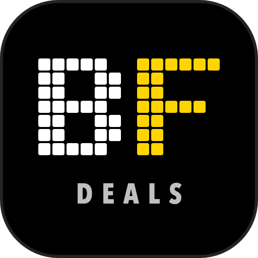

<div align="center">



# Awesome Black Friday & Cyber Monday Deals 2026

Black Friday, Cyber Monday & holiday deals for developers, techies & entrepreneurs

<!-- stats:start -->🔥 <b>634 deals listed</b> · Updated Nov 25, 2026<!-- stats:end -->

🔎 **[Browse & search all deals](https://twf-nikhila.github.io/Awesome-Black-Friday-Cyber-Monday-deals/)** · 📬 **[Subscribe to get the best deals in your inbox](https://app.vbout.com/subscribe-twf/f/63323)**

Maintained by Nikhil · 👋 Let's connect: **[X](https://x.com/HeyNikhila)** · **[LinkedIn](https://www.linkedin.com/in/nikhil-agrawal-21b31833)** · **[YouTube](https://youtube.com/@heynikhila)**

</div>

---

# ✨ What's new in 2026

- 🏆 **Top 10 deals get featured in our newsletter**: the best deals submitted here are sent to all our subscribers.
- 💸 ♾️ **Spot the best deals faster**: 💸 marks 50% OFF or more, ♾️ marks lifetime / buy-once deals.
- 🟢 **Live status on every deal**, updated automatically every day.
- 🔢 **Live deal counts** in the Table of Contents, updated automatically.

# ✍️ Add Your Deal

Listing is free, and the 10 best deals get featured in our newsletter.

1. 🔁 [Edit the README](https://github.com/twf-nikhila/Awesome-Black-Friday-Cyber-Monday-deals/edit/main/README.md) and add one row at the **end** of the right category's table, then open a pull request. Pick the category by what the product **does** (e.g. a video editor goes in Video, whether it's an app, SaaS or AI)
2. 👤 Not technical? Fill [this form](https://fill.formnx.com/f/63pk80)

<details>
<summary><b>Row format</b></summary>

```
| [Product Name](https://product.com) | One-line description of what it does | 💸 ♾️ **60% OFF** lifetime · code `BF26` | Nov 24, 2026 - Dec 1, 2026 |
```

Start the deal details with 💸 if the discount is 50% or more, and ♾️ if it's a lifetime or buy-once deal.

</details>

<details>
<summary><b>🏅 Got listed? Grab your "Featured on" badge</b></summary>

<br>

[](https://github.com/twf-nikhila/Awesome-Black-Friday-Cyber-Monday-deals)

Add it to your website, README, or launch post:

```markdown
[](https://github.com/twf-nikhila/Awesome-Black-Friday-Cyber-Monday-deals)
```

```html
<a href="https://github.com/twf-nikhila/Awesome-Black-Friday-Cyber-Monday-deals"></a>
```

</details>

# Table of Contents

* 🎬 [Video, Audio & Podcasting](#-video-audio--podcasting) (69) - Video editing, AI video & music, screen recording, captions, transcription
* 📸 [Photo, Image & Screenshot](#-photo-image--screenshot) (39) - Image editing & compression, AI images, screenshots, color tools
* 📝 [AI Assistants & Writing](#-ai-assistants--writing) (36) - AI chat apps, writing & rewriting, knowledge assistants, resumes
* 🔍 [SEO & AI Search Visibility](#-seo--ai-search-visibility) (25) - SEO, backlinks, rankings, getting recommended by ChatGPT & co.
* 📣 [Marketing, Social & Lead Gen](#-marketing-social--lead-gen) (47) - Social media, lead finding & outreach, email marketing, launch directories
* 💼 [Business, Finance & Operations](#-business-finance--operations) (52) - Invoicing, expenses, customer feedback & support, e-signature, team admin
* 🧑‍💻 [Developer Tools](#%E2%80%8D-developer-tools) (65) - Git, databases, APIs, debugging, testing, deploys, servers, monitoring
* 🧱 [Boilerplates & Starter Kits](#-boilerplates--starter-kits) (19) - Code templates & components to ship a SaaS or app faster
* 🎨 [UI Kits, Icons & Design Assets](#-ui-kits-icons--design-assets) (28) - Tailwind/React components, Figma kits, icons, themes, animations
* 🌐 [Website Builders, No-Code & WordPress](#-website-builders-no-code--wordpress) (19) - Site builders, no-code & vibe-coding tools, WordPress themes & plugins
* 💻 [Mac & Desktop Utilities](#-mac--desktop-utilities) (76) - Clipboard, window & Dock managers, launchers, menu bar, disk & file tools
* ✅ [Productivity, Notes & Focus](#-productivity-notes--focus) (54) - Notes, tasks, time tracking, focus & blocking, journaling, email
* 🔐 [Security & Privacy](#-security--privacy) (29) - Pentesting, threat monitoring, encrypted email & files, privacy tools
* 📱 [Lifestyle, Health & Travel](#-lifestyle-health--travel) (31) - Fitness, nutrition, travel, home & personal apps
* 📚 [Courses & Books](#-courses--books) (35) - Courses, books, certifications & guides
* 📩 [Newsletters, Communities & Databases](#-newsletters-communities--databases) (3) - Paid newsletters, communities, curated databases & lists
* 🎁 [Free Stuff](#-free-stuff) (7) - Free credits, free plans, giveaways
* 🔖 [Other places to list Black Friday Deals](#-other-places-to-list-black-friday-deals) - More lists and trackers to submit your deal to

**Legend:** 💸 50% OFF or more · ♾️ Lifetime / buy-once deal · 🟢 Live now · ⏳ Not started yet · ~~Dates~~ Ended

**Special Request 👉** ⭐ Star this repository so it becomes trending on Black Friday!

---

# Sponsors

<table>
  <tr>
    <td align="center" width="33%">
      <a href="https://formnx.com"></a><br>
      <a href="https://formnx.com"><b>FormNX</b></a><br>
      The most affordable no-code drag-n-drop form builder<br>
      🔥 <b>50% OFF</b> all plans · code <code>BFCM26</code>
    </td>
    <td align="center" width="33%">
      <a href="https://blackfriday.lifemathmoney.com/"></a><br>
      <a href="https://blackfriday.lifemathmoney.com/"><b>STRONGLAND Publishing</b></a><br>
      Learn from people with real life experience with what they teach<br>
      🔥 <b>Black Friday deal</b> · code <code>BFCM26</code>
    </td>
    <td align="center" width="33%">
      <a href="https://gojiberry.ai/?utm_source=github&utm_medium=nikhila&utm_campaign=bf2026featured"></a><br>
      <a href="https://gojiberry.ai/?utm_source=github&utm_medium=nikhila&utm_campaign=bf2026featured"><b>Gojiberry.ai</b></a><br>
      AI sales agent that finds high-intent prospects and contacts them for you, 24/7<br>
      🔥 <b>40% OFF</b> yearly plan · no code needed
    </td>
  </tr>
</table>

<p align="center">
  <a href="Sponsorship.md"></a>
</p>

---

## 🎬 Video, Audio & Podcasting
| **Name** | **Description**| **Deal details** (Discount & coupon code)| **Start-End date** |
|:-:|:-:|:-:|:-:|
| [Seedeo](https://seedeo.ai/black-friday?utm_source=awesome-black-friday-deals&utm_medium=github&utm_campaign=bfcm2026) | All-in-one AI creative platform for video, image, music & voice (Kling 3.0, Seedance 2, Veo, GPT Image, Nano Banana Pro) on one shared credit balance | 💸 ♾️ **62% OFF** 20,000 never-expiring credits for $99 · **64% OFF** Pro annual ($129 first year) · auto-applied | 🟢 Oct 27, 2026 - Nov 30, 2026 |
| [Kensa](https://www.kensa.cc/deals/black-friday?utm_source=twf-nikhila&utm_campaign=bf2026) | Multi-model AI video generator: Veo 3.1, Seedance 2.5, MiniMax H3 and more on one credit balance · turn text, images or a product link into videos | **25% OFF** first year of yearly plans · code shown on the deal page | 🟢 Nov 20, 2026 - Dec 1, 2026 |
| [inReels](https://www.inreels.ai/pricing?utm_source=twf-bf26) | AI creative platform built for ads: UGC video ads, static ads, product & marketing videos, AI images, plus faceless & brainrot videos | 💸 **50% OFF** all yearly plans · code `BLACKFRIDAY2026` (auto-applied at yearly checkout) | 🟢 Oct 31, 2026 - Dec 1, 2026 |
| [Cutfac](https://cutfac.com?utm_source=awesome-black-friday-deals&utm_medium=github&utm_campaign=bfcm2026) | Create and refine short videos with Claude Code or Codex on Mac. | ♾️ **40% OFF** one-time licenses · code `BF2026` · [auto-applied at checkout](https://buy.polar.sh/polar_cl_DCl65fjz77iirFmV46uiC4ad5ffs62aJNUFM327F9zH?utm_source=awesome-black-friday-deals&utm_medium=github&utm_campaign=bfcm2026) · 1/3/5 Macs: $29.40/$41.40/$59.40 before tax; 1 year of updates, then keep the last version; bring your own agent subscription | 🟢 Oct 31, 2026 - Dec 31, 2026 |
| [SmoothCapture](https://www.smoothcapture.app/pricing?utm_source=awesome-black-friday-deals&utm_medium=github&utm_campaign=bfcm2026) | Turns screen recordings into polished app demo videos on Mac, with auto zoom, a smooth cursor and real 3D iPhone, iPad and Mac models | 💸 ♾️ **50% OFF** Lifetime and Personal · code `BLACKFRIDAY26` (auto-applied on the pricing page) · Lifetime $74.50 (was $149), Personal $39.50 (was $79), Chronoid + SmoothCapture bundle $99.50 (was $199) | 🟢 Nov 3, 2026 - Dec 2, 2026 |
| [FaceCam](https://gracehuang.gumroad.com/l/facecam/BLACKFRIDAY26?utm_source=awesome-black-friday-deals&utm_medium=github&utm_campaign=bfcm2026) | Floating camera overlay for Mac video calls and recordings: a movable facecam bubble with custom shapes, zoom, mirror and name labels | ♾️ **40% OFF** one-time · code `BLACKFRIDAY26` · $6 (was $10) on Gumroad | 🟢 Nov 1, 2026 - Dec 2, 2026 |
| [Compresto](https://compresto.app/?ref=Awesome-Black-Friday-Cyber-Monday-deals&utm_source=awesome-black-friday-deals&utm_medium=github&utm_campaign=bfcm2026) | Video, image and PDF compression for macOS | ♾️ **40% OFF** lifetime · code `BFCM26` | 🟢 Nov 2, 2026 - Dec 1, 2026 |
| [RocketScribe](https://rocketscribe.ai?utm_source=awesome-black-friday-deals&utm_medium=github&utm_campaign=bfcm2026) | Transcribe audio and video to text with timestamps and speakers, export to Word, PDF, SRT or VTT | 💸 ♾️ **Up to 60% OFF** · lifetime from $69 · no code needed | 🟢 Nov 24, 2026 - Dec 6, 2026 |
| [FaceScreen](https://facescreen.app?utm_source=awesome-black-friday-deals&utm_medium=github&utm_campaign=bfcm2026) | Floating camera overlay plus a text overlay (name, handle) and a ring light, for screen recordings and video calls on Mac, iPhone, and iPad | ♾️ **30% OFF** one-time purchase ($5.99 → $4.19) · code `FACESCREEN30` · direct purchase from the website only | 🟢 Nov 18, 2026 - Dec 2, 2026 |
| [JSON2Video](https://json2video.com/pricing/blackfriday-2026/?c=twf&utm_source=awesome-black-friday-deals&utm_medium=github&utm_campaign=bfcm2026) | Video editing API: turn JSON or templates into MP4 videos with AI voices, subtitles and AI images, from code, n8n, Make, Zapier, Claude or ChatGPT | **25% OFF** first year of yearly plans · code `BF2026TWF` (auto-applied) · Professional $399.60 → $299.70 ($24.98/mo, half the monthly plan), Hobby $199.50 → $149.63 | 🟢 Nov 24, 2026 - Dec 1, 2026 |
| [Podwise](https://podwise.ai?utm_source=awesome-black-friday-deals&utm_medium=github&utm_campaign=bfcm2026) | Turns any podcast episode into summaries, transcripts, mind maps and searchable notes, on web, iOS and Android, plus API/CLI/MCP for coding agents | **40% OFF** annual plans on top of the existing annual price (64% off vs paying monthly) · code `BF2026` · Pro $142.80 → $85.68/yr, Standard $70.80 → $42.48/yr | 🟢 Nov 16, 2026 - Dec 6, 2026 |
| [ScreenSage Pro](https://screensage.pro/bf2026?ref=twf-nikhila-bf2026&utm_source=awesome-black-friday-deals&utm_medium=github&utm_campaign=bfcm2026) | Mac screen recording and video editing for polished tutorials and product demos, with cursor-following auto zoom, camera layouts and iPhone/iPad recording | 💸 ♾️ **Up to 53% OFF** one-time licenses · Lifetime $209.90 (was $449), code `BFS2026L` · Pro 3 Macs $79.90 (was $149), 46% off, code `BFS2026P` | 🟢 Nov 4, 2026 - Dec 15, 2026 |
| [SmoothCut](https://smoothcut.studio/pricing?utm_source=awesome-black-friday-deals&utm_medium=github&utm_campaign=bfcm2026) | Screen recorder for macOS and Windows that auto-zooms on your clicks, smooths the cursor and adds a camera bubble and on-device captions | ♾️ **40% OFF** Personal and Pro one-time licenses · code `BLACKFRIDAY40` (auto-applied at checkout) · Personal $47.40 (was $79), Pro $101.40 (was $169) | 🟢 Nov 10, 2026 - Dec 1, 2026 |
| [Transcrybe](https://transcrybe.app/?utm_source=awesome-black-friday-deals&utm_medium=github&utm_campaign=bfcm2026) | Live translated subtitles for your microphone or any Mac app. | 💸 ♾️ **50% OFF** one-time purchase ($29.99 → $14.99 USD) · auto-applied on the Mac App Store and direct website; no code needed | 🟢 Nov 16, 2026 - Dec 2, 2026 |
| [Renderly](https://renderly.video/pricing?code=BLACKFRIDAY2026&utm_source=twf-bf26) | Video rendering API: send a JSON template and your data, get an MP4 back · browser editor, AI captions and voiceover, Zapier, Make and an MCP server for Claude | **30% OFF** the first payment of a new Creator or Business subscription · code `BLACKFRIDAY2026` · Creator $29 → $20.30, Business $99 → $69.30 for the first month | ⏳ Nov 27, 2026 - Dec 1, 2026 |
| [Pimosa](https://pimosa.app?utm_source=awesome-black-friday-deals&utm_medium=github&utm_campaign=bfcm2026) | Offline desktop toolkit with 36 tools for video, audio, images, GIFs and PDFs, for macOS 12.4+ (Apple Silicon) and Windows | ♾️ **40% OFF** one-time · code `BLACKFRIDAY40` (auto-applied at checkout) · Personal $17.40 (was $29), Plus $29.40 (was $49) | 🟢 Nov 10, 2026 - Nov 30, 2026 |
| [MultiTrim](https://multitrim.app?utm_source=awesome-black-friday-deals&utm_medium=github&utm_campaign=bfcm2026) | Mac app that trims leading and trailing silence from whole folders of audio (MP3, WAV, FLAC, AIFF, AAC/ALAC, Ogg) without re-encoding · free for single files | ♾️ Pro **€4.99** one-time on the Mac App Store (regular €9.99; lowest price in the previous 30 days €4.99) · no code, auto-applied · local prices vary | ⏳ Nov 27, 2026 - Nov 30, 2026 |
| [ClipUGC](https://clipugc.com/black-friday?utm_source=twf-nikhila) | Make UGC style videos for your app with AI influencers: paste your App Store or Play link, add a screen recording, get vertical videos with hooks and captions | 💸 **50% OFF** any plan for your first 2 months · code `BLACKFRIDAY` · Professional $14.99 → $7.50/mo · first videos free, no card | 🟢 Nov 11, 2026 - Dec 6, 2026 |
| [Kveeky](https://kveeky.com/blog/best-black-friday-ai-voiceover-deals?utm_source=awesome-black-friday-deals&utm_medium=github&utm_campaign=bfcm2026) | AI voiceover for video and audio | **35% OFF** · code `BF2026` · Basic $9.00/mo → $5.85/mo | 🟢 Nov 11, 2026 - Dec 15, 2026 |
| [BlitzReels](https://blitzreels.com/black-friday?utm_source=twf-nikhila) | Turns long videos into captioned vertical clips for TikTok, Reels and Shorts, then schedules them to your accounts | **Up to 34% OFF** the first year on yearly plans · auto-applied, no code · Starter $204 → $139, Growth $564 → $379, Agency $1,428 → $949 · +90 bonus credits | 🟢 Nov 10, 2026 - Dec 1, 2026 |
| [Roomtape](https://extensions.loopspec.com/roomtape?utm_source=awesome-black-friday-deals&utm_medium=github&utm_campaign=bfcm2026) | Record Google Meet and Microsoft Teams calls to a local MP4. No bot, no account, and nothing uploaded. | 💸 ♾️ **69% OFF** one-time license ($29 → $9), including 3 years of updates · no code needed | 🟢 Nov 5, 2026 - Dec 2, 2026 |
| [TranscribeX](https://www.transcribex.io/?utm_source=awesome-black-friday-deals&utm_medium=github&utm_campaign=bfcm2026) | Local, private AI transcription: turn audio and video into accurate transcripts fully on your device, no cloud | ♾️ **30% OFF** Lifetime ($39 → $27.30) · code `BLACKFRIDAY2026` | 🟢 Nov 23, 2026 - Dec 6, 2026 |
| [PugSoda](https://pugsoda.com/pricing?utm_source=awesome-black-friday-deals&utm_medium=github&utm_campaign=bfcm2026) | Turn a single photo into trending AI meme, dance and photo-studio videos in your browser | **30% OFF** first month on monthly plans (Starter $14 → $9.80, Creator $34 → $23.80, Studio $96 → $67.20) · code `BF2026` · plus **+25%–30% bonus** on never-expiring credit packs | 🟢 Nov 13, 2026 - Dec 1, 2026 |
| [RapStar Studio](https://rapstarstudio.com/pricing?utm_source=awesome-black-friday-deals&utm_medium=github&utm_campaign=bfcm2026) | Turn names and inside jokes into a custom AI rap song in two versions with two 720p lyric videos (no account needed) | ♾️ **30% OFF** one-time custom song ($9.90 → $6.93) · code `BF2026` | 🟢 Nov 13, 2026 - Dec 1, 2026 |
| [Crisp](https://crispvideo.app/pricing/?utm_source=twf-nikhila&utm_medium=deals) | Restores, denoises and upscales old video up to 4K on your own Mac or Windows PC, offline, with a timeline editor · free version available | ♾️ **$9.99 one-time** through Dec 2 (then $29) · auto-applied, no code | 🟢 Nov 13, 2026 - Dec 2, 2026 |
| [MusicMV](https://musicmv.ai/black-friday?utm_source=awesome-black-friday-deals&utm_medium=github&utm_campaign=bfcm2026) | Turn a song and a photo into a beat-synced music video with lip-sync and a reviewable storyboard. | ♾️ **Up to 40% OFF** one-time credit packs · credits never expire · no code needed | 🟢 Nov 13, 2026 - Dec 1, 2026 |
| [palmscreen](https://www.palmscreen.app/black-friday/?utm_source=awesome-black-friday-deals&utm_medium=github&utm_campaign=bfcm2026) | Mac screen recorder that turns every click into a smooth zoom, with an editor and annotated screenshots | ♾️ **34% OFF** one-time license for one Mac ($29 → $19) · code `BLACKWEEK` (active from Nov 23) | 🟢 Nov 23, 2026 - Nov 30, 2026 |
| [LiveReacting](https://www.livereacting.com/pricing?utm_source=awesome-black-friday-deals&utm_medium=github&utm_campaign=bfcm2026) | Stream pre-recorded videos and 24/7 live channels to YouTube, Facebook, Twitch and more from the cloud. No computer needs to stay on. | 💸 **50% OFF** your first year of annual plans (Small, Medium, Large, 24/7 Streaming) · code `BF2026` · new customers only | 🟢 Nov 20, 2026 - Dec 4, 2026 |
| [Recut](https://getrecut.com/?utm_source=awesome-black-friday-deals&utm_medium=github&utm_campaign=bfcm2026) | Removes silence from videos and podcasts automatically and exports to Premiere, Resolve and Final Cut Pro (Mac, Windows, Linux) | ♾️ **$50 OFF**, one-time purchase ($149 → $99) · auto-applied | 🟢 Nov 12, 2026 - Dec 4, 2026 |
| [LottieGo](https://lottiego.com/black-friday?utm_source=gh-twf-nikhila&utm_medium=github&utm_campaign=bf2026) | Shrinks Lottie JSON files and exports them as MP4, transparent MOV or GIF on your Mac | 💸 ♾️ **50% OFF** Pro Lifetime ($4.99 → $2.49) · no code needed | 🟢 Nov 20, 2026 - Dec 6, 2026 |
| [Blumify](https://blumify.io/pro?utm_source=twf-bfcm&utm_medium=github&utm_campaign=bfcm2026) | Turn YouTube videos and podcast episodes into transcripts with summaries you can ask questions about | 💸 **50% OFF** the first year of Unlimited ($29.99, was $59.99) · auto-applied, no code needed | 🟢 Nov 11, 2026 - Nov 30, 2026 |
| [Yaptake](https://yaptake.com/?utm_source=awesome-black-friday-deals&utm_medium=github&utm_campaign=bfcm2026#pricing) | Video editor for Mac that works like a document: cut the video by editing its transcript | 💸 **50% OFF** your first year · code `YAPTAKEBF26` · new subscribers | 🟢 Nov 18, 2026 - Dec 2, 2026 |
| [PureScribe](https://appsthere.com/apps/purescribe?utm_source=awesome-black-friday-deals&utm_medium=github&utm_campaign=bfcm2026) | On-device speech to text for Mac and iPhone: audio never leaves the device, no account, no subscription | 💸 ♾️ **50% OFF** Pro one-time purchase ($9.99 → $4.99) · auto-applied in the App Store | ⏳ Nov 27, 2026 - Dec 1, 2026 |
| [Transcribee](https://transcribee.io/black-friday/?utm_source=awesome-black-friday-deals&utm_medium=github&utm_campaign=bfcm2026) | AI transcription for audio and video in 90+ languages, with a meeting recorder and AI summaries | **40% OFF** Unlimited (monthly $25.99 → $15.59 first month, yearly $199.99 → $119.99 first year) · code `BF2026` | 🟢 Nov 19, 2026 - Nov 30, 2026 |
| [1VideoTool](https://1videotool.com?utm_source=awesome-black-friday-deals&utm_medium=github&utm_campaign=bfcm2026) | Describe a video, preview a free draft, then render the finished MP4 on your own machine | 💸 ♾️ **50% OFF** Pro one-time licence ($29 → $14.50) · code `BFDEALS50` · first 100 redemptions | 🟢 Nov 19, 2026 - Nov 29, 2026 |
| [1ShowcaseTool](https://1showcasetool.com?utm_source=awesome-black-friday-deals&utm_medium=github&utm_campaign=bfcm2026) | Record a product flow once and turn it into a guide, a film, a 3D mockup or a click-through demo | 💸 ♾️ **50% OFF** Pro one-time licence ($29 → $14.50) · code `BFDEALS50` · first 100 redemptions | 🟢 Nov 19, 2026 - Nov 29, 2026 |
| [VocalRemover.one](https://vocalremover.one/black-friday?utm_source=awesome-black-friday-deals&utm_medium=github&utm_campaign=bfcm2026) | Separate songs into vocal and instrumental tracks | 💸 **55% OFF** per minute vs the regular Large Pack: 1,000 minutes for $59.99 one-time, valid 2 years · no code needed | 🟢 Nov 15, 2026 - Nov 30, 2026 |
| [Molens AI](https://molensai.com/black-friday?utm_source=awesome-black-friday-deals&utm_medium=github&utm_campaign=bfcm2026) | Generate videos from prompts or photos and create images with the same credits | 💸 **50% OFF** first year of any annual plan (Starter $129 → $64.50) · new subscribers · no code needed | 🟢 Nov 1, 2026 - Nov 30, 2026 |
| [Oil Studio](https://studio.oiloil.org/en/?utm_source=awesome-black-friday-deals&utm_medium=github&utm_campaign=bfcm2026) | Native Apple Silicon screen recorder and video editor with click auto-zoom, on-device transcript cutting and a CLI + Agent Skill for Claude Code / Codex | ♾️ **20% OFF** one-time purchase for 2 Macs ($39 → $31.20) · code `BFCM2026` | 🟢 Nov 20, 2026 - Dec 2, 2026 |
| [BibiGPT](https://bibigpt.co/en/shop?ref=BLACKFRIDAY&utm_source=awesome-black-friday-deals&utm_medium=github&utm_campaign=bf2026) | AI summaries, transcripts, mind maps and Q&A for YouTube videos, podcasts and articles | 💸 **50% OFF** first payment of Plus and Pro (Plus yearly $142.56 → $71.28) · code `BLACKFRIDAY` (auto-applied) | 🟢 Nov 12, 2026 - Dec 1, 2026 |
| [DramaSo](https://drama.so/en/pricing?promo=DRAMABF2026&billing=yearly&utm_source=awesome-black-friday-deals&utm_medium=github&utm_campaign=bf2026) | AI short drama generator: beat sheet, dialogue audio preview, then 9:16 vertical video for TikTok and Reels | 💸 **50% OFF** first year of Pro yearly ($280.80 → $140.40) · code `DRAMABF2026` (auto-applied) | 🟢 Nov 13, 2026 - Dec 1, 2026 |
| [Effect Video](https://effect.video/black-friday?utm_source=awesome-black-friday-deals&utm_medium=github&utm_campaign=bfcm2026) | Turn photos into cinematic AI video effects (Hotel Lobby, Snow Globe, Santa Hug) and get a shareable MP4 | **+50% bonus credits** on every credit pack and annual plan · auto-applied · credits never expire | 🟢 Nov 24, 2026 - Dec 1, 2026 |
| [FastScribe](https://fastscribe.org/pricing?utm_source=awesome-black-friday-deals&utm_medium=github&utm_campaign=bfcm2026) | Turns audio, video and social links into transcripts, subtitles and AI summaries | **26% OFF** Pro first year ($120 → $89) + 6,500 bonus credits · new subscribers, no code needed | 🟢 Nov 17, 2026 - Nov 30, 2026 |
| [SunoMV](https://suno.bi/en/pricing?utm_source=awesome-black-friday-deals&utm_medium=github&utm_campaign=bf2026) | AI music video generator: turn a Suno or Udio song into a lyric-synced 9:16 music video | 💸 **50% OFF** first month of Pro and Studio (Pro $39.90 → $19.95) · **30% OFF** credit packs · auto-applied | 🟢 Nov 19, 2026 - Dec 1, 2026 |
| [XGetter](https://xgetter.com/?utm_source=awesome-black-friday-deals&utm_medium=github&utm_campaign=bfcm2026#pricing) | Desktop video and audio downloader for Windows, macOS and Linux: save from 70+ platforms in up to 8K | **30% OFF** all plans (Pro $10 → $7, Extended $15 → $10.50) · code `BF2026` | 🟢 Nov 20, 2026 - Dec 2, 2026 |
| [Sum](https://sumtranscribe.com/pricing?utm_source=awesome-black-friday-deals&utm_medium=github&utm_campaign=bfcm2026) | Turns audio and video into transcripts and AI summaries in your browser | 💸 **50% OFF** first billing period of Pro Monthly or Annual · code `SUMBF50` | 🟢 Nov 20, 2026 - Nov 30, 2026 |
| [ViralReel](https://www.viralreel.app/pricing?utm_source=awesome-black-friday-deals&utm_medium=github&utm_campaign=bfcm2026) | Turns your photos into AI short videos using templates inspired by social media trends | **Up to 30% OFF** one-time credit packs (180 credits $19.90 → $16, 480 credits $39.90 → $28) · auto-applied · subscriptions excluded | 🟢 Nov 20, 2026 - Nov 30, 2026 |
| [YIX](https://yix.ai/pricing?utm_source=awesome-black-friday-deals&utm_medium=github&utm_campaign=bfcm2026) | Create and edit AI images and generate short videos from text or photos in your browser | 💸 **50% OFF** first month of all monthly plans (Starter $19.90 → $9.95, Pro $49.90 → $24.95) · auto-applied | 🟢 Nov 20, 2026 - Nov 30, 2026 |
| [ScribeToAny](https://scribetoany.com/pricing?utm_source=awesome-black-friday-deals&utm_medium=github&utm_campaign=bfcm2026) | Turns audio, video and links into timestamped transcripts with speaker labels and SRT/VTT subtitles in about 98 languages | **30% OFF** first month (Plus $10 → $7) · code `FIRST_30_OFF` · or $20 off the first year · code `FIRST_20_OFF` | 🟢 Nov 17, 2026 - Nov 30, 2026 |
| [CutFast](https://cutfa.st/?utm_source=awesome-black-friday-deals&utm_medium=github&utm_campaign=bf2026#pricing) | AI video editor: highlight subtitle lines to keep, cut filler and silence, export clips (web + Mac / Windows app) | ♾️ **30% OFF** Lifetime ($399 → $279.30) and 60-minute packs ($30 → $21) · auto-applied | 🟢 Nov 20, 2026 - Dec 1, 2026 |
| [quso.ai](https://quso.ai/pricing?utm_source=awesome-black-friday-deals&utm_medium=github&utm_campaign=bf26_deal_lists) | Turn long videos and podcasts into captioned vertical clips with AI, then schedule and auto-post them to TikTok, Shorts, Instagram, LinkedIn and X | 💸 **50% OFF** yearly plans, kept on every renewal (Lite $348 → $174/yr) · no code needed | 🟢 Nov 20, 2026 - Dec 1, 2026 |
| [Lumière](https://lumiere.artsvit.com/?utm_source=awesome-black-friday-deals&utm_medium=github&utm_campaign=bfcm2026) | Play your personal media from Jellyfin, Plex or Lumière Server on Mac, iPhone, iPad and Apple TV | ♾️ **20% OFF** lifetime unlock ($59.99 → $47.99) · code `ARTSVITBF20` · first 500 redemptions | 🟢 Nov 20, 2026 - Nov 30, 2026 |
| [Seedance AI Video Generator](https://www.seeddance.io/pricing?utm_source=awesome-black-friday-deals&utm_medium=github&utm_campaign=bfcm2026) | AI video and image generator with Seedance 2.5, Kling, Veo, Hailuo, Seedream and GPT Image in one workspace | 💸 **50% OFF** Pro on annual billing ($29 → $14.50/mo) · auto-applied | 🟢 Nov 20, 2026 - Dec 1, 2026 |
| [Wispim: Voice Teleprompter](https://wispim.com/black-friday?utm_source=awesome-black-friday-deals&utm_medium=github&utm_campaign=bfcm2026) | Teleprompter for iPhone, iPad and Mac that follows your voice: the script scrolls as you speak and waits while you pause | 💸 ♾️ **50% OFF** Lifetime Pro, a one-time purchase ($199.99 → $99.99) · auto-applied | ⏳ Nov 27, 2026 - Nov 30, 2026 |
| [Motionflare](https://motionflare.ai/pricing?utm_source=awesome-black-friday-deals&utm_medium=github&utm_campaign=bfcm2026) | Paste your URL and get an on-brand marketing video built from your real screenshots, logo, colors and copy | 💸 **50% OFF** the first month of Pro or Max ($29 → $14.50, $99 → $49.50) · auto-applied, no code needed | 🟢 Nov 21, 2026 - Dec 1, 2026 |
| [Narration Box](https://narrationbox.com/pricing?utm_source=awesome-black-friday-deals&utm_medium=github&utm_campaign=bfcm2026) | AI voice generator for audiobooks and voiceovers: turn a PDF, EPUB, DOCX or URL into natural narration in 80+ languages, cast different voices per character, clone your own voice · free plan, no card | 💸 **55% OFF** the first year of all annual plans · no coupon code needed, auto-applied at checkout · Plus $9/mo (was $20), Pro $18/mo (was $40), Scale $45/mo (was $100) | 🟢 Nov 22, 2026 - Dec 2, 2026 |
| [Leelo](https://leelo-ai.com/black-friday?utm_source=awesome-black-friday-deals&utm_medium=github&utm_campaign=bfcm2026) | AI voice studio for narration, videos and podcasts: text to speech with 1,150+ voices, video dubbing and voice cloning | ♾️ **25% OFF** lifetime deals, paid once · Lifetime Basic $79 → $59 (35,000 credits every month) · Lifetime Pro $199 → $149 (80,000 credits every month) · **50% more credits** on every pack · auto-applied, no code needed | 🟢 Nov 24, 2026 - Dec 1, 2026 |
| [CocoReader](https://www.cocoreader.cc/black-friday?utm_source=awesome-black-friday-deals&utm_medium=github&utm_campaign=bfcm2026) | Reads the EPUB books you already own aloud on iPhone, with a Mac version | **33% OFF** first year of annual Pro ($29.99 → $19.99) · no code needed | 🟢 Nov 23, 2026 - Dec 1, 2026 |
| [Mockvid](https://mockvid.com/?utm_source=bf26-twf) | Paste a URL and get a 3D animated mockup video of your website on laptop and phone | **20% OFF** first year of Studio ($49 → $39.20/yr) · auto-applied | 🟢 Nov 23, 2026 - Dec 1, 2026 |
| [Skywall](https://getskywall.app/black-friday?ref=bf26-awesome-twf&utm_source=awesome-black-friday-deals&utm_medium=github&utm_campaign=bfcm2026) | Live TV wall for iPhone, iPad, Mac and Apple Vision Pro: up to nine official live channels on one screen | ♾️ **33% OFF** Skywall Full, one-time in-app purchase ($5.99 → $3.99) · auto-applied | ⏳ Nov 27, 2026 - Nov 30, 2026 |
| [Narva](https://narva.app/?utm_source=awesome-black-friday-deals&utm_medium=github&utm_campaign=bfcm2026#pricing) | Turn a topic, script or voiceover into a finished faceless YouTube video | **30% OFF** first month of any plan ($29 → $20.30, $79 → $55.30, $199 → $139.30) · code `NARVA30` | 🟢 Nov 23, 2026 - Nov 30, 2026 |
| [Shorvo](https://shorvostudio.com/pricing/?utm_source=awesome-black-friday-deals&utm_medium=github&utm_campaign=bfcm2026) | Windows app that turns a script into a finished vertical YouTube Short with real footage, AI voiceover and captions, rendered on your PC | ♾️ **40% OFF** Pro Lifetime ($129 → $77.40) · code `BF40` | 🟢 Nov 20, 2026 - Dec 10, 2026 |
| [Beamly](https://beamly.com/?utm_source=awesome-black-friday-deals&utm_medium=github&utm_campaign=bfcm2026) | Podcast platform: hosting and analytics, podcast websites, private podcasts and memberships | **30% OFF** new annual plans | 🟢 Nov 23, 2026 - Dec 1, 2026 |
| [ABContents](https://abcontents.com/?utm_source=awesome-black-friday-deals&utm_medium=github&utm_campaign=bfcm2026) | Turns a PDF, slide deck or website into a narrated explainer or marketing video with AI voice, captions and music, in more than 100 styles | **30% OFF** every video and API pack · code `BLACKFRIDAY` · videos from $2.10 (was $3), 10-video API pack $14.70 (was $21) | ⏳ Nov 27, 2026 - Dec 1, 2026 |
| [FrameGloss](https://framegloss.app/?deal=blackfriday&utm_source=awesome-black-friday-deals&utm_medium=github&utm_campaign=bfcm2026) | Browser-based product demo polisher: add smooth zooms, device frames, backdrops and callouts, then export MP4 or GIF locally | 💸 ♾️ **50% OFF** Pro Lifetime ($15 → $7.50) · code `BLACKFRIDAY` | 🟢 Nov 24, 2026 - Nov 30, 2026 |
| [FluidCast: Podcast Player](https://fluidcastapp.com/event?utm_source=awesome-black-friday-deals&utm_medium=github&utm_campaign=bfcm2026) | Cross-platform podcast player with cloud sync and AI content detection, on iPhone, iPad, Mac, Android, Windows and Linux | 💸 ♾️ **50% OFF** Lifetime (£89.99 → £44.99) and the first year of Annual · code `BLACKFRIDAY2026` (`BLACKFRIDAY2026LT` for iOS Lifetime) | 🟢 Nov 5, 2026 - Nov 30, 2026 |
| [ONTRK](https://ontrk.app/pricing?utm_source=awesome-black-friday-deals&utm_medium=github&utm_campaign=bfcm2026) | Finds your music airing on TV worldwide and shows the performance royalties you are missing, song by song, for composers and music publishers | **25% OFF** first month of any monthly plan (Micro $15 → $11.25, Solo $85 → $63.75) · code `BLACKFRIDAY25` · new customers | 🟢 Nov 24, 2026 - Nov 30, 2026 |
| [DropCue](https://dropcue.app/pricing?utm_source=awesome-black-friday-deals&utm_medium=github&utm_campaign=bfcm2026) | Music management for composers and music libraries, with password-protected share links and listening analytics (web and iOS) | **25% OFF** first month of any monthly plan (Artist $10 → $7.50, Pro 1K $19 → $14.25) · code `BLACKFRIDAY25` at web checkout · new customers | 🟢 Nov 24, 2026 - Nov 30, 2026 |
| [BlendCue](https://blendcue.com/?ref=bf-twf&utm_source=awesome-black-friday-deals&utm_medium=github&utm_campaign=bfcm2026) | Companion app for Serato DJ Pro (Mac and Windows) that follows what's playing and shortlists the next track from your library by key, BPM, energy and genre | ♾️ **40% OFF** one-time licence: Solo $49 → $29 · code `FOUNDINGSOLO` · Pro (2 computers) $79 → $49 · code `FOUNDINGPRO` · first 25 buyers | 🟢 Nov 24, 2026 - Dec 31, 2026 |

## 📸 Photo, Image & Screenshot
| **Name** | **Description**| **Deal details** (Discount & coupon code)| **Start-End date** |
|:-:|:-:|:-:|:-:|
| [NewYouGo](https://newyougo.com/pricing?promo=bf2026&utm_source=awesome-black-friday-deals&utm_medium=github&utm_campaign=bfcm2026) | AI image, video and music generator in one studio (Nano Banana, Seedream, FLUX, LTX-2 video, AI music, bg remove, upscale, LoRA) · free users get 20 FLUX/day | **20% OFF** monthly & yearly subscriptions (credit packs excluded) · discounted price locked on renewals · auto-applied via link | 🟢 Nov 20, 2026 - Dec 1, 2026 |
| [ResizeGenius](https://gracehuang.gumroad.com/l/resizegenius/BLACKFRIDAY26?utm_source=awesome-black-friday-deals&utm_medium=github&utm_campaign=bfcm2026) | Batch image resizing for Mac: resize, convert (JPEG, PNG, HEIC, WebP, TIFF) and rename many images at once, with built-in presets and drag-and-drop | ♾️ **40% OFF** one-time · code `BLACKFRIDAY26` · $6 (was $10) on Gumroad | 🟢 Nov 1, 2026 - Dec 2, 2026 |
| [Redac](https://gracehuang.gumroad.com/l/redac/BLACKFRIDAY26?utm_source=awesome-black-friday-deals&utm_medium=github&utm_campaign=bfcm2026) | Redact text in images and screenshots on Mac: cover names, emails and other sensitive details before sharing | ♾️ **40% OFF** one-time · code `BLACKFRIDAY26` · $3 (was $5) on Gumroad | 🟢 Nov 1, 2026 - Dec 2, 2026 |
| [Shotomatic](https://www.shotomatic.com/pricing?discount_code=BF2026&utm_source=awesome-black-friday-deals&utm_medium=github&utm_campaign=bfcm2026) | Automate repeated screenshots and keypress sequences on Mac. | ♾️ **40% OFF** lifetime licenses · code `BF2026` · 1 Mac $23.40 (was $39), up to 3 Macs $65.40 (was $109); before tax, subscriptions excluded | 🟢 Oct 18, 2026 - Dec 31, 2026 |
| [Digital Photo Frame](https://digitalphotoframeapp.com/?utm_source=awesome-black-friday-deals&utm_medium=github&utm_campaign=bfcm2026) | Turn your iPhone, iPad, Mac or Apple TV into a smart photo frame | 💸 **50% OFF** · $19.99 → $9.99 USD · no code needed | ⏳ Nov 27, 2026 - Dec 1, 2026 |
| [Photo Booth App](https://thephotoboothapp.com/?utm_source=awesome-black-friday-deals&utm_medium=github&utm_campaign=bfcm2026) | Turn your iPhone or iPad into a photo booth for events | 💸 **50% OFF** · $99.99 → $49.99 USD · no code needed | ⏳ Nov 27, 2026 - Dec 1, 2026 |
| [Our Family Album](https://ourfamilyalbum.com/?utm_source=awesome-black-friday-deals&utm_medium=github&utm_campaign=bfcm2026) | The private family album app for iPhone and iPad | 💸 **50% OFF** · $49.99 → $24.99 USD · no code needed | ⏳ Nov 27, 2026 - Dec 1, 2026 |
| [Atmos](https://atmos.style/?utm_source=twf-nikhila&utm_campaign=bf2026) | Color palette tool for UI design that builds accessible, perceptually uniform shades and syncs them to Figma | 💸 ♾️ **50% OFF** Lifetime · code `BF2026` | 🟢 Nov 23, 2026 - Nov 29, 2026 |
| [BirdFrame](https://getbirdframe.com/?utm_source=bf26-twf#black-friday) | Mac app that crops thousands of bird photos in one go, from the full-size original | ♾️ **33% OFF** the one-time unlock · $29.99 → $19.99 USD · no code needed | 🟢 Nov 20, 2026 - Dec 1, 2026 |
| [RenderPixels](https://renderpixels.com/?ref=twf-nikhila&utm_source=awesome-black-friday-deals&utm_medium=github&utm_campaign=bfcm2026) | Lets Claude, ChatGPT or other assistants that support remote MCP and OAuth make your marketing images, like Open Graph images, social posts and logos | **20% OFF** any credit pack · code `BF2026` · credits never expire | 🟢 Nov 9, 2026 - Nov 30, 2026 |
| [PAPLO](https://getpaplo.com/news/black-friday-2026?utm_source=press-twf-bf&utm_medium=listing&utm_campaign=press-twf-bf) | Turn photos of your pets, friends and food into chat stickers for iMessage, WhatsApp and Telegram, on iPhone and Android | ♾️ **43% OFF** the one-time Plus purchase · $6.99 → $3.99 USD · no code needed | ⏳ Nov 27, 2026 - Dec 1, 2026 |
| [Sip](https://sipapp.io/blackfriday/?ref=twf-bf&utm_source=awesome-black-friday-deals&utm_medium=github&utm_campaign=bfcm2026) | Native color picker for macOS that helps collect, organize, edit and share colors and palettes | 💸 **50% OFF** ($29.99 per seat, incl. 1 year of updates) · code `BLACKFRIDAY26` Nov 27–29 · code `CYBERMONDAY26` Nov 30–Dec 2 | ⏳ Nov 27, 2026 - Dec 2, 2026 |
| [SnapTidy](https://snaptidyapp.github.io/snaptidy-site/blackfriday/?utm_source=awesome-black-friday-deals&utm_medium=github&utm_campaign=bfcm2026) | Photo cleaner for iPhone and iPad: swipe a few photos at a time to keep or mark; nothing is deleted until you confirm | 💸 ♾️ **50% OFF** the one-time Pro Lifetime purchase · $39.99 → $19.99 USD · no code needed · local prices vary, not in mainland China | ⏳ Nov 27, 2026 - Nov 30, 2026 |
| [ScreenSnap Pro](https://www.screensnap.pro/pricing?utm_source=awesome-black-friday-deals&utm_medium=github&utm_campaign=bfcm2026) | All-in-one screenshot and screen recording app for Mac and Windows, with annotation tools and a built-in video editor | 💸 ♾️ **50% OFF** lifetime license · code `BLACKFRIDAY` · $19.50 (was $39), one license covers 2 computers | 🟢 Nov 10, 2026 - Nov 30, 2026 |
| [MakeItSay](https://makeitsay.com/pricing?utm_source=awesome-black-friday-deals&utm_medium=github&utm_campaign=bfcm2026) | Edit or translate text inside photos, screenshots and badges while preserving the original font and background (web, API & MCP) | ♾️ **30% OFF** non-expiring credit packs (6 edits $3 → $2.10, 40 edits $10 → $7) · code `BF2026` | 🟢 Nov 13, 2026 - Dec 1, 2026 |
| [Unmerge](https://unmerge.app/pricing?utm_source=awesome-black-friday-deals&utm_medium=github&utm_campaign=bfcm2026) | Split flat images, illustrations and anime art into movable transparent PSD and PNG layers (web, API & MCP) | ♾️ **+33%–35% bonus credits** (~26% OFF per layer) on non-expiring packs (Starter $3.90: 45 → 60 credits, Basic $10: 130 → 175 credits) · auto-applied | 🟢 Nov 13, 2026 - Dec 1, 2026 |
| [Zipic](https://zipic.app/black-friday?utm_source=gh-twf-nikhila&utm_medium=github&utm_campaign=bf2026) | Image compression for Mac and Windows · compress, convert and resize whole folders locally, including AVIF, WebP and JPEG XL | ♾️ **33% OFF** one-time licenses · code `BF2026` · Solo $13.39 (was $19.99), Personal $20.09 (was $29.99), Team $87.09 (was $129.99) | 🟢 Nov 20, 2026 - Dec 6, 2026 |
| [Clipture](https://apps.apple.com/app/id6787685075?utm_source=awesome-black-friday-deals&utm_medium=github&utm_campaign=bfcm2026) | Lightweight screenshot tool for macOS | 💸 ♾️ **50% OFF** Lifetime Unlock · no code needed | ⏳ Nov 27, 2026 - Nov 30, 2026 |
| [AntShot](https://antshot.com/?ref=awesome-black-friday-deals&utm_source=awesome-black-friday-deals&utm_medium=github&utm_campaign=bfcm2026) | Full-page screenshots for Chrome and Edge, including tables and lists that scroll inside a page, saved on your device | ♾️ **35% OFF** Pro Lifetime ($39 → $25.35) · code `BLACKFRIDAY26` | 🟢 Nov 12, 2026 - Dec 2, 2026 |
| [Textmock](https://textmock.com/pricing?utm_source=awesome-black-friday-deals&utm_medium=github&utm_campaign=bfcm2026) | Make iMessage-style conversation mockups on the web or Mac and save them as images or videos | 💸 **50% OFF** Pro for your first 12 months · code `TEXTMOCKBF26` · new subscribers | 🟢 Nov 18, 2026 - Dec 2, 2026 |
| [InPlaceText](https://inplacetext.com/?utm_source=awesome-black-friday-deals&utm_medium=github&utm_campaign=bfcm2026) | AI editor that changes the text inside images (posters, menus, product photos, screenshots) while keeping the same font | **Up to 50% bonus credits** on one-time credit packs · auto-applied | 🟢 Nov 19, 2026 - Dec 1, 2026 |
| [Deletti](https://deletti.app/?utm_source=awesome-black-friday-deals&utm_medium=github&utm_campaign=bfcm2026#black-friday) | Free up space on your iPhone: start with your biggest videos and photos, then swipe to keep or trash them | ♾️ **Lifetime launch price $8.99** · code `BFCM26` · US App Store price | 🟢 Nov 20, 2026 - Dec 1, 2026 |
| [Krea3 AI](https://krea3.org/black-friday?utm_source=awesome-black-friday-deals&utm_medium=github&utm_campaign=bfcm2026) | Turn prompts and photos into portraits, product shots and posters | **40% OFF** first year of annual plans (Starter $149 → $89.40) · auto-applied | 🟢 Nov 1, 2026 - Nov 30, 2026 |
| [TranslateManga](https://translatemanga.net/?pricing_mode=annual&utm_source=awesome-black-friday-deals&utm_medium=github&utm_campaign=bfcm2026#pricing) | AI translates raw manga, manhwa and webtoons right inside the original speech bubbles, in 50+ languages (web + Chrome extension) | **40% OFF** first year of yearly Standard & Pro (from $10 → $6/mo) · no code needed | 🟢 Nov 20, 2026 - Dec 1, 2026 |
| [Clarpex AI](https://clarpex.ai/pricing?utm_source=github-twf&utm_medium=bf_directory&utm_campaign=bf2026) | Unblur, upscale to 4K/8K, restore and colorize old photos, remove watermarks and change backgrounds | 💸 **50% OFF** first month of monthly plans (Starter $9.90 → $4.95) · **30% OFF** first year of yearly plans · auto-applied | 🟢 Nov 20, 2026 - Dec 1, 2026 |
| [SciFig](https://scifig.ai/black-friday?utm_source=awesome-black-friday-deals&utm_medium=github&utm_campaign=bfcm2026) | Create editable scientific figures and diagrams for papers and presentations | **20% OFF** first billing period of new subscriptions and credit packs (Starter annual $100 → $80) · auto-applied | 🟢 Oct 22, 2026 - Dec 1, 2026 |
| [Sightline](https://sightlinemac.com/black-friday/?utm_source=awesome-black-friday-deals&utm_medium=github&utm_campaign=bfcm2026) | Mac screenshot and screen-recording app with an image and video editor, design diffs, and an MCP server and CLI for Claude Code and Codex | ♾️ **23% OFF** lifetime ($29.99 → $22.99) · code `SIGHTLINELIFEDISCOUNT26` · or first 3 months free on yearly · code `SIGHTLINEEARLY` | 🟢 Nov 20, 2026 - Jan 7, 2027 |
| [ChatImg](https://chatimg.ai/en/pricing?utm_source=awesome-black-friday-deals&utm_medium=github&utm_campaign=bf2026) | AI image generator and editor: upload a photo, describe the change, export | 💸 **50% OFF** first payment of Plus / Pro (Pro yearly $215.28 → $107.64) · credit packs 30% off · auto-applied | 🟢 Nov 20, 2026 - Dec 1, 2026 |
| [Snapperon](https://snapperon.com/?utm_source=awesome-black-friday-deals&utm_medium=github&utm_campaign=bfcm2026#pricing) | Annotate screenshots, redact private details and copy text from images on your Mac | 💸 ♾️ **50% OFF** Pro: lifetime $38.99 → $19.50, annual $19.99 → $10 first year · code `BLACKFRIDAY26` | 🟢 Nov 20, 2026 - Dec 1, 2026 |
| [Paletteo](https://paletteo.artsvit.com/?utm_source=awesome-black-friday-deals&utm_medium=github&utm_campaign=bfcm2026) | Capture colors from images and build reusable palettes and gradients on iPhone and iPad | ♾️ **20% OFF** lifetime unlock ($4.99 → $3.99) · code `ARTSVITBF20` · first 500 redemptions | 🟢 Nov 20, 2026 - Nov 30, 2026 |
| [BatchMark](https://batchmark.dispatchcat.com/holiday-sale/?utm_source=awesome-black-friday-deals&utm_medium=github&utm_campaign=bfcm2026) | Batch watermark up to 100 photos at once, plus art frames and photo stories, all on-device | 💸 ♾️ **50% OFF** Lifetime ($79.99 → $39.99) · first year of Yearly $19.99 · auto-applied | 🟢 Nov 15, 2026 - Dec 25, 2026 |
| [ConceptViz](https://conceptviz.app/pricing?utm_source=awesome-black-friday-deals&utm_medium=github&utm_campaign=bfcm2026) | AI scientific figures and diagrams for researchers: turn text or papers into editable, publication-ready diagrams and concept maps | ♾️ **$299 lifetime deal** · 1,500 non-expiring credits and Ultra features for life · no code needed | 🟢 Nov 21, 2026 - Dec 1, 2026 |
| [Unraster](https://unraster.ai/pricing?utm_source=awesome-black-friday-deals&utm_medium=github&utm_campaign=bfcm2026) | Turn slide, chart and diagram screenshots into editable PowerPoint or SVG in your browser | **45% OFF** the 150-credit pack ($79.90 → $43.95) · code `BLACKFRIDAY45` | 🟢 Nov 21, 2026 - Dec 1, 2026 |
| [SpriteCanvas](https://spritecanvas.com/pricing/?utm_source=awesome-black-friday-deals&utm_medium=github&utm_campaign=bfcm2026) | AI sprite sheet generator for 2D games: describe or upload a character, animate it, export PNG sheets with JSON atlases | **30% OFF** the first month of Starter or Pro monthly (Starter $12 → $8.40, Pro $29 → $20.30), then regular price · no code, applied at checkout · first subscription only | 🟢 Nov 21, 2026 - Dec 1, 2026 |
| [MakeMidas](https://makemidas.com/pricing?utm_source=awesome-black-friday-deals&utm_medium=github&utm_campaign=bfcm2026) | Make AI images, videos and music with GPT Image, Nano Banana, Veo, Kling and Suno in one app, with one credit balance | **Up to 25% more credits** on every one-time credit pack (125 credits per $1, e.g. $10 → 1,250 credits instead of 1,000) · auto-applied · no subscription | 🟢 Nov 20, 2026 - Dec 1, 2026 |
| [ImageToPES](https://imagetopes.com/?utm_source=awesome-black-friday-deals&utm_medium=github&utm_campaign=bfcm2026#pricing) | Browser image-to-embroidery digitizer (PES, DST, JEF, EXP, VP3) with a free 3D stitch preview and file viewer | ♾️ **30% OFF** all one-time, non-expiring credit packs · auto-applied · first 100 per day | 🟢 Nov 22, 2026 - Nov 30, 2026 |
| [Spaceclear](https://spaceclear.app/black-friday?ref=bf26-awesome-twf&utm_source=awesome-black-friday-deals&utm_medium=github&utm_campaign=bfcm2026) | Phone cleaner for iPhone and iPad that finds duplicate and lookalike photos and big videos, on the device | ♾️ **25% OFF** Spaceclear Pro, one-time in-app purchase ($7.99 → $5.99) · auto-applied | ⏳ Nov 27, 2026 - Nov 30, 2026 |
| [memecub](https://memecub.com/pricing?utm_source=awesome-black-friday-deals&utm_medium=github&utm_campaign=bfcm2026) | Meme search engine and AI meme maker your AI agent can use (MCP, API, CLI): find reaction memes and GIFs or place them into a post | 💸 **50% OFF** first payment on any plan (Hobby $3 → $1.50 first month, Pro yearly $90 → $45 first year) · auto-applied | 🟢 Nov 24, 2026 - Dec 2, 2026 |
| [FolioSort](https://www.foliosort.app/pricing?utm_source=awesome-black-friday-deals&utm_medium=github&utm_campaign=bfcm2026) | Photo organizer for Mac and Windows: sorts photos and videos by real date, camera and place, repairs Google Photos Takeout exports and cleans duplicates, no import | ♾️ **25% OFF** Elite one-time licence (€39.99 → €29.99) · code `BLACKFRIDAY` (auto-applied) | ⏳ Nov 26, 2026 - Nov 30, 2026 |

## 📝 AI Assistants & Writing
| **Name** | **Description**| **Deal details** (Discount & coupon code)| **Start-End date** |
|:-:|:-:|:-:|:-:|
| [TypingMind](https://www.typingmind.com/?utm_source=twf-nikhila) | Advanced chat UI for ChatGPT, Claude, Gemini and more, with all models in one place, MCP & plugins, AI agents, and private local storage | 💸 ♾️ **60% OFF** Lifetime Premium · code `BLACKFRIDAY2026` | 🟢 Nov 2, 2026 - Dec 15, 2026 |
| [RewriteBar](https://rewritebar.com?ref=twf-nikhila&utm_source=awesome-black-friday-deals&utm_medium=github&utm_campaign=bfcm2026) | AI writing toolkit for macOS · fix grammar, adjust tone, translate, rewrite and summarize in any app, plus custom actions and templates | 💸 ♾️ **50% OFF** one-time licenses and subscriptions · code `BF2026` | 🟢 Nov 2, 2026 - Dec 3, 2026 |
| [Rezi](https://www.rezi.ai/pricing?utm_source=awesome-black-friday-deals&utm_medium=github&utm_campaign=bfcm2026) | AI resume builder · writes and tailors ATS-friendly resumes, scores them on 23 ATS metrics, plus AI cover letters, mock interviews and auto-apply to jobs in the mobile app | 💸 **70% OFF** Rezi Pro for 3 months ($29 → $8.70/mo) · code `Blackfriday2026` | 🟢 Nov 13, 2026 - Dec 11, 2026 |
| [Fluent 2](https://fluentmac.app/?ref=twf-nikhila&utm_source=awesome-black-friday-deals&utm_medium=github&utm_campaign=bfcm2026) | Not another chat window: AI for macOS that works in any app, plus AI teammates for routine tasks | ♾️ **25% OFF** lifetime licenses · code `BF2026` | 🟢 Nov 1, 2026 - Dec 1, 2026 |
| [BoltAI](https://boltai.com/pricing?utm_source=twfdeals&utm_medium=partner&utm_campaign=bf2026) | Native AI workspace for Mac · ChatGPT, Claude, Gemini and local AI models in one app, now with agents that browse in Chrome and use the apps you allow | ♾️ **40% OFF** Pro, Pro+ and Lifetime · code `BFCM2026` (Lifetime $399 → $239.40) | 🟢 Nov 2, 2026 - Dec 1, 2026 |
| [PDF Pals](https://pdfpals.com/buy?utm_source=twfdeals&utm_medium=partner&utm_campaign=bf2026) | Chat with your PDF, Word, Excel, PowerPoint, EPUB and Markdown files on Mac, with cited answers and built-in local AI models | ♾️ **40% OFF** Lifetime ($249 → $149, no code) · **20% OFF** Basic and Plus · code `BF20` | 🟢 Nov 2, 2026 - Dec 1, 2026 |
| [Aymo AI](https://aymo.ai/pricing?utm_source=awesome-black-friday-deals&utm_medium=github&utm_campaign=bfcm2026) | All-in-one multi-AI chat platform for developers and teams | **30% OFF** paid plans, recurring · code `BLFCM2026` | 🟢 Nov 16, 2026 - Dec 1, 2026 |
| [LogicBalls](https://logicballs.com/blog/black-friday-deals?utm_source=awesome-black-friday-deals&utm_medium=github&utm_campaign=bfcm2026) | AI workspace for writing, SEO and content | 💸 **50% OFF** · code `BF2026` · Pro $9.99/mo → $5.00/mo | 🟢 Nov 11, 2026 - Dec 15, 2026 |
| [MindPal](https://mindpal.io/pricing?utm_source=github-twf-nikhila&utm_campaign=bf2026) | Turn your expertise into AI agents and multi-agent workflows that your team, clients and audience use around the clock · no code | 💸 **60% OFF** your first year on any annual plan · code `BLACKFRIDAY2026` (billed yearly: Pro $39 → $16/mo, Advanced $149 → $60/mo, Ultra $374 → $150/mo) | 🟢 Nov 10, 2026 - Dec 11, 2026 |
| [Wovo](https://wovo.one/?ref=twf2026&utm_source=awesome-black-friday-deals&utm_medium=github&utm_campaign=bfcm2026#pricing) | One MCP that turns any AI into a multi-device agent across all your computers | 💸 **50% OFF** Pro and Max yearly · auto-applied, no code · Pro $144 → $72/yr, Max $348 → $174/yr · price locked for the subscription | 🟢 Nov 12, 2026 - Dec 15, 2026 |
| [Orwellix](https://orwellix.com/lifetime-deal?utm_source=twf-awesome-bfcm&utm_medium=deal-directory&utm_campaign=lifetime-deal-2026) | AI writing editor where an agent edits your whole document in place and you accept or reject every change | ♾️ **Lifetime plan $249 once** (Premium is normally $468/year) · auto-applied · only 300 deals | 🟢 Nov 12, 2026 - Dec 31, 2026 |
| [Wordfully](https://www.wordfully.ai/c/BLACKFRIDAY2026?utm_source=awesome-black-friday-deals&utm_medium=github&utm_campaign=bfcm2026) | AI grammar checker and rephraser for everyday writing. | 💸 **50% OFF** the first monthly or annual Pro payment · code `BLACKFRIDAY2026` · monthly $20 → $10, annual $108 → $54 · first-time paying customers | 🟢 Nov 12, 2026 - Dec 4, 2026 |
| [Outlier](https://outlier.host/pricing/?utm_source=twf-nikhila&utm_medium=deals) | Runs open AI models on your own Mac, even offline; chats stay on your Mac unless you use web search or Research. Chat plus a coding agent for your own codebase · free to start | ♾️ **$16.99 one-time** through Dec 2 (then $39) · auto-applied, no code | 🟢 Nov 13, 2026 - Dec 2, 2026 |
| [Vinaa](https://www.vinaa.ai/pricing/?utm_source=twf-nikhila) | Native AI chat app for Mac with cloud and local models · projects, folders, web search, MCP tools, full-text search, multiple tabs and windows, and private iCloud sync | ♾️ **Up to 45% OFF** lifetime · auto-applied, no code | 🟢 Nov 6, 2026 - Nov 30, 2026 |
| [Radiantly](https://radiantly.space/pricing?utm_source=awesome-black-friday-deals&utm_medium=github&utm_campaign=bfcm2026) | Turn your knowledge into branded AI agents with interactive experiences, personalized responses for each client, and connections to 1,600+ apps | 💸 **60% OFF** the first annual payment for new users · code `BF60` · Pro $228 → $91.20/yr, Max $708 → $283.20/yr | 🟢 Nov 15, 2026 - Dec 15, 2026 |
| [TypeBoost](https://typeboost.ai/?ref=twf-nikhila&utm_source=awesome-black-friday-deals&utm_medium=github&utm_campaign=bfcm2026) | AI writing in every app on your Mac, plus an iPhone keyboard: fix, rewrite or dictate text anywhere | 💸 **50% OFF** first year of Pro annual ($60 → $30) · code `TYPEBOOST50` · web checkout only | 🟢 Nov 23, 2026 - Nov 30, 2026 |
| [ImagineYourBook](https://www.imagineyourbook.com/blackfriday?utm_source=awesome-black-friday-deals&utm_medium=github&utm_campaign=bfcm2026) | Pay-once AI book writing, with credits that never expire | 💸 ♾️ **Up to 75% OFF** novel credit packs: 2 novels $160 → $59, 5 novels $400 → $119, 10 novels $800 → $199 (plus 1 novel to give away on 5+) · auto-applied, no code | 🟢 Nov 11, 2026 - Nov 30, 2026 |
| [Orchard](https://orchard.5km.tech/black-friday?utm_source=gh-twf-nikhila&utm_medium=github&utm_campaign=bf2026) | Lets AI assistants read and control 11 Apple apps on your Mac through Agent Skills, MCP or a CLI, all locally | ♾️ **33% OFF** Lifetime ($39.99 → $26.79) and Pro Annual first year ($24.99 → $16.74) · code `BF2026` | 🟢 Nov 20, 2026 - Dec 6, 2026 |
| [DuoTyping](https://duotyping.com/pricing?utm_source=awesome-black-friday-deals&utm_medium=github&utm_campaign=bfcm2026) | Writing app that fixes grammar, spelling and tone as you type in any app and predicts your next words, on Mac, Windows, Chrome/Edge and the web | 💸 **50% OFF** the first payment of Pro · code `BFCM2026` · monthly $9.90 → $4.95, yearly $89.90 → $44.95 · first Pro purchase only | 🟢 Nov 13, 2026 - Dec 13, 2026 |
| [Refine](https://refine.sh/?utm_source=awesome-black-friday-deals&utm_medium=github&utm_campaign=bfcm2026#pricing) | Offline AI writing assistant for Mac: grammar, autocomplete, rewrites, translation and explanations in 36 languages across your apps | ♾️ **35% OFF** one-time license · auto-applied, no code | 🟢 Nov 15, 2026 - Nov 30, 2026 |
| [Perisclaw](https://perisclaw.com/pricing?utm_source=github-twf-bfcm&utm_medium=deal-listing&utm_campaign=cyber-monday-2026) | AI assistant that automates your work on WhatsApp: follow-ups, reminders and tasks, with full chat context | **40% OFF** the annual plan ($200 → $120/yr) · no code needed, auto-applied at checkout · annual plan only | ⏳ Nov 27, 2026 - Dec 1, 2026 |
| [1AIVault](https://1aivault.com?utm_source=awesome-black-friday-deals&utm_medium=github&utm_campaign=bfcm2026) | One local memory vault for all your AI tools, served back to them over MCP | 💸 ♾️ **50% OFF** Pro one-time licence ($29 → $14.50) · code `BFDEALS50` · first 100 redemptions | 🟢 Nov 19, 2026 - Nov 29, 2026 |
| [1LocalAITool](https://1localaitool.com?utm_source=awesome-black-friday-deals&utm_medium=github&utm_campaign=bfcm2026) | Private AI chat, PDF summaries, transcription and image generation that run offline on your computer | 💸 ♾️ **50% OFF** Pro one-time licence ($29 → $14.50) · code `BFDEALS50` · first 100 redemptions | 🟢 Nov 19, 2026 - Nov 29, 2026 |
| [Sabi](https://meetsabi.com/pages/blackfriday?utm_source=github&utm_medium=deal-list&utm_campaign=blackfriday2026&utm_content=twf) | AI employee you text like a person: answers your email, runs your calendar, follows up with leads and posts to social media | 💸 **50% OFF** 6 months of Sabi Pro ($995 → $495) · auto-applied | 🟢 Nov 20, 2026 - Nov 30, 2026 |
| [Fix My Japanese](https://fixmyjapanese.com/upgrade?utm_source=awesome-black-friday-deals&utm_medium=github&utm_campaign=bfcm2026) | Japanese grammar, particle and keigo checker for iOS and web that corrects your writing and explains every change | **40% OFF** Pro Annual ($29.99 → $17.99/yr) · auto-applied (or code `BLACKFRIDAY2026` on iOS) | 🟢 Nov 20, 2026 - Dec 1, 2026 |
| [Transync AI](https://www.transyncai.com/black-friday/?utm_source=awesome-black-friday-deals&utm_medium=github&utm_campaign=bfcm2026) | Real-time AI translation for meetings, with bilingual subtitles and voice in 60 languages | **22% OFF** Personal Premium annual ($89.90 → $69.90) · auto-applied | 🟢 Nov 24, 2026 - Dec 1, 2026 |
| [Enconvo](https://enconvo.com/?utm_source=github-twf-nikhila&utm_medium=deal-list&utm_campaign=black-friday-2026) | Native AI assistant and agent for Mac: automates tasks across apps, dictates, searches your documents, runs cloud or local models | ♾️ **30% OFF** every Lifetime licence (Standard $59 → $41.30) and the first Enconvo Cloud payment · auto-applied | 🟢 Nov 20, 2026 - Dec 7, 2026 |
| [CVder](https://cvder.app/pricing?utm_source=awesome-black-friday-deals&utm_medium=github&utm_campaign=bfcm2026) | AI job application tool that tailors your CV to each job posting and writes the cover letter | 💸 **50% OFF** your first payment on any Pro plan (monthly €14 → €7, annual €84 → €42) · code `BF2026` | ⏳ Nov 27, 2026 - Dec 1, 2026 |
| [Stashkin](https://stashkin.com/pricing?utm_source=awesome-black-friday-deals&utm_medium=github&utm_campaign=bfcm2026) | Chrome extension that exports ChatGPT conversations to editable Word (.docx), PDF, Markdown, PNG and JSON with tables, LaTeX equations and images intact | 💸 **50% OFF** first year of Pro Annual ($46.56 → $23.28, $1.94/mo) · code `BF2026` · annual plan only | 🟢 Nov 22, 2026 - Dec 1, 2026 |
| [Morse](https://trymorse.ai/?src=gh-bf-twf&utm_source=awesome-black-friday-deals&utm_medium=github&utm_campaign=bfcm2026) | Private AI chat: GPT, Claude, Gemini, DeepSeek and more in one app, encrypted so even Morse can't read your chats | **40% OFF** first payment on Pro or Max, monthly or yearly · code `BLACKFRIDAY` | 🟢 Nov 23, 2026 - Dec 1, 2026 |
| [BookForge CLI](https://kineticsprint-studio.vercel.app/bookforge.html?utm_source=awesome-black-friday-deals&utm_medium=github&utm_campaign=bfcm2026) | Book typesetting and PDF publishing engine for technical authors and indie publishers: 6 editorial styles, auto table of contents and print-ready PDFs | 💸 ♾️ **50% OFF** lifetime licence ($119 → $59) · auto-applied | 🟢 Nov 24, 2026 - Nov 30, 2026 |
| [ClaudeKit](https://claudekit.app/pricing?utm_source=twf-bfcm&utm_medium=directory&utm_campaign=bf-2026) | Chrome extension for claude.ai that shows your usage and the exact limit reset time, with a heads-up at 90% | **29% OFF** first year of Pro annual ($28 → $20) · auto-applied | 🟢 Nov 19, 2026 - Dec 2, 2026 |
| [Grai](https://grai.page?utm_source=awesome-black-friday-deals&utm_medium=github&utm_campaign=bfcm2026) | Offline cadence gate that flags AI-writing tells before clients do: 8 deterministic rules run offline, cadence scoring, plus a live cryptographic verification link for client work | **30% OFF** first billing cycle on Solo Offline ($79/yr → $55.30) & Agency Protocol ($99/mo → $69.30, $790/yr → $553) · code `BF2026` | 🟢 Nov 24, 2026 - Nov 30, 2026 |
| [Meboki](https://meboki.com/?utm_source=awesome-black-friday-deals&utm_medium=github&utm_campaign=bfcm2026#pricing) | Open-source offline grammar checker for Mac: underlines English mistakes as you type in any app and fixes them in place | ♾️ **26% OFF** one-time licence ($39 → $29 for 1 Mac) · auto-applied | 🟢 Nov 21, 2026 - Dec 1, 2026 |
| [Whizi](https://whizi.io/pricing/?utm_medium=deal-list&utm_campaign=bf2026&utm_source=twf-nikhila) | One subscription for Claude, ChatGPT, Gemini and other AI models, with image, video and music in the same chat (web, iPhone and Android) | **30% OFF** first year of any annual plan (Pro $239.99 → $167.99/yr) · auto-applied | 🟢 Nov 24, 2026 - Dec 24, 2026 |
| [AxiomAI](https://axiom.stream/join?utm_source=awesome-black-friday-deals&utm_medium=github&utm_campaign=bfcm2026) | Private AI for chat, code and images, decrypted only inside a GPU enclave | **30% OFF** · no code needed | 🟢 Nov 25, 2026 - Dec 2, 2026 |

## 🔍 SEO & AI Search Visibility
| **Name** | **Description**| **Deal details** (Discount & coupon code)| **Start-End date** |
|:-:|:-:|:-:|:-:|
| [CiteWing](https://citewing.com?utm_source=awesome-black-friday-deals&utm_medium=github&utm_campaign=bfcm2026) | AI Backlink Outreach Agent to get recommended by AI | 💸 **36% OFF** Pro Plan; **50% OFF** [directory submission service](https://citewing.com/directory-submission-service?utm_source=awesome-black-friday-deals&utm_medium=github&utm_campaign=bfcm2026) · auto-applied | 🟢 Nov 1, 2026 - Dec 31, 2026 |
| [AUTX AI Visibility Check](https://autx.ai/?utm_source=awesome-black-friday-deals&utm_medium=github&utm_campaign=bfcm2026) | See whether AI models name your business when customers ask | **20% OFF** the AUTX AI Visibility Report, $39.20 instead of $49 · code `LAUNCH20` | 🟢 Nov 2, 2026 - Nov 30, 2026 |
| [Outpublished](https://outpublished.com/black-friday?utm_source=awesome-black-friday-deals&utm_medium=github&utm_campaign=bfcm2026) | Shows content and SEO teams every page their competitors have that they don't, and each new one they publish | **40% OFF** for as long as you stay subscribed, first 150 accounts · auto-applied | 🟢 Nov 20, 2026 - Dec 4, 2026 |
| [LinkBunny](https://getlinkbunny.com/pricing?utm_source=awesome-black-friday-deals&utm_medium=github&utm_campaign=bfcm2026#black-friday-2026) | Build and exchange nofollow backlinks through your coding agent | **30% OFF** first annual payment ($210 → $147), then $210/year · code `BLACKFRIDAY2026` | 🟢 Nov 5, 2026 - Nov 30, 2026 |
| [GrackerAI](https://gracker.ai/blog/black-friday-deals?utm_source=awesome-black-friday-deals&utm_medium=github&utm_campaign=bfcm2026) | AI search visibility (AEO and GEO) for cybersecurity and B2B SaaS | **20% OFF** · code `BF2026` · Individual $99/mo → $79.20/mo | 🟢 Nov 11, 2026 - Dec 15, 2026 |
| [OutlierKit](https://outlierkit.com/app/pricing?utm_source=twf-github&utm_campaign=bfcm26) | YouTube research: find videos that beat a channel's usual views, research keywords and study competitors · MCP server and API on every plan | **40% OFF** any plan, including lifetime · code `BFCM40` (Pro annual $599 → $359.40) | 🟢 Nov 12, 2026 - Dec 5, 2026 |
| [Citation Rocket](https://www.citationrocket.com/pricing?utm_source=twf-nikhila&utm_medium=bf_list&utm_campaign=bf2026) | Checks if GPT, Claude, Gemini, Perplexity and Grok name your brand, then ranks the fixes to get cited | ♾️ **40% OFF** lifetime licence, $99 → $59 (Agency $149 → $89) · auto-applied | 🟢 Nov 12, 2026 - Dec 2, 2026 |
| [ZeroRank](https://zerorank.ai?utm_source=awesome-black-friday-deals&utm_medium=github&utm_campaign=bfcm2026) | AI search visibility and GEO software for SEO teams and agencies to track brand mentions, citations and competitors across AI answer engines. | **28% OFF** the first 3 monthly payments · discounted first year on annual plans · [terms](https://zerorank.ai/pricing?utm_source=awesome-black-friday-deals&utm_medium=github&utm_campaign=bfcm2026) | 🟢 Nov 2, 2026 - Nov 30, 2026 |
| [Ascope](https://ascope.app/?utm_source=awesome-black-friday-deals&utm_medium=github&utm_campaign=bfcm2026#pricing) | ASO tool for Mac and Windows: tracks App Store and Google Play keyword ranks daily in 50+ countries, with popularity and difficulty · MCP server for Cursor and Claude | 💸 ♾️ **63% OFF** lifetime licence, $189 → $69 one-time · auto-applied | 🟢 Nov 1, 2026 - Nov 30, 2026 |
| [Check Engine SEO](https://checkengineseo.com/pricing/?utm_source=twf-nikhila&utm_medium=deals) | Desktop SEO audit for Mac and Windows: 99 checks, including whether AI crawlers like GPTBot can read your site, ranked into a fix plan · free version available | ♾️ **$19.99 one-time** through Dec 2 (then $39) · auto-applied, no code | 🟢 Nov 13, 2026 - Dec 2, 2026 |
| [Keyword Race](https://keywordrace.com/?utm_source=twf-github&utm_medium=deal-list&utm_campaign=bfcm-2026) | App Store keyword research for indie iOS developers · competing apps, your position and estimated demand, paid once | ♾️ **40% OFF** lifetime access ($59 → $35) · no code needed | 🟢 Nov 14, 2026 - Dec 2, 2026 |
| [Supacite](https://supacite.com?ref=twf&utm_source=awesome-black-friday-deals&utm_medium=github&utm_campaign=bfcm2026) | Guaranteed more Google traffic in 90 days or you don't pay full price, proven on our own app (1,300 to 25,400 visitors/month, 3.9x revenue in 4 months) | **33% OFF** · done-for-you SEO with dashboard and MCP, $299 → $199 for 3 months + success fee only if we hit your target (first 20) · do-it-yourself $89 → $59/month while subscribed · no code needed | 🟢 Nov 17, 2026 - Dec 7, 2026 |
| [RightBlogger](https://rightblogger.com/pricing?offer=bf2026&utm_source=twf-github&utm_medium=deal-list&utm_campaign=bfcm2026) | AI blogging tool that writes in your voice, publishes to WordPress and other CMSs on a schedule, and flags older posts to fix from Search Console data | 💸 **50% OFF** every annual plan, kept on every renewal (Solo $588 → $294/yr) · auto-applied | 🟢 Nov 17, 2026 - Dec 1, 2026 |
| [Directory Ideas](https://directoryideas.ai/?utm_source=twf-github&utm_medium=deal-list&utm_campaign=bfcm2026) | Finds directory website ideas people actually search for, with real Google search numbers, first listings and a 7-day launch plan | ♾️ **33% OFF** lifetime access ($89 → $59) · auto-applied, no code | 🟢 Nov 21, 2026 - Nov 30, 2026 |
| [BoringLaunch](https://www.boringlaunch.com/?utm_source=awesome-black-friday-deals&utm_medium=github&utm_campaign=bfcm2026) | Done-for-you directory submissions to 50–100+ startup platforms in 7 days to build foundational backlinks and improve online visibility. | 💸 **50% OFF** Basic (~~$299~~ $149) and Not Boring (~~$499~~ $249) · code `BASIC50` · one-time payment | 🟢 Nov 21, 2026 - Dec 30, 2026 |
| [CiteReady](https://citeready-checker.appwrite.network/?utm_source=awesome-black-friday-deals&utm_medium=github&utm_campaign=bfcm2026) | AI search visibility and GEO auditor: checks 10 AI crawlers, Schema.org entity graphs and /llms.txt, with 50-URL batch exports | 💸 ♾️ **83% OFF** Web Pro one-time ($12 → $2) · 3-App Suite $29 → $5 · auto-applied | 🟢 Nov 22, 2026 - Dec 2, 2026 |
| [CrawlRaven](https://crawlraven.com/pricing?utm_source=awesome-black-friday-deals&utm_medium=github&utm_campaign=bfcm2026) | Joins Google Search Console, GA4 and a site crawl into one prioritized SEO plan, readable by your coding agent over MCP | 💸 ♾️ **50% OFF** every lifetime plan (Starter $190 → $95, Pro $390 → $195, Agency $1,990 → $995) · code `CRBFCM50` | 🟢 Nov 9, 2026 - Nov 30, 2026 |
| [AITroveX](https://aitrovex.com/pricing?utm_source=twf-github&utm_medium=deal-list&utm_campaign=bfcm2026) | Hand-checked AI tools directory: priority listings need no backlink, are reviewed in 2 business days and include a dofollow link | 💸 **71% OFF** bulk pack: 20 listing credits for $29 (was $100) · credits never expire · auto-applied | 🟢 Nov 23, 2026 - Dec 1, 2026 |
| [Vaneform](https://vaneform.com/pricing?utm_source=awesome-black-friday-deals&utm_medium=github&utm_campaign=bfcm2026) | Website traffic checker for any domain: monthly visits, traffic sources, countries, ranking keywords and backlinks, with an API and MCP server | **20% OFF** first year of Pro Annual ($99 → $79) · code `VFBF2026` (auto-applied) | 🟢 Nov 24, 2026 - Nov 30, 2026 |
| [BacklinkGenie](https://backlinkgenie.com/pricing/?utm_source=awesome-black-friday-deals&utm_medium=github&utm_campaign=bfcm2026) | AI link-building agent: finds posts where your product fits, pitches the editors, follows up and checks that won links stay live | 💸 **50% OFF** yearly (Starter $990 → $495/yr) or **30% OFF** monthly ($99 → $69.30/mo), for as long as you stay subscribed · auto-applied | 🟢 Nov 24, 2026 - Dec 31, 2026 |
| [RankSimply](https://www.ranksimply.io/pricing?utm_source=shortlisted&utm_medium=directory&utm_campaign=bfcm_2026) | Managed local SEO and AI visibility for local businesses: listings, website improvements, articles and monitoring, with human review | **30% OFF** the first month of monthly plans (Get Found $699 → $489.30, Get Recommended $1,799 → $1,259.30) · auto-applied · new customers | 🟢 Nov 23, 2026 - Nov 30, 2026 |
| [AI Tool Trek](https://aitooltrek.com/submit?utm_source=awesome-black-friday-deals&utm_medium=github&utm_campaign=bfcm2026) | AI tools directory with 5,000+ tools where makers list their AI tool for discovery, traffic and dofollow backlinks | 💸 **50% OFF** Fast Track listing ($24.90 → $12.45) · code `BLACKFRIDAY50` (auto-applied) | 🟢 Nov 24, 2026 - Nov 30, 2026 |
| [SiteData](https://sitedata.dev/black-friday?utm_source=awesome-black-friday-deals&utm_medium=github&utm_campaign=bfcm2026) | Analyze website traffic, SEO keywords and competitor ads, and discover sites linked by shared AdSense publisher IDs | 💸 **50% OFF** annual plans · **30% OFF** monthly plans · kept on renewals while subscribed · auto-applied | 🟢 Nov 24, 2026 - Nov 30, 2026 |
| [Glocavo](https://gbpseotools.com/pricing?utm_source=awesome-black-friday-deals&utm_medium=github&utm_campaign=bfcm2026) | Local SEO for businesses and agencies: Google Maps grid rank tracking, AI visibility checks, SERP tracking and Google Business Profile management | **30% OFF** first 3 months on any monthly plan · code `BF26MONTH` (applied at checkout) · Starter $21.99 → $15.39/mo · yearly plans **15% OFF** the first year · code `BF26YEAR` | 🟢 Nov 24, 2026 - Dec 1, 2026 |
| [List My Site](https://listmy.site/?utm_source=awesome-black-friday-deals&utm_medium=github&utm_campaign=bfcm2026) | Manual submission of your SaaS to 100+ high-authority directories for backlinks, Domain Rating and AI visibility | **6% OFF** the 100+ directories plan ($169 → $159) · code `GETCITED10` | 🟢 Nov 25, 2026 - Nov 30, 2026 |

## 📣 Marketing, Social & Lead Gen
| **Name** | **Description**| **Deal details** (Discount & coupon code)| **Start-End date** |
|:-:|:-:|:-:|:-:|
| [SwiftERM](https://swifterm.com/black-friday/?utm_source=awesome-black-friday-deals&utm_medium=github&utm_campaign=bfcm2026) | Autonomous individualisation for ecommerce email marketing · picks what each customer is most likely to buy next and sends it without campaigns | **40% OFF** first 12 paid monthly subscriptions after the free 30-day trial · new customers only · code `BLACKFRIDAY26` | 🟢 Nov 20, 2026 - Dec 3, 2026 |
| [LandinTools](https://tools.landin.page/advertise?ref=Awesome-Black-Friday-Cyber-Monday-deals&utm_source=awesome-black-friday-deals&utm_medium=github&utm_campaign=bfcm2026) | Directory of 1,000+ AI and SaaS tools. Get your tool featured for a full year. | 💸 **50% OFF** Featured listing for a full year · code `BF2026` ($49 → $24.50) | 🟢 Oct 28, 2026 - Dec 31, 2026 |
| [Updately](https://updately.ai?utm_source=awesome-black-friday-deals&utm_medium=github&utm_campaign=bfcm2026) | AI that finds high-intent leads on LinkedIn and messages them the way you would | **30% OFF** the first 12 months on any plan · code `UPDATELYBF30` | 🟢 Nov 24, 2026 - Dec 2, 2026 |
| [SyncSignature](https://syncsignature.com/?utm_source=twf-github&utm_medium=bf-listicle&utm_campaign=bfcm26) | Email signature management for Google Workspace and Microsoft 365 · design once, auto-installs for every employee, with banner campaigns and click tracking | 💸 **50% OFF** Teams plan · 2 years for the price of 1 ($180 for 24 months, up to 5 users) · no code needed | 🟢 Nov 10, 2026 - Dec 4, 2026 |
| [Sponsonizer](https://sponsonizer.com/?ref=twf-nikhila&utm_source=awesome-black-friday-deals&utm_medium=github&utm_campaign=bfcm2026) | Sell newsletter sponsorships without the email back-and-forth: sponsors pick an open slot, fill in their ad and pay with Stripe | 💸 **50% OFF** first year of Pro Yearly · code `BF2026` ($99 → $49.50) | 🟢 Nov 5, 2026 - Nov 30, 2026 |
| [Nuelink](https://offer.nuelink.com/mcp/?utm_source=github&utm_medium=referral&utm_campaign=bfcm_2026&utm_content=twf_nikhila_awesome_black_friday_cyber_monday_deals) | Agentic social media scheduling and automation for 12 platforms: tell Claude or ChatGPT what to post and Nuelink publishes it | 💸 **50% OFF** yearly plans (6 months free) or **25% OFF** your first 3 monthly payments · code `BFCM26` (Standard $288 → $144 first year, or $24 → $18/mo) | 🟢 Nov 6, 2026 - Nov 30, 2026 |
| [Posteady](https://www.posteady.com/black-friday?promo=BF26&utm_source=twf-github&utm_medium=referral&utm_campaign=bf2026) | AI social media workspace · turn a link or idea into carousels, Reels and Shorts, clip long videos into short ones, and schedule to Threads, Instagram, X, LinkedIn, TikTok, YouTube and Facebook | 💸 **50% OFF** annual plans · code `BF26` (Creator $29/mo → $14.50/mo billed yearly, price kept while you stay annual) · new monthly subscribers: **20% OFF** the first 3 months | 🟢 Nov 20, 2026 - Dec 3, 2026 |
| [Scalelist](https://scalelist.com/black-friday/?utm_source=awesome-black-friday-deals&utm_medium=github&utm_campaign=bfcm2026) | Finds the emails and mobile numbers of the people you want to call | **40% OFF** annual plans · 12 months for the price of 7 · code `BF40` | 🟢 Nov 9, 2026 - Dec 2, 2026 |
| [Terlido](https://terlido.com/pricing?utm_source=twf-github&utm_medium=deal-list&utm_campaign=bfcm-2026) | Cold email and newsletters from your own mailbox · warmup, campaigns, inbox and an AI agent; newsletters free up to 10,000 subscribers | **40% OFF** for 12 months · code `BF2026` (Email Pro $39 → $23.40/seat/mo, Newsletter Pro $29 → $17.40/mo) | 🟢 Nov 9, 2026 - Dec 1, 2026 |
| [PageDuel](https://pageduel.com/pricing?utm_source=twf-github&utm_medium=deal-list&utm_campaign=bfcm-2026) | Web analytics, A/B testing and revenue attribution in one tool · funnels and URL personalization for indie hackers, SaaS and Shopify stores | **40% OFF** for 12 months · code `BF2026` (plans from $9 → $5.40/mo) | 🟢 Nov 9, 2026 - Dec 1, 2026 |
| [Broadcast](https://sendbroadcast.net/black-friday?ref=twf-nikhila&utm_source=awesome-black-friday-deals&utm_medium=github&utm_campaign=bfcm2026) | Self-hosted email marketing · newsletters, automations and transactional email on your own server, with a one-time license and unlimited subscribers | ♾️ **40% OFF** the Regular License, a one-time license ($250 → $150) · code `BLACKFRIDAY26` | 🟢 Nov 9, 2026 - Dec 1, 2026 |
| [LeadMerlin](https://leadmerlin.com/black-friday/?utm_source=twf-github) | Local business leads for AI agents and automations · owner names, checked emails, phone line types and site tech via API or dashboard | **40% OFF** your first payment, the whole first year on yearly plans · code `BF2026` (Starter $348 → $208.80/yr, Pro $468 → $280.80/yr, Agency $948 → $568.80/yr) | 🟢 Nov 10, 2026 - Dec 2, 2026 |
| [Social9](https://social9.com/?utm_source=awesome-black-friday-deals&utm_medium=github&utm_campaign=bfcm2026) | Social media scheduling | **30% OFF** · code `BF2026` · Individual $12/mo → $8.40/mo | 🟢 Nov 11, 2026 - Dec 15, 2026 |
| [Mailazy](https://mailazy.com/blog/black-friday-deals?utm_source=awesome-black-friday-deals&utm_medium=github&utm_campaign=bfcm2026) | Email sending and marketing | **30% OFF** · code `THANKS30` · Pro $49/mo → $34.30/mo | 🟢 Nov 5, 2026 - Feb 5, 2027 |
| [AppTrack Ninja](https://apptrack.ninja/pricing?utm_source=twf-github&utm_medium=deal-list&utm_campaign=bfcm-2026) | App Store intelligence and ASO · keyword ranks, trending apps, publisher portfolios, app transfers and competitors' Apple Search Ads, plus an MCP server | ♾️ **Lifetime Pro $89**, one payment (normally $69.99/year) · auto-applied on the pricing page | 🟢 Nov 12, 2026 - Nov 30, 2026 |
| [FomoToast](https://fomotoast.com?utm_source=awesome-black-friday-deals&utm_medium=github&utm_campaign=bfcm2026) | Social-proof popups built from real customer activity, for any site including WooCommerce and Shopify | ♾️ **40% OFF** lifetime plans · code `BF26` · one-time payment, from $39 | 🟢 Nov 13, 2026 - Dec 2, 2026 |
| [Fourth Feed](https://fourthfeed.com/write?utm_source=awesome-black-friday-deals&utm_medium=github&utm_campaign=bfcm2026) | Publish side-by-side sponsored video benchmark comparisons on an AI video tools directory | ♾️ **30% OFF** non-expiring maker post packs (1 post $19 → $13.30, 3 posts $39 → $27.30, 9 posts $99 → $69.30) · code `BF2026` | 🟢 Nov 13, 2026 - Dec 1, 2026 |
| [Powers4GA](https://powers4ga.com/?utm_source=awesome-black-friday-deals&utm_medium=github&utm_campaign=bfcm2026#pricing) | A simple Google Analytics 4 dashboard that shows which traffic sources bring in revenue | ♾️ **$39 lifetime** for the first 4 purchases, then **$49** for the next 10 · unlimited websites · auto-applied, no code needed | 🟢 Nov 13, 2026 - Dec 31, 2026 |
| [Surfolks](https://surfolks.com/pricing?utm_source=awesome-black-friday-deals&utm_medium=github&utm_campaign=bfcm2026) | Relationship tool for LinkedIn and X: watch up to 50 people and read all their public posts in one focused feed, with ICP goals, people discovery and engagement insights | ♾️ **$99 lifetime, paid once** · the monthly plan is $29/mo (regularly $49), so it pays for itself in under 4 months · 50 people and every feature included · first 100 deals only · no code needed · ends 1 Dec 2026 | 🟢 Nov 12, 2026 - Dec 1, 2026 |
| [Launch Agent Kit](https://swipetolaunch.com/kit?utm_source=awesome-black-friday-deals&utm_medium=github&utm_campaign=bfcm2026) | A kit your AI agent (Claude Code, Codex, Cursor or any other agent) uses to submit your product to the 300+ launch directories that fit your niche, then report every listing | ♾️ **$29 one-time** Black Friday price ($99 from Dec 2) · no code needed | 🟢 Nov 8, 2026 - Dec 1, 2026 |
| [Radar Lab](https://partnershipintel.com/?utm_source=awesome-black-friday-deals#pricing) | Find newsletters to sponsor that reach your buyers, with proof of who already sponsors each one | 💸 **67% OFF** Pro yearly: ~~$299~~ $99/year, locked for as long as you stay · no code needed | 🟢 Nov 16, 2026 - Nov 30, 2026 |
| [Mailzzy](https://mailzzy.com/emails-savings-sale/?utm_source=github&utm_medium=deals&utm_campaign=bf2026) | Email marketing for small businesses with templates, AI-drafted campaigns, A/B testing and automations | 💸 **70% OFF** first year (annual) · **60% OFF** first 3 months (monthly) · auto-applied | 🟢 Nov 16, 2026 - Dec 14, 2026 |
| [Unspam.email](https://unspam.email/black-friday?utm_source=awesome-black-friday-deals&utm_medium=github&utm_campaign=bfcm2026) | Email spam checker: 0-100 spam score, SPF/DKIM/DMARC and blacklist checks, inbox placement, previews on 60+ clients | **35% OFF** first invoice of the Custom plan, code `BLACKFRIDAY35` · first year ~~$709.98~~ $461.49 · 40% via the deal-page game | 🟢 Nov 16, 2026 - Dec 1, 2026 |
| [TelemetryDeck](https://telemetrydeck.com/?utm_source=twf-github&utm_medium=deal-list&utm_campaign=black-week-2026) | Privacy-first app analytics for iOS, Android, Flutter, React Native and web apps, hosted in Europe | **30% OFF** for 12 months · code `WEEK26` · no minimum order | 🟢 Nov 23, 2026 - Dec 1, 2026 |
| [1MarketingTool](https://1marketingtool.com?utm_source=awesome-black-friday-deals&utm_medium=github&utm_campaign=bfcm2026) | Local-first marketing desktop app for AI campaigns, publishing to 17 networks and SEO audits | 💸 ♾️ **50% OFF** Pro one-time licence ($29 → $14.50) · code `BFDEALS50` · first 100 redemptions | 🟢 Nov 19, 2026 - Nov 29, 2026 |
| [Krumzi](https://www.krumzi.com/pricing?utm_source=awesome-black-friday-deals&utm_medium=github&utm_campaign=bfcm2026) | Designs editable flyers, social posts, carousels and video in your brand from a one-line description | 💸 **60% OFF** first year of yearly plans (Starter $76, Pro $156, Studio $356) · no code needed | 🟢 Nov 20, 2026 - Dec 1, 2026 |
| [Wavegrain](https://wavegrain.com/pricing?utm_source=awesome-black-friday-deals&utm_medium=github&utm_campaign=bfcm2026) | AI maker for TikTok slideshows and Instagram carousels in your brand style, with a content calendar, scheduled posting and an MCP server | **20% OFF** your first payment on any plan · new customers · code `BLACKFRIDAY20` | 🟢 Nov 20, 2026 - Dec 1, 2026 |
| [Appfigures](https://appfigures.com/platform/pricing?utm_source=github&utm_medium=deal-list&utm_campaign=bf26&utm_content=awesome) | ASO and app intelligence for the App Store and Google Play: competitor keywords, custom product pages, download and revenue estimates | 💸 **50% OFF** monthly or annual plans for 12 months · code `BF2650` | 🟢 Nov 23, 2026 - Nov 30, 2026 |
| [OpenFree](https://openfree.tools/advertise?utm_source=awesome-black-friday-deals&utm_medium=github&utm_campaign=bfcm2026) | Banner, listing-grid and detail-page ads on an AI tool directory for indie makers | 💸 **50% OFF** daily ad reservations ($10 → $5/day) · auto-applied · reserve by Nov 30 | 🟢 Nov 21, 2026 - Nov 30, 2026 |
| [JitSuites](https://jitsuites.com/black-friday-deal/?utm_source=deallist&utm_medium=listing&utm_campaign=twf-github) | All-in-one marketing app for small businesses: funnels, landing pages, email and SMS campaigns, social auto-posting and AI clips | ♾️ **Lifetime deal from $69** · pay once, no monthly fees · no code needed | 🟢 Nov 21, 2026 - Dec 2, 2026 |
| [Pitchlist](https://pitchlist.serpwrap.com?utm_source=awesome-black-friday-deals&utm_medium=github&utm_campaign=bfcm2026) | Local business leads by city and business type with phone, address, rating and website, as CSV, XLSX or JSON. Claude Code integration support via a hosted MCP server. Pay once, no subscription | 💸 **60% OFF** every lead pack · code `BLACKFRIDAY60` | 🟢 Nov 21, 2026 - Nov 30, 2026 |
| [Mailtea](https://mailtea.app/pricing?utm_source=awesome-bfcm&utm_medium=deal_list&utm_campaign=black_friday_2026#black-friday) | Transactional and marketing email for people and AI agents, in one product | **3 months free** on Pro 25K (25,000 emails a month) · code `BLACKFRIDAY26` · new customers, first 100 redemptions · card required, monthly billing, then $16 or $21 a month | 🟢 Nov 23, 2026 - Nov 30, 2026 |
| [Founder Launch OS 2026](https://sprintcraft-studio.netlify.app/founder-os/?utm_source=awesome-black-friday-deals&utm_medium=github&utm_campaign=bfcm2026) | Notion-importable launch workspace + 50-community directory + 2x PNG Graphics Studio | 💸 ♾️ **64% OFF** one-time ($39 → $14) · no code needed | 🟢 Nov 22, 2026 - Dec 1, 2026 |
| [Waitlyze](https://waitlyze.com/pricing?utm_source=awesome-black-friday-deals&utm_medium=github&utm_campaign=bfcm2026) | Waitlist platform for founders and creators: build branded waitlists, grow through referrals, automate launch emails and track signup sources | **40% OFF** Pro Annual for the first year ($119 → $71.40) · code `BFCM2026` · renews at $119/year | 🟢 Nov 22, 2026 - Dec 3, 2026 |
| [WaveGen](https://wavegen.ai/pricing?utm_source=awesome-black-friday-deals&utm_medium=github&utm_campaign=thanksgiving2026) | Turns your articles, newsletters and videos into on-brand carousels and short videos and schedules them to Instagram, LinkedIn, TikTok, Facebook, YouTube and Pinterest · free plan available | **40% OFF** the first year of any yearly plan · code `THANKS2026` · auto-applied | 🟢 Nov 23, 2026 - Dec 1, 2026 |
| [Highseat](https://highseat.com/pricing?billing=yearly&utm_source=twf-github&utm_medium=deal-list&utm_campaign=black-friday-2026) | Cookieless web analytics with revenue on every breakdown, net of refunds | **40% OFF** the first year of any yearly plan · auto-applied, no code needed (10k events $90 → $54/yr) · new customers only | 🟢 Nov 23, 2026 - Dec 1, 2026 |
| [Tantra](https://deals.usetantra.com/?ref=Awesome-Black-Friday-Cyber-Monday&utm_source=awesome-black-friday-deals&utm_medium=github&utm_campaign=bfcm2026) | AI-first outreach tool that sends personalized messages across email, LinkedIn and WhatsApp, with every reply in one inbox | 💸 **50% OFF for life** on Pro and Scale · code `TANTRA50` | 🟢 Nov 23, 2026 - Dec 1, 2026 |
| [HookTide](https://hooktide.io/pricing?utm_source=awesome-black-friday-deals&utm_medium=github&utm_campaign=bfcm2026) | AI that learns your LinkedIn writing voice and drafts posts, comments and DMs that sound like you | 💸 **50% OFF** first year of the Pipeline yearly plan · code `BLACKFRIDAY50` (auto-applied) | 🟢 Nov 23, 2026 - Dec 1, 2026 |
| [Mixpost](https://mixpost.app/pricing?utm_source=awesome-black-friday-deals&utm_medium=github&utm_campaign=black-friday-2026) | Social media scheduler with one calendar for every channel, built-in analytics and MCP support for AI agents, cloud or self-hosted | **25% OFF** all Cloud plans for 12 months (Spark $29 → $21.75/mo) and the self-hosted licence ($299 → $224) · auto-applied | 🟢 Nov 23, 2026 - Dec 1, 2026 |
| [HeyNews](https://app.heynews.co/register?coupon_code=BLACKFRIDAY50&trial_mode=card&utm_source=github-twf-nikhila&utm_medium=referral&utm_campaign=bf2026) | AI that drafts your newsletter in your voice from the blogs, RSS feeds and news sites you follow | 💸 **50% OFF** any plan for 12 months (Hobbyist $39 → $19.50/mo, Starter $99 → $49.50/mo) · code `BLACKFRIDAY50` · new subscriptions | 🟢 Nov 24, 2026 - Nov 30, 2026 |
| [PostSyncer](https://postsyncer.com/pricing?utm_source=twf&utm_campaign=black-friday-2026) | Social media scheduler for 12 networks, run from a calendar or from ChatGPT and Claude | **40% OFF** first year of any yearly plan · auto-applied | 🟢 Nov 24, 2026 - Dec 1, 2026 |
| [Gojiberry.ai](https://gojiberry.ai/?utm_source=github&utm_medium=nikhila&utm_campaign=bf2026) | AI sales agent that finds high-intent prospects and contacts them for you, 24/7 | **40% OFF** yearly plan · no code needed | 🟢 Nov 24, 2026 - Dec 2, 2026 |
| [Expandi](https://expandi.io/bfcm-promo/?utm_source=github-twf-nikhila&utm_medium=referral&utm_campaign=bfcm-2026) | LinkedIn and email outreach in one campaign, with a dedicated IP for each LinkedIn account | **33% OFF** for 12 months ($79 → $53 per LinkedIn account/mo, billed yearly) · volume pricing down to $23 · auto-applied | 🟢 Nov 20, 2026 - Dec 4, 2026 |
| [Narrareach](https://www.narrareach.com/pricing?utm_source=shortlisted&utm_medium=directory&utm_campaign=bfcm_2026) | Draft in your own voice and schedule articles and short posts across Substack, Medium, LinkedIn, X, WordPress, Ghost and more | **30% OFF** the first year of annual plans (Audience Builder $199 → $139.30, Revenue Writer $390 → $273) · auto-applied · new customers | 🟢 Nov 23, 2026 - Nov 25, 2026 |
| [Clothsy AI](https://clothsyai.fabricvton.com/pricing?utm_source=awesome-black-friday-deals&utm_medium=github&utm_campaign=bfcm2026) | Virtual try-on for Shopify and WooCommerce fashion stores: a Try It On button shows shoppers the garment on their own photo | 💸 **50% OFF** the first month of any monthly plan (Starter $19.99 → $9.99, Growth $49.99 → $24.99) · no code needed | 🟢 Nov 23, 2026 - Nov 27, 2026 |
| [WhatsTeam](https://whats.team/?utm_source=twf-nikhila&utm_medium=deal-listing&utm_campaign=blackfriday2026) | Shared WhatsApp inbox for sales and support teams on the official WhatsApp Business API, with broadcast campaigns, chat assignment and AI agents | **40% OFF** first 6 months of any monthly plan (Starter $29 → $17.40/mo) · code `BLACKFRIDAY40` · new subscriptions | 🟢 Nov 22, 2026 - Dec 1, 2026 |
| [Loudwell](https://loudwell.app/black-friday/?s=bf-twf&utm_source=awesome-black-friday-deals&utm_medium=github&utm_campaign=bfcm2026) | Mac app that plans a week of social posts from the photos and clips on your Mac, writes captions in your voice and waits for your approval on iPhone before posting | **40% OFF** your first year (Solo £49.99 → £29.99/yr, Studio £99.99 → £59.99/yr) · code `BF40` | ⏳ Nov 27, 2026 - Dec 1, 2026 |
| [surl.li](https://surl.li/en) | URL shortener with custom domains, QR codes, click analytics, an API and an MCP server for AI agents | 💸 **60% OFF** all plans · no code needed | Nov 25, 2026 - Dec 1, 2026 |

## 💼 Business, Finance & Operations
| **Name** | **Description**| **Deal details** (Discount & coupon code)| **Start-End date** |
|:-:|:-:|:-:|:-:|
| [Finny: AI Money Manager](https://apps.apple.com/us/app/finny-ai-money-manager/id6736472735?utm_source=awesome-black-friday-deals&utm_medium=github&utm_campaign=bfcm2026) | Fully automatic expense tracking on iPhone | **40% OFF** first year · code `BFCM26` | 🟢 Nov 2, 2026 - Dec 1, 2026 |
| [SyncMyGroup](https://syncmygroup.com?utm_source=awesome-black-friday-deals&utm_medium=github&utm_campaign=bfcm2026) | Keep user groups in sync across Google, Slack, Teams, Jira, GitHub and BambooHR | **20% OFF** all paid plans · code `BF20` | 🟢 Nov 24, 2026 - Dec 1, 2026 |
| [UserJot](https://userjot.com/?ref=twf-bf&utm_source=awesome-black-friday-deals&utm_medium=github&utm_campaign=bfcm2026) | Live chat, feedback boards, roadmap and changelog for SaaS teams, with an AI agent that answers support questions | **30% OFF** first year on yearly plans · code `BF2026` | 🟢 Nov 2, 2026 - Dec 2, 2026 |
| [Clientish](https://clientish.co/black-friday-client-management-portal-deal/?utm_source=github&utm_medium=deal-list&utm_campaign=twf-bfcm) | White-label client portal and CRM for agencies and freelancers: orders, invoices, payments, tickets and live chat | **30% OFF** every yearly renewal, not just year one · code `BF30` | 🟢 Nov 1, 2026 - Dec 1, 2026 |
| [Evendeals](https://evendeals.com/?ref=Awesome-Black-Friday-Cyber-Monday-deals&utm_source=awesome-black-friday-deals&utm_medium=github&utm_campaign=bfcm2026) | Increase revenue by up to 30% with purchasing power parity pricing | **40% OFF** all annual and lifetime plans · code `BF2026` | 🟢 Nov 5, 2026 - Nov 30, 2026 |
| [SubManager](https://submanager.app?utm_source=awesome-black-friday-deals&utm_medium=github&utm_campaign=bfcm2026) | Track subscriptions across iOS, macOS and visionOS and never miss a renewal. | 💸 ♾️ **50% OFF** SubManager+ Lifetime | ⏳ Nov 27, 2026 - Nov 30, 2026 |
| [Kira-AI](https://getkira.com/black-friday?promo=BF-DIRECTORY&utm_source=awesome-black-friday-deals&utm_medium=github&utm_campaign=bfcm2026) | Voice-interviews every applicant and hands you the evidence, quoted with timestamps | 💸 **50% OFF** for 12 months, Starter $149 → $74/mo, Professional $349 → $174/mo · code `BF-DIRECTORY` | 🟢 Nov 9, 2026 - Dec 2, 2026 |
| [Nivon](https://nivon.ai/pricing?utm_source=awesome-black-friday-deals&utm_medium=github&utm_campaign=bfcm2026) | No-code AI customer support chatbot trained on your website and docs | **40% OFF** all paid plans, recurring · code `BLFCM2026` | 🟢 Nov 16, 2026 - Dec 1, 2026 |
| [Fidiora](https://fidiora.com/?utm_source=awesome-black-friday-deals&utm_medium=github&utm_campaign=bfcm2026) | AI customer support that resolves customer questions, captures leads and routes the rest to your team | **25% OFF** · code `FID25OFF` · off the per-resolution rates (list price Starter $0.69, Growth $0.45) | 🟢 Nov 5, 2026 - Dec 31, 2026 |
| [Voksha](https://voksha.com/?utm_source=awesome-black-friday-deals&utm_medium=github&utm_campaign=bfcm2026) | AI receptionist that answers business calls | **30% OFF** · code `FESTIVE30` · Starter $14/mo → $9.80/mo | 🟢 Nov 5, 2026 - Feb 5, 2027 |
| [MotionOps](https://www.motionops.com/black-friday?utm_source=awesome-bf-cm-deals-shortliste&utm_medium=deal_listing&utm_campaign=bfcm_2026) | Field service management for growing contractor teams: jobs, crew schedules, proposals, invoices and payments in one app | 💸 **50% OFF** any plan for 6 months · Solo $59/mo → $29.50/mo · no code, claim by booking a short onboarding call | 🟢 Nov 10, 2026 - Nov 30, 2026 |
| [Opskeet](https://opskeet.com?utm_source=awesome-black-friday-deals&utm_medium=github&utm_campaign=bfcm2026) | AI agent, live chat, shared inbox, tickets and a help center for customer support, in your brand | **40% OFF** all plans · code `BF26` | 🟢 Nov 13, 2026 - Dec 2, 2026 |
| [Larderly full menu costing](https://bardachtechnologies.gumroad.com/l/larderly-full-menu-costing?utm_source=awesome-black-friday-deals&utm_medium=github&utm_campaign=bfcm2026) | Done-for-you restaurant menu costing: send your menu and supplier invoices, get every dish costed in the Larderly workbook (Excel / Google Sheets) within 3 business days | **38% OFF** ($79 → $49) one-time · code `BLACKFRIDAY49` | 🟢 Nov 24, 2026 - Dec 1, 2026 |
| [Invoice Factory](https://apps.apple.com/us/app/id6744819252?utm_source=awesome-black-friday-deals&utm_medium=github&utm_campaign=bfcm2026) | Invoice maker and bookkeeping app for freelancers and small businesses on iPhone: invoices, payments and bills | 💸 **50% OFF** the first year of Premium annual ($179.99 → $89.99 USD) · auto-applied in the app, no code | 🟢 Nov 5, 2026 - Dec 6, 2026 |
| [DigiCard Pro](https://digicard.pro/?ref=twf-nikhila&utm_source=awesome-black-friday-deals&utm_medium=github&utm_campaign=bfcm2026) | Digital business card for Apple Wallet and Google Wallet: share your contact details with a QR code, no app needed for the recipient | 💸 ♾️ **50% OFF** Pro, one-time ($49.99 → $24.99) · code `DIGI50` | 🟢 Nov 23, 2026 - Nov 30, 2026 |
| [Tagnivo](https://apps.apple.com/app/id6804351905?utm_source=awesome-black-friday-deals&utm_medium=github&utm_campaign=bfcm2026) | Manage assets, employee assignments, supplies and inventory audits in one Mac app | 💸 ♾️ **50% OFF** Lifetime Unlock · no code needed | ⏳ Nov 27, 2026 - Nov 30, 2026 |
| [Inkfree](https://inkfree.app/signature-savings-sale/?utm_source=github&utm_medium=deals&utm_campaign=bf2026) | eSignature for teams with signing order, templates, bulk send and a sealed audit trail | 💸 **70% OFF** first year (annual) · **60% OFF** first 3 months (monthly) · auto-applied | 🟢 Nov 16, 2026 - Dec 14, 2026 |
| [InterviewFlowAI](https://interviewflowai.com/black-friday?utm_source=twf&utm_medium=deal_listing&utm_campaign=bfcm2026) | AI phone and video interviews that screen candidates for you | **40% OFF** the first year of yearly Growth & Scale · code `BFCM40` | 🟢 Nov 17, 2026 - Dec 4, 2026 |
| [Faivelo](https://faivelo.com/black-friday?utm_source=github&utm_medium=deal_listing&utm_campaign=twf) | Email hosting for your own domain with unlimited mailboxes, aliases and domains | 💸 **80% OFF** · $12 for the year instead of $60, renews at $12 · no code needed · new customers, first 500 accounts | 🟢 Nov 17, 2026 - Dec 1, 2026 |
| [IvaBoard](https://ivaboard.com/lifetime/?utm_source=awesome-black-friday-deals&utm_medium=github&utm_campaign=bfcm2026) | Customer feedback boards, votes, roadmaps, changelogs and waitlists for SaaS teams and agencies, with white-label portals on your own domain | ♾️ **30% OFF** lifetime plans · code `BF30` · Hosted Solo from €55 → €38.50 (price rises in stages) | 🟢 Nov 17, 2026 - Nov 30, 2026 |
| [Reopen](https://apps.microsoft.com/detail/9PJB82W27F50?utm_source=awesome-black-friday-deals&utm_medium=github&utm_campaign=bfcm2026) | Converts digital PDFs to Excel and Word on your own PC and checks every column against the totals the PDF printed | 💸 ♾️ **50% OFF** one-time purchase on the Microsoft Store · no code needed | ⏳ Nov 27, 2026 - Nov 30, 2026 |
| [LeaseRail](https://apps.apple.com/app/id6807973930?utm_source=awesome-black-friday-deals&utm_medium=github&utm_campaign=bfcm2026) | Turns a folder of tenancy-contract PDFs into spreadsheet data on your own Mac, each field checked against its page | 💸 ♾️ **50% OFF** one-time purchase on the Mac App Store · no code needed | ⏳ Nov 27, 2026 - Nov 30, 2026 |
| [App14](https://app14.appetite.studio/black-friday?utm_source=awesome-black-friday-deals&utm_medium=github&utm_campaign=bfcm2026) | A custom iOS and Android app for your business, designed, built and submitted to both app stores in 14 days by a UK studio | 💸 **75% OFF** · Starter app £3,999 → £999, Advanced £6,999 → £1,999 · no code needed | 🟢 Nov 18, 2026 - Nov 30, 2026 |
| [BarcodeCraft](https://www.barcodecraft.com/black-friday?utm_source=awesome-black-friday-deals&utm_medium=github&utm_campaign=bfcm2026) | Barcode generator for iPhone and iPad | 💸 ♾️ **50% OFF** lifetime ($9.99 → $4.99) · no code needed | 🟢 Nov 18, 2026 - Dec 4, 2026 |
| [BundleWP](https://bundlewp.com/complete-business-software-bundle/?utm_source=awesome-black-friday-deals&utm_medium=github&utm_campaign=bfcm2026) | Bundle of 11 business software products: restaurant system, e-commerce, billing, AI lead gen, finance tools and more | 💸 ♾️ **87% OFF** all 11 products for $129 one-time (regular $1,029) · code `BUNDLE129` | 🟢 Nov 24, 2026 - Dec 1, 2026 |
| [Dar Templates](https://darjob.myshopify.com/collections/all?utm_source=awesome-black-friday-deals&utm_medium=github&utm_campaign=bfcm2026) | Ready-made Excel systems for 36 professions: property management, rentals, contractors, restaurants, salons, bookkeeping | 💸 ♾️ **50% OFF** one-time purchase · code `BF50` | 🟢 Nov 19, 2026 - Dec 1, 2026 |
| [BooksRail](https://apps.microsoft.com/detail/9PL6X2RTW7T9?utm_source=awesome-black-friday-deals&utm_medium=github&utm_campaign=bfcm2026) | Double-entry accounting for the property you own, kept in one encrypted file on your own Windows PC | 💸 ♾️ **50% OFF** one-time unlock in the app (Microsoft Store) · no code needed | ⏳ Nov 27, 2026 - Nov 30, 2026 |
| [Toffee: Debt Payoff Planner](https://apps.apple.com/us/app/toffee-debt-payoff-snowball/id6743946913?utm_source=awesome-black-friday-deals&utm_medium=github&utm_campaign=bfcm2026) | Debt payoff planner for iPhone and Android: snowball or avalanche plans, a debt-free date and bill reminders | 💸 ♾️ **50% OFF** Pro Lifetime ($59.99 → $29.99) · auto-applied in the app | 🟢 Nov 19, 2026 - Dec 1, 2026 |
| [MoneyWiz](https://www.wiz.money/black-friday?utm_source=awesome-black-friday-deals&utm_medium=github&utm_campaign=bfcm2026) | Personal finance for Mac, iPhone and iPad: budgets, bill forecasts, reports, investments and optional bank sync | **20% OFF** first year of Standard ($29.99 → $23.99) and Premium ($59.99 → $47.99) · code `BFCM26` · website purchases only | 🟢 Nov 13, 2026 - Dec 1, 2026 |
| [Options Matrix Pro](https://www.optionsmatrixpro.com/black-friday?utm_source=awesome-black-friday-deals&utm_medium=github&utm_campaign=bfcm2026) | Options strategy visualizer, scanners and trade journal for retail options traders | 💸 **50% OFF** every plan: first year on annual, first 3 months on monthly · auto-applied | 🟢 Nov 23, 2026 - Nov 30, 2026 |
| [ChartScout](https://chartscout.io/black-friday?utm_source=awesome-black-friday-deals&utm_medium=github&utm_campaign=bfcm2026) | Chart-pattern detection and alerts for crypto traders across multiple timeframes | **40% OFF** ChartScout Pro for 3 months · auto-applied | 🟢 Nov 20, 2026 - Dec 1, 2026 |
| [Kikuyo](https://kikuyo.app/?utm_source=awesome-black-friday-deals&utm_medium=github&utm_campaign=bfcm2026) | Feedback boards, voting and changelogs for indie hackers and small teams managing multiple apps, with CLI and MCP support | ♾️ **38% OFF** Lifetime Pro ($79 → $49) · auto-applied | 🟢 Nov 20, 2026 - Dec 1, 2026 |
| [SubsDay](https://subsday.appps.od.ua?utm_source=awesome-black-friday-deals&utm_medium=github&utm_campaign=bfcm2026) | Subscription calendar for iOS and Mac with automatic import from the App Store and other sources | ♾️ **40% OFF** Lifetime (Single $19.99 → $11.99, Family $26.99 → $15.99) · code `BLKFR2026` (Family: `BLKFR2026FAMILY`) | 🟢 Nov 15, 2026 - Dec 1, 2026 |
| [BankStatementsCSV](https://bankstatementscsv.com/?utm_source=awesome-black-friday-deals&utm_medium=github&utm_campaign=bfcm2026) | Convert PDF bank statements to clean CSV with AI extraction, free preview, files auto-deleted in 24 hours | **10% OFF** your first 10 conversions · code `BLACKFRIDAY26` | 🟢 Nov 21, 2026 - Dec 1, 2026 |
| [CardStatementCSV](https://cardstatementcsv.com/?utm_source=awesome-black-friday-deals&utm_medium=github&utm_campaign=bfcm2026) | Convert PDF credit card statements to clean CSV with AI extraction, free preview, no sign-up | **10% OFF** your first 10 conversions · code `BLACKFRIDAY26` | 🟢 Nov 21, 2026 - Dec 1, 2026 |
| [DataStandardize](https://datastandardize.com/?utm_source=awesome-black-friday-deals&utm_medium=github&utm_campaign=bfcm2026) | AI data cleaning, smart column mapping and automated normalization for messy CSV files | **1 month FREE** · code `BlackFriday26` | 🟢 Nov 21, 2026 - Dec 1, 2026 |
| [WHMSPro](https://whmspro.com/?utm_source=awesome-black-friday-deals&utm_medium=github&utm_campaign=bfcm2026) | QR-powered warehouse management for inventory, orders, storage and fulfillment, no special hardware needed | **1 month FREE** for up to 5 users · code `BLACKFRIDAY26` | 🟢 Nov 21, 2026 - Dec 1, 2026 |
| [LiquidationRoute](https://liquidationroute.com/?utm_source=awesome-black-friday-deals&utm_medium=github&utm_campaign=bfcm2026) | Warehouse software for liquidation auction operators: reconcile manifests, grade returns, build lots and schedule pickups | **1 month FREE** for up to 5 users · code `BLACKFRIDAY26` | 🟢 Nov 21, 2026 - Dec 1, 2026 |
| [EquipRoute](https://equiproute.com/?utm_source=awesome-black-friday-deals&utm_medium=github&utm_campaign=bfcm2026) | Consignment software for used equipment dealers: intake, QR-tagged storage, listings and delivery with a free driver app | **1 month FREE** for up to 5 users · code `BLACKFRIDAY26` | 🟢 Nov 21, 2026 - Dec 1, 2026 |
| [Legalnaut](https://legalnaut.com/?utm_source=awesome-black-friday-deals&utm_medium=github&utm_campaign=bfcm2026) | AI case workspace for litigation teams: chronology, contradictions between documents, proof chart and deadlines, with every fact linked to its source page | **30% OFF** any plan for the first 12 months · code `BF2026` | 🟢 Nov 21, 2026 - Nov 30, 2026 |
| [SIGNUM HQ](https://apps.apple.com/app/signum-hq-stock-market-intel/id6783130444?pt=129074309&ct=bf_twf_1122&mt=8&utm_source=awesome-black-friday-deals&utm_medium=github&utm_campaign=bfcm2026) | US stock market app for iPhone: real-time prices, a one-line AI explanation of why a stock moved, earnings calendar and alerts | 💸 **50% OFF** first year of PRO Yearly · code `BLACKFRIDAY50` ($74.99 → $37.49) · monthly: 50% OFF first 3 months · code `BFCM50` | 🟢 Nov 22, 2026 - Dec 2, 2026 |
| [Mast](https://mastrules.com/en/founders?utm_source=github-twf&utm_medium=launch&utm_campaign=bf2026) | Rule locks for traders on Tradovate, TopstepX, MT5 and crypto: set your loss limits while calm, and loosening them waits 24 hours. Pre-launch, not open yet | **47% OFF** · Founders 300: 2 years of Core for $249 once (Core yearly lists at $239/year), then $99/year · no code needed · 300 seats, refundable until launch · or **30% OFF** the first 3 months of monthly Core, Nov 27 - Nov 30 (Paris time), billed from opening, not combinable | ⏳ Nov 27, 2026 - Dec 31, 2026 |
| [AY Grants](https://grants.ayskilllab.com/?utm_source=awesome-black-friday-deals&utm_medium=github&utm_campaign=bfcm2026#pricing) | Open government grants in the US, EU and UK in one list, by deadline, with saved searches and nightly alerts | 💸 **50% OFF** first month on the monthly plan ($9 → $4.50) · auto-applied, no code · then renews at $9/mo | 🟢 Nov 22, 2026 - Nov 30, 2026 |
| [AY Tenders](https://tenders.ayskilllab.com/?utm_source=awesome-black-friday-deals&utm_medium=github&utm_campaign=bfcm2026#pricing) | Public tender notices from the EU (TED), UK, Ireland and US federal, sorted into seven sectors, with alerts | 💸 **50% OFF** first month on monthly plans (Tenders $19 → $9.50, Tenders + Grants $24 → $12) · auto-applied, no code · then the normal price | 🟢 Nov 22, 2026 - Nov 30, 2026 |
| [DocRenewal](https://docrenewal.com?utm_source=awesome-black-friday-deals&utm_medium=github&utm_campaign=bfcm2026) | Contract management platform that tracks renewal and cancellation deadlines and sends automated reminders | 💸 **60% OFF** the first year of yearly plans, new customers only · code `BLACKFRIDAY60` · then renews at the published yearly price (Starter $99.99/yr, Professional $250/yr, Enterprise $1,990/yr) | 🟢 Nov 22, 2026 - Nov 30, 2026 |
| [QSPro](https://qspro.neocities.org/?utm_source=awesome-black-friday-deals&utm_medium=github&utm_campaign=bfcm2026) | Quantity surveying for construction: BoQ, take-off, rebar schedules, S-curves and payment claims in one system | ♾️ **48% OFF** founding price, one-time (Starter $382 → $199, Professional $1,164 → $599) · first 10 customers | 🟢 Nov 23, 2026 - Nov 30, 2026 |
| [Checkout Page](https://checkoutpage.com/black-friday?utm_source=awesome-black-friday-deals&utm_medium=github&utm_campaign=bfcm2026) | Checkout pages, events and forms for tickets, memberships and donations, paid to your own Stripe account | **30% OFF** every paid plan for the first 6 months (monthly) or first year (yearly) · auto-applied · new paid plans | 🟢 Nov 23, 2026 - Nov 30, 2026 |
| [BoxAudit](https://getboxaudit.com?utm_source=awesome-black-friday-deals&utm_medium=github&utm_campaign=bfcm2026) | Shipping box optimizer for Shopify, Etsy, ShipStation and Pirate Ship sellers (USPS Cubic and UPS/FedEx dimensional pricing) | **41% OFF** one-time 90-day box audit ($49 → $29) · auto-applied · pay $0 if savings are under $29 | 🟢 Nov 23, 2026 - Nov 30, 2026 |
| [Clino](https://clino.ch/en?utm_source=awesome-black-friday-deals&utm_medium=github&utm_campaign=bfcm2026) | Employ your cleaner, nanny or carer legally in Switzerland: employment contract, monthly payslips and social-insurance paperwork for every canton | **20% OFF** the annual plan (CHF 238.80 → CHF 191) · no code needed | 🟢 Nov 23, 2026 - Nov 29, 2026 |
| [ShiftApp](https://shiftapp.com/black-friday?utm_source=awesome-black-friday-deals&utm_medium=github&utm_campaign=bfcm2026) | Employee scheduling software: plan shifts, handle time-off requests and keep staff informed on their phones | 💸 **88% OFF** for 8 months · code `BLACKFRIDAY2026` | 🟢 Nov 23, 2026 - Dec 12, 2026 |
| [Rouliva](https://appsumo.com/products/rouliva/?utm_source=awesome-black-friday-deals&utm_medium=github&utm_campaign=bfcm2026) | Track business mileage, scan receipts and export a separate expense report for each company you run | ♾️ **10% OFF** lifetime for one user ($46 → $41.40) on AppSumo | 🟢 Nov 23, 2026 - Dec 1, 2026 |
| [Faxio](https://faxio.app/pricing?utm_source=awesome_bfcm_twf&utm_medium=deal_listing&utm_campaign=black_friday_2026) | Send a fax online from your browser or Android phone, pay per fax with no subscription | **10% OFF** every web purchase ($2.99 → $2.69 per fax, $9.99 → $8.99 for 5) · auto-applied · web only | 🟢 Nov 24, 2026 - Dec 1, 2026 |

## 🧑‍💻 Developer Tools
| **Name** | **Description**| **Deal details** (Discount & coupon code)| **Start-End date** |
|:-:|:-:|:-:|:-:|
| [JuxtaCode](https://juxtacode.app?utm_source=awesome-black-friday-deals&utm_medium=github&utm_campaign=bfcm2026) | Compare Git branches and resolve merge conflicts with ease on macOS | ♾️ **40% OFF** · code `BLACKFRIDAY26` (direct purchase only) | 🟢 Nov 20, 2026 - Dec 1, 2026 |
| [1bench](https://1bench.dev/?utm_source=bfcm-twf&utm_medium=referral&utm_campaign=bfcm2026) | One desktop GUI for 25+ databases. | 💸 ♾️ **50% OFF** lifetime, $199 → $99 · code `FCBF26` | 🟢 Nov 20, 2026 - Dec 1, 2026 |
| [SSH Workbench](https://sshworkbench.com/?utm_source=bfcm-twf&utm_medium=referral&utm_campaign=bfcm2026) | Manage every server visually over SSH. | 💸 ♾️ **50% OFF** lifetime, $199 → $99 · code `FCBF26` | 🟢 Nov 20, 2026 - Dec 1, 2026 |
| [CostGoat](https://costgoat.com/?utm_source=bfcm-twf&utm_medium=referral&utm_campaign=bfcm2026) | Desktop app that tracks your AI, cloud and SaaS costs in real time. | 💸 ♾️ **50% OFF** lifetime, $199 → $99 · code `FCBF26` | 🟢 Nov 20, 2026 - Dec 1, 2026 |
| [Pagerly](https://pagerly.io?utm_source=awesome-black-friday-deals&utm_medium=github&utm_campaign=bfcm2026) | On-call schedules, rotations, alerting and incident response inside Slack and Teams | **30% OFF** any plan for the first 12 months · code `PAGERLYBF30` | 🟢 Nov 24, 2026 - Dec 2, 2026 |
| [Lockit](https://lockitbot.com?utm_source=awesome-black-friday-deals&utm_medium=github&utm_campaign=bfcm2026) | Reserve, lock and release shared resources (environments, servers) inside Slack | 💸 **50% OFF** Starter for the first 12 months ($17 → $8.50/mo) · code `LOCKITBF50` | 🟢 Nov 24, 2026 - Dec 2, 2026 |
| [PixelVault](https://pixelvault.dev/blackfriday/?utm_source=awesome-black-friday-deals&utm_medium=github&utm_campaign=bfcm2026) | Image hosting for developers and AI agents. Upload through the API, CLI or MCP and get a permanent CDN URL back. Zero egress fees, EU data storage. | 💸 **50% OFF** Starter or Pro for the first 3 monthly invoices, new paying customers only · code `BLACKFRIDAY2026` | 🟢 Nov 23, 2026 - Nov 30, 2026 |
| [DevUtils](https://devutils.com/?utm_source=twf-nikhila) | Offline all-in-one toolbox for developers on macOS | 💸 ♾️ **60% OFF** all plans, one-time license · code `BLACKFRIDAY2026` | 🟢 Nov 2, 2026 - Dec 30, 2026 |
| [ConnectWizard](https://apps.apple.com/us/app/asc-analytics-connectwizard/id6747314580?utm_source=awesome-black-friday-deals&utm_medium=github&utm_campaign=bfcm2026) | Unlock hidden App Store Connect Analytics. | 💸 **50% OFF** Pro Annual | ⏳ Nov 27, 2026 - Dec 1, 2026 |
| [WhaleDeck](https://apps.apple.com/us/app/docker-manager-gui-whaledeck/id1581548562?utm_source=awesome-black-friday-deals&utm_medium=github&utm_campaign=bfcm2026) | Effortlessly manage and monitor your Docker servers on your iPhone, iPad, and Mac. | ♾️ **40% OFF** Lifetime | ⏳ Nov 27, 2026 - Dec 1, 2026 |
| [Aba Search and Replace](https://www.abareplace.com?utm_source=awesome-black-friday-deals&utm_medium=github&utm_campaign=bfcm2026) | Regular expression search and replace, convert timestamps, Base64, URL encoding, and decode JWT tokens. | 💸 ♾️ **50% OFF** Lifetime ($30 → $15) · code `Sale2026` | 🟢 Nov 3, 2026 - Dec 31, 2026 |
| [DynoTable](https://dynotable.com/?utm_source=twf-nikhila) | Desktop GUI for DynamoDB and OpenSearch on Apple Silicon Macs, Windows and Linux, with a SQL Workbench that runs JOIN and GROUP BY | 💸 **50% OFF** for 12 months, Individual $108 → $54 first year · code `BF50` | 🟢 Nov 4, 2026 - Dec 3, 2026 |
| [Poedit](https://poedit.com/?utm_source=twf-nikhila) | Translations editor for app and websites, supports PO, XLIFF, JSON, RESX and other formats, with built-in auto-translation | **30% OFF** · code `BF26` | 🟢 Nov 4, 2026 - Dec 3, 2026 |
| [ESN Hosting](https://panel.esnoffical.com/plans?utm_source=awesome-black-friday-deals&utm_medium=github&utm_campaign=bfcm2026) | Discord bot, Minecraft and game server hosting on a Pterodactyl web panel (Python, Node.js, Java and more) | 💸 **85% OFF** the first month on monthly plans, applied at checkout, no code (Stripe minimum $0.50): Elite 4 GB $4.49 → $0.67 first month | 🟢 Oct 31, 2026 - Dec 1, 2026 |
| [GetYouTubeTranscript](https://getyoutubetranscript.com/pricing?utm_source=awesome-black-friday-deals&utm_medium=github&utm_campaign=bfcm2026) | YouTube transcript API, MCP server and Chrome extension | ♾️ **Lifetime access for $149** one-time, 3,000 credits every month for life · first 100 buyers · or **30% OFF** the first year of the annual plan · auto-applied at checkout, or code `BF26GYT` | 🟢 Nov 1, 2026 - Dec 10, 2026 |
| [Piloterr](https://www.piloterr.com/blackfriday?utm_source=awesome-black-friday-deals&utm_medium=github&utm_campaign=bfcm2026) | Web scraping API that handles headless browsers and rotating proxies for you | 💸 **50% OFF** the first 3 months on every monthly plan, e.g. $49 → $24.50/mo · code `BLACKFRIDAY50` | 🟢 Nov 9, 2026 - Nov 30, 2026 |
| [OneClickClaw](https://oneclickclaw.io/plans?utm_source=twf_nikhila&utm_medium=deal_list&utm_campaign=blackfriday2026) | Your own OpenClaw or Hermes Agent server in the EU (Denmark), set up for you · free 7-day trial, no card | **Up to 33% OFF** the first month on monthly plans: Starter €14.99 → €9.99, Hobbyist €25.99 → €17.99, Pro €49.99 → €34.99 · auto-applied at checkout, no code · then the regular monthly price | 🟢 Nov 10, 2026 - Dec 1, 2026 |
| [FormBold](https://formbold.com/pricing?utm_source=awesome-black-friday-deals&utm_medium=github&utm_campaign=bfcm2026) | Form backend and API that sends submissions to email, Slack and Notion | **40% OFF** all paid plans, recurring · code `BLFCM2026` | 🟢 Nov 16, 2026 - Dec 1, 2026 |
| [Static.run](https://static.run/pricing?utm_source=awesome-black-friday-deals&utm_medium=github&utm_campaign=bfcm2026) | Static site hosting with analytics and one-click deploy | **30% OFF** all paid plans, recurring · code `BLFCM2026` | 🟢 Nov 16, 2026 - Dec 1, 2026 |
| [POSH](https://poshtui.com/black-friday?utm_source=twf-bfcm&utm_campaign=bf2026) | Version-matched Ruby and Rails docs for your coding agent, via CLI and MCP. Free terminal browser. macOS & Linux. | **30% OFF** for as long as you stay subscribed · code `BLACKFRIDAY2026` · €7 → €4.90/month, €60 → €42/year · new subscriptions only | 🟢 Nov 11, 2026 - Dec 2, 2026 |
| [Perch](https://perch.run/black-friday?ref=twf-nikhila&utm_source=awesome-black-friday-deals&utm_medium=github&utm_campaign=bfcm2026) | Mac menu bar app that shows every Claude Code, Codex, Cursor and other AI coding agent session, with approvals from your iPhone and Apple Watch | ♾️ **40% OFF** one-time licence ($29 → $17.40), solo or per team seat · code `BLACKFRIDAY2026` · first 500 orders | 🟢 Nov 2, 2026 - Dec 1, 2026 |
| [DevWorkspace Pro](https://devworkspacepro.com/?utm_source=awesome-black-friday-deals&utm_medium=github&utm_campaign=bfcm2026) | Desktop workspace that keeps each project's files, Git, terminals, services and logs together, and sends failed CI runs and GitHub issues to Claude Code, Codex or OpenCode. macOS, Windows and Linux | **40% OFF** all plans (new purchases; first month on the monthly plan) · code `BLACKFRIDAY40OFF` | 🟢 Nov 10, 2026 - Dec 10, 2026 |
| [DevIntern](https://devintern.com/pricing/?utm_source=awesome-black-friday-deals&utm_medium=github&utm_campaign=bfcm2026) | Self-hosted worker that turns tracker tickets into PRs with your own coding agent across multiple repos, plus automations | **40% OFF** the first invoice · code `BLACKFRIDAY26` · Team $99 → $59.40/mo or $990 → $594/yr · Supporter License $99 → $59.40 | 🟢 Nov 20, 2026 - Dec 1, 2026 |
| [HiAPI](https://hiapi.ai/en/promotions/black-friday-2026?utm_source=github&utm_medium=deal-list&utm_campaign=bf26&utm_content=twf) | One pay-as-you-go API key for image, video, audio and LLM models: GPT Image, Seedance, Kling, Veo, DeepSeek, Claude | **Up to 30% extra credit** (top up $500, get up to $650) · plus 10M free DeepSeek V4.1 Flash tokens a day with a paid top-up · no code needed | 🟢 Nov 24, 2026 - Dec 1, 2026 |
| [AtAt](https://atatapp.com/black-friday?utm_source=bf-twf) | @ for people. @@ for AI. Call in Claude Code, Codex, Ollama, Siri AI, or your own API key anywhere you type on Mac — emails, chats, docs, or code — with screen, clipboard, and Finder context and no copy-paste, plus an `atat` CLI for terminal agents | ♾️ **34% OFF** first year of Yearly ($59 → $39, then $59/yr) · **Lifetime $89** once ($119 early-bird, $169 regular) · auto-applied, no code needed | 🟢 Nov 24, 2026 - Dec 15, 2026 |
| [Akev](https://akev.dev/pricing?utm_source=awesome-black-friday-deals&utm_medium=github&utm_campaign=bfcm2026) | Open-source HTTP(S) debugging proxy to inspect, mock and rewrite traffic from browsers, apps, phones and containers | ♾️ **30% OFF** Pro licence, one-time ($49 → $34.30) · code `BLACKFRIDAY` | 🟢 Nov 15, 2026 - Dec 6, 2026 |
| [SupaYatta](https://supayatta.com?ref=twf&utm_source=awesome-black-friday-deals&utm_medium=github&utm_campaign=bfcm2026) | Know when your AI agents need you, right from your Mac's notch. Alerts for Claude, Cursor, Cowork and more. | 💸 ♾️ **65% OFF** Lifetime ($19.99 → $6.99) · code `YATTADEAL` | 🟢 Nov 9, 2026 - Dec 7, 2026 |
| [KeygenGo](https://keygengo.5km.tech/black-friday?utm_source=gh-twf-nikhila&utm_medium=github&utm_campaign=bf2026) | Native Mac client for Keygen.sh · manage licenses, users, products and machines for cloud or self-hosted accounts | 💸 ♾️ **50% OFF** Lifetime ($39.99 → $19.99, no code needed) · Annual first year $9.99 (was $19.99) · code `BF2026YEAR` | 🟢 Nov 20, 2026 - Dec 6, 2026 |
| [Wasmer Pro](https://wasmer.io/black-friday-2026?utm_source=github_twf&utm_medium=community&utm_campaign=black_friday_2026) | Deploy websites and apps on Wasmer Edge | 💸 **50% OFF** Pro for 12 months · code `BLACKFRIDAY26` · $10 → $5/month or $100 → $50 for the first year · first-time Pro customers | 🟢 Nov 16, 2026 - Nov 30, 2026 |
| [Talking Avatar](https://talking-avatar.dev/black-friday?utm_source=twf&utm_medium=deal_listing&utm_campaign=bfcm2026) | Real-time photorealistic AI avatars and no-code AI voice agents, from $0.02/min | **2x credits**: your next top-up is matched up to $100 (pay $100, get $200 of credits) · code `LAUNCH2X` | 🟢 Nov 17, 2026 - Dec 4, 2026 |
| [Static.app](https://static.app/black-friday?utm_source=awesome-black-friday-deals&utm_medium=github&utm_campaign=bfcm2026) | Static website hosting: upload HTML/CSS/JS or edit in the browser, custom domain, free SSL, forms and daily backups | **35% OFF** first payment, code `BLACKFRIDAY35` · Starter ~~$60~~ $39/yr · 40% if you score 600+ in the deal-page game | 🟢 Nov 16, 2026 - Dec 1, 2026 |
| [Pulsetic](https://pulsetic.com/black-friday?utm_source=awesome-black-friday-deals&utm_medium=github&utm_campaign=bfcm2026) | Uptime monitoring for sites, APIs, SSL, DNS and cron jobs from 15 regions, with alerts and status pages | **35% OFF** first payment, code `BLACKFRIDAY35` · Solo ~~$90~~ $58.50/yr · 40% if you keep 99%+ uptime in the deal-page game | 🟢 Nov 16, 2026 - Dec 3, 2026 |
| [KittyTrace](https://kittytrace.com/?utm_source=twf-bfcm&utm_campaign=bf2026) | Self-hosted, Sentry-compatible error tracking that runs free on your own Cloudflare account or on your server with Docker | ♾️ **34% OFF** one-time license, $29 → $19 · code `BF2026` | 🟢 Nov 17, 2026 - Dec 1, 2026 |
| [RenewRoster](https://renewroster.com/pricing?utm_source=bfcm-twf&utm_medium=referral&utm_campaign=bfcm2026) | Track every client's domain and SSL expiry in one list, with alerts and white-label client reminders. | 💸 **50% OFF** annual plans, Agency $390 → $195/yr · auto-applied | 🟢 Nov 17, 2026 - Dec 4, 2026 |
| [Tower](https://www.git-tower.com/?utm_source=awesome-black-friday-deals&utm_medium=github&utm_campaign=bfcm2026) | The most powerful Git client for Mac and Windows | 💸 **Up to 50% OFF** first year, Pro $129 → $64.50/yr, Basic $69 → $48.30/yr · auto-applied | 🟢 Nov 23, 2026 - Dec 6, 2026 |
| [Social Fetch](https://socialfetch.dev/black-friday?utm_source=awesome-black-friday-deals&utm_medium=github&utm_campaign=bfcm2026) | REST API and hosted MCP server for public social data as JSON from TikTok, Instagram, YouTube, X, Reddit, LinkedIn and more | **Double credits** on every plan (first month on monthly, first 3 months on annual) · auto-applied, no code · new plans only | 🟢 Nov 19, 2026 - Dec 1, 2026 |
| [MailScope](https://mailscope.app/blackfriday/?utm_source=awesome-black-friday-deals&utm_medium=github&utm_campaign=bfcm2026) | Native Mac app to catch, preview and check development emails locally before they reach your users | ♾️ **34% OFF** one-time licence ($29 → $19) · code `bf2026` (prefilled at checkout) | 🟢 Nov 18, 2026 - Nov 30, 2026 |
| [data-peek](https://www.datapeek.dev/pricing?utm_source=awesome-black-friday-deals&utm_medium=github&utm_campaign=bfcm2026) | Fast, keyboard-first SQL client for PostgreSQL, MySQL, SQL Server, SQLite and ClickHouse on Mac, Windows and Linux | **40% OFF** Pro yearly ($29 → $17.40) · auto-applied | ⏳ Nov 26, 2026 - Dec 1, 2026 |
| [Plomer](https://plomer.app?utm_source=awesome-black-friday-deals&utm_medium=github&utm_campaign=bfcm2026) | Website uptime and domain monitoring on Mac, iPhone, iPad and Apple Watch, plus custom events from your apps | **33% OFF** yearly plan ($59.99 → $41.99) · code `BLACKFRIDAY2026` | 🟢 Nov 19, 2026 - Dec 7, 2026 |
| [Skillry](https://skillry.dev/pricing?utm_source=awesome-black-friday-deals&utm_medium=github&utm_campaign=bfcm2026) | Curated creative Agent Skills for Claude Code, Codex and Cursor: slides, websites, images and launch videos from one prompt | 💸 **50% OFF** Pro ($9.99 first month / $79 first year) · ♾️ Founding Lifetime $169 (was $249) · auto-applied | 🟢 Nov 19, 2026 - Nov 30, 2026 |
| [Fixa](https://fixa.dev/black-friday?utm_source=twf&utm_medium=deal-list&utm_campaign=bf2026) | AI software engineer with its own cloud machine: hand it a GitHub issue, get a tested pull request | 💸 **50% OFF** first year of yearly plans (Starter $96 → $48, Pro $240 → $120) · code `BLACKFRIDAY` | 🟢 Nov 19, 2026 - Dec 1, 2026 |
| [1DevTool](https://1devtool.com?utm_source=awesome-black-friday-deals&utm_medium=github&utm_campaign=bfcm2026) | Desktop workbench that runs Claude Code, Codex and other coding agents side by side, with a browser, database client and git | 💸 ♾️ **50% OFF** Pro one-time licence ($29 → $14.50) · code `BFDEALS50` · first 100 redemptions | 🟢 Nov 19, 2026 - Nov 29, 2026 |
| [Server Compass](https://servercompass.app?utm_source=awesome-black-friday-deals&utm_medium=github&utm_campaign=bfcm2026) | Deploy any repo to your own VPS without the terminal: zero-downtime deploys, SSL and rollbacks | 💸 ♾️ **50% OFF** Pro one-time licence ($29 → $14.50) · code `BFDEALS50` · first 100 redemptions | 🟢 Nov 19, 2026 - Nov 29, 2026 |
| [Next.js Launch Skills](https://nandohusni.gumroad.com/l/nextjs-launch-skills?utm_source=awesome-black-friday-deals&utm_medium=github&utm_campaign=bfcm2026) | Agent skills for Claude Code, Cursor and Codex that take a Next.js site from build to launch | ♾️ **40% OFF** ($9.99 → $5.99) · code `BF40` | 🟢 Nov 19, 2026 - Dec 1, 2026 |
| [Devkito](https://devkito.com/pricing?utm_source=awesome-black-friday-deals&utm_medium=github&utm_campaign=bfcm2026) | 122 offline developer tools in one desktop app for Mac, Windows and Linux: JSON, JWT, regex, Base64, hashes, HTTP client and more | 💸 ♾️ **50% OFF** one-time licence ($10 → $5, 2 computers $15 → $7.50, 5 computers $30 → $15) · code `BF2026` | 🟢 Nov 20, 2026 - Dec 2, 2026 |
| [APIKO](https://apiko.app/?utm_source=awesome-black-friday-deals&utm_medium=github&utm_campaign=bfcm2026) | Pay-as-you-go, OpenAI-compatible API gateway for text, image and video models | **10% extra API credits** on every paid top-up (pay $100, get $110) · auto-applied | 🟢 Nov 12, 2026 - Nov 27, 2026 |
| [Warplet](https://warplet.app/?utm_source=awesome-black-friday-deals&utm_medium=github&utm_campaign=bfcm2026) | Native macOS app that connects ChatGPT, Claude, Perplexity and Grok to your local MCP servers | **40% OFF** first year of Annual ($14.99 → $8.99) · code `BLACKFRIDAY2026` | 🟢 Nov 20, 2026 - Dec 1, 2026 |
| [Toplify](https://toplify.app?utm_source=awesome-black-friday-deals&utm_medium=github&utm_campaign=bfcm2026) | Tracks App Store chart positions in 175 countries for iOS and Mac developers | ♾️ **45% OFF** Lifetime ($89.99 → $49.99) · code [`BLKFR2026`](https://apps.apple.com/redeem?ctx=offercodes&id=6782706682&code=BLKFR2026&utm_source=awesome-black-friday-deals&utm_medium=github&utm_campaign=bfcm2026) | 🟢 Nov 15, 2026 - Dec 1, 2026 |
| [RunJS](https://runjs.app?utm_source=awesome-black-friday-deals&utm_medium=github&utm_campaign=bfcm2026) | JavaScript and TypeScript playground with zero config and instant feedback | **30% OFF** · code `BLACKFRIDAY2026` | 🟢 Nov 20, 2026 - Dec 2, 2026 |
| [LurkAPI](https://lurkapi.com/pricing?utm_source=awesome-black-friday-deals&utm_medium=github&utm_campaign=bfcm2026) | Social media data API and MCP server that returns public posts, ads and profiles from 16 platforms as JSON | **30% OFF** any credit pack (Pro $39 → $27.30) · code `BLACKFRIDAY30` | 🟢 Nov 20, 2026 - Nov 30, 2026 |
| [Open Pi](https://openpi.uk/?utm_source=awesome-black-friday-deals&utm_medium=github&utm_campaign=bfcm2026) | Monitor Raspberry Pi health, manage Docker containers and run SSH commands from iPhone, iPad or Mac | ♾️ **20% OFF** lifetime unlock ($5.99 → $4.79) · code `ARTSVITBF20` · first 500 redemptions | 🟢 Nov 20, 2026 - Nov 30, 2026 |
| [TeaGo for Gitea](https://apps.apple.com/us/app/teago-for-gitea/id6805488091?utm_source=awesome-black-friday-deals&utm_medium=github&utm_campaign=bfcm2026) | Browse repositories, pull requests and issues from your Gitea instance on iPhone, iPad and Mac | ♾️ **20% OFF** lifetime unlock ($4.99 → $3.99) · code `ARTSVITBF20` · first 500 redemptions | 🟢 Nov 20, 2026 - Nov 30, 2026 |
| [Doubles](https://doubles.dev/pricing?utm_source=awesome-black-friday-deals&utm_medium=github&utm_campaign=bfcm2026) | Remote pair programming app for Mac: screen sharing sharp enough to read code, and your pair can drive when you allow it | 💸 ♾️ **50% OFF** one-time purchase ($169 → $84.50) · code `DOUBLES50` | 🟢 Nov 20, 2026 - Dec 1, 2026 |
| [Termalin](https://termal.in/pricing/?utm_source=bfcm-twf&utm_medium=referral&utm_campaign=bf2026) | SSH, SFTP and RDP client for Windows, macOS, Linux and iOS that also lets ChatGPT and Claude run commands on your servers without SSH keys | **16 months for the price of 12** on yearly Pro ($96, $8 → $6/mo) + 100 GB cloud storage · auto-applied | 🟢 Nov 23, 2026 - Dec 1, 2026 |
| [SerpWrap](https://serpwrap.com?utm_source=awesome-black-friday-deals&utm_medium=github&utm_campaign=bfcm2026) | SERP API returning structured JSON from live search results. Pay-once credit packs, no subscription, credits valid 12 months | **40% OFF** every credit pack · code `BLACKF40` | 🟢 Nov 21, 2026 - Nov 30, 2026 |
| [Layerbase](https://layerbase.com/pricing?utm_source=awesome-black-friday-deals&utm_medium=github&utm_campaign=bfcm2026) | Serverless databases with flat monthly pricing: Postgres, MySQL, Redis, Valkey, ClickHouse, Qdrant, Meilisearch and more across 19 cloud engines, no egress or usage metering | 💸 **50% OFF** your first month: Solo $2.50 (then $5/mo) with code `BFSOLO26`, Pro $7.50 (then $15/mo) with code `BFPRO26`. First 50 redemptions per code | 🟢 Nov 20, 2026 - Nov 30, 2026 |
| [Storewire](https://plugins.hackerman.ge?utm_source=awesome-black-friday-deals&utm_medium=github&utm_campaign=bfcm2026) | Laravel package that lets an online store answer shoppers inside AI assistants, built on the official laravel/mcp (free MIT version: hackerman/storewire-lite) | **40% OFF** single store ($149 → $89) and unlimited ($349 → $209) · auto-applied, no code needed | ⏳ Nov 27, 2026 - Dec 2, 2026 |
| [pline.ai](https://www.pline.ai/?utm_source=awesome-black-friday-deals&utm_medium=github&utm_campaign=bfcm2026) | Web scraping API for LLMs and AI agents | **30% OFF** first 3 months on monthly or first year on yearly plans · auto-applied | 🟢 Nov 25, 2026 - Nov 30, 2026 |
| [12happy](https://www.12hpy.com/deals/black-friday?utm_source=github&utm_medium=deal-list&utm_campaign=black-friday-2026) | Uptime monitoring and status pages for websites, APIs and cron jobs · free plan available | **3 months of Pro free** (normally $15/mo) · code `BLACKFRIDAY` · no card · first 100 accounts | 🟢 Nov 22, 2026 - Dec 1, 2026 |
| [CtrlOps](https://ctrlops.io/pricing?utm_source=awesome-black-friday-deals&utm_medium=github&utm_campaign=bfcm2026) | Deploy, debug, manage and audit Linux servers with AI, from one local-first desktop app for Mac, Windows and Linux | ♾️ **31% OFF** all Yearly and Lifetime plans (Personal $90 → $62.10/yr, Lifetime $349 → $240.81) · code `BFCM31` | 🟢 Nov 21, 2026 - Dec 2, 2026 |
| [SocialAPIs](https://socialapis.io/pricing?utm_source=github&utm_medium=deal-list&utm_campaign=bf2026&utm_content=twf) | REST API for public Facebook and Instagram data: pages, posts, Marketplace, Meta Ad Library ads and Instagram profiles · free plan available | **30% OFF** first 3 months of monthly plans (Pro $4.99 → $3.49/mo) · 17% off first year of yearly plans · code `BLACKDATA30` · new customers | 🟢 Nov 24, 2026 - Dec 1, 2026 |
| [DASH](https://dashcanvas.dev/?utm_source=github&utm_medium=deal-list&utm_campaign=bf&utm_content=twf) | Run Claude Code, Codex, Cursor and Gemini CLI agents side by side on one desktop canvas (Windows and Mac), on your own subscriptions | ♾️ **40% OFF** buy-once licence ($49.99 → $29.99) · code `BLACKFRIDAY` | ⏳ Nov 27, 2026 - Nov 30, 2026 |
| [Synap402](https://synap402.com/?utm_source=github&utm_medium=awesome-bfcm&utm_campaign=black-friday-2026) | One OpenAI-compatible API key for open models (DeepSeek, Qwen, GLM, Gemma, gpt-oss), with zero data retention | **$1 for your first 7 days** on the Start plan (then $20/mo) · **25% extra credit** on every card purchase · no code needed | 🟢 Nov 1, 2026 - Nov 30, 2026 |
| [GridPin](https://gridpin.dev/buy?utm_source=awesome-black-friday-deals&utm_medium=github&utm_campaign=bfcm2026#snapshot) | Offline geocoder for 13 countries: one file per country, no API key, addresses never leave your machine | ♾️ **40% OFF** the one-time Snapshot ($199 → $119, paid in USDC) · auto-applied | 🟢 Nov 25, 2026 - Dec 1, 2026 |
| [Spring Prompt](https://springprompt.com/plans?utm_source=awesome-black-friday-deals&utm_medium=github&utm_campaign=bfcm2026) | Tests every LLM prompt in your app on other models and wordings, and shows when a cheaper model or a prompt fix would do | **40% OFF** first 3 months of either monthly plan (Basic $49 → $29.40/mo, Pro $200 → $120/mo) · code `BF2026` · new subscriptions | 🟢 Nov 25, 2026 - Dec 1, 2026 |

## 🧱 Boilerplates & Starter Kits
| **Name** | **Description**| **Deal details** (Discount & coupon code)| **Start-End date** |
|:-:|:-:|:-:|:-:|
| [ShipAhead](https://shipahe.ad?utm_source=awesome-black-friday-deals&utm_medium=github&utm_campaign=bfcm2026) | Ship your SaaS in a weekend with Nuxt Starter Kit | 💸 ♾️ **50% OFF** · auto-applied | 🟢 Nov 1, 2026 - Dec 31, 2026 |
| [React PDF Kit](https://www.react-pdf-kit.dev/pricing?utm_source=github-twf-nikhila&utm_medium=referral&utm_campaign=bfcm2026) | Customizable PDF viewer component for React apps | 💸 ♾️ **50% OFF** Developer ($89 → $44.50) & Organization ($239 → $119.50) perpetual licenses · code `BFCM2026` | 🟢 Nov 1, 2026 - Dec 1, 2026 |
| [NextJS Templates](https://nextjstemplates.com/all-access?utm_source=awesome-black-friday-deals&utm_medium=github&utm_campaign=bfcm2026) | 20+ Next.js templates, starter kits and boilerplates | **40% OFF** all plans · code `BLFCM2026` | 🟢 Nov 16, 2026 - Dec 1, 2026 |
| [SaaSBold](https://saasbold.com/pricing?utm_source=awesome-black-friday-deals&utm_medium=github&utm_campaign=bfcm2026) | Full-stack Next.js SaaS boilerplate | 💸 **50% OFF** all plans · code `BLFCM2026` | 🟢 Nov 16, 2026 - Dec 1, 2026 |
| [CozyCommerce](https://cozycommerce.dev/pricing?utm_source=awesome-black-friday-deals&utm_medium=github&utm_campaign=bfcm2026) | Next.js and Tailwind eCommerce kit with 100+ components and 20+ pages | 💸 **50% OFF** all plans · code `BLFCM2026` | 🟢 Nov 16, 2026 - Dec 1, 2026 |
| [NextMerce](https://nextmerce.com/pricing?utm_source=awesome-black-friday-deals&utm_medium=github&utm_campaign=bfcm2026) | Next.js eCommerce boilerplate | 💸 **50% OFF** all plans · code `BLFCM2026` | 🟢 Nov 16, 2026 - Dec 1, 2026 |
| [Dirstarter](https://dirstarter.com/?discountCode=BF2026&utm_source=awesome-black-friday-deals&utm_medium=github&utm_campaign=bfcm2026) | Next.js directory template with built-in payments, SEO and an MCP server for AI agents | 💸 ♾️ **50% OFF** lifetime license: Basic $150 → $75, Pro $200 → $100 · code `BF2026` | 🟢 Nov 10, 2026 - Dec 1, 2026 |
| [Agentwright](https://agentwright.app?utm_source=awesome-black-friday-deals&utm_medium=github&utm_campaign=bfcm2026) | Next.js starter kit for Claude-powered agent SaaS: agent loop with tools and MCP, per-user cost metering, plan caps, auth and billing | ♾️ **$50 OFF** one-time license ($149 → $99), all future versions included · code `LAUNCH` (auto-applied), first 50 licenses | 🟢 Nov 10, 2026 - Dec 1, 2026 |
| [Aikeedo](https://aikeedo.com/black-friday/?utm_source=twf-nikhila&utm_medium=deal-listing&utm_campaign=bfcm2026) | Launch your own AI SaaS, branded and self-hosted. AI chat, images, video and voice in one white-label platform. | 💸 ♾️ **50% OFF** Core for 12 months, the one-time Commercial License ($749.50) and every add-on · $100 off All-Access first year · auto-applied | 🟢 Nov 24, 2026 - Dec 1, 2026 |
| [SaaSykit](https://saasykit.com/?utm_source=awesome-black-friday-deals&utm_medium=github&utm_campaign=bfcm2026) | Production-ready Laravel SaaS boilerplate with billing (Stripe, Paddle, Lemon Squeezy), auth, admin panel and multi-tenancy | 💸 ♾️ **50% OFF** all versions (SaaSykit $239 → $119.50, Tenancy $269 → $134.50, Complete $299 → $149.50) · auto-applied or code `BLACKFRIDAY26` | 🟢 Nov 14, 2026 - Dec 6, 2026 |
| [SoarStarter](https://soarstarter.com/?utm_source=awesome-bfcm&utm_campaign=bf2026#pricing) | Starter kits for web, mobile and desktop (Next.js, Nuxt, TanStack Start, SwiftUI, Kotlin, Expo, Electron, Tauri) with auth and payments built in | ♾️ **20% OFF** All-Access Bundle: all 8 kits for $199 instead of $249 · code `BF2026` | 🟢 Nov 24, 2026 - Dec 1, 2026 |
| [Liftoff](https://nandohusni.gumroad.com/l/hnxqmi?utm_source=awesome-black-friday-deals&utm_medium=github&utm_campaign=bfcm2026) | Next.js 16 and Tailwind CSS landing page kit for SaaS products, with a guide to ship it in a day | ♾️ **40% OFF** ($29 → $17.40) · code `BF40` | 🟢 Nov 20, 2026 - Dec 1, 2026 |
| [ZeroDirs](https://zerodirs.com?utm_source=awesome-black-friday-deals&utm_medium=github&utm_campaign=bfcm2026) | SEO-first, AI-agent-ready directory boilerplate with a $0/mo hosting bill | 💸 ♾️ **73% OFF** ($179 → $49) | 🟢 Nov 20, 2026 - Dec 20, 2026 |
| [TanStarter](https://tanstarter.dev/?utm_source=awesome-black-friday-deals&utm_medium=github&utm_campaign=bfcm2026#pricing) | SaaS boilerplate for Cloudflare Workers with TanStack Start | 💸 ♾️ **50% OFF** lifetime ($199 → $99) · code `2026-BLACKFRIDAY` (auto-applied) | 🟢 Nov 21, 2026 - Nov 30, 2026 |
| [SaaScaffold](https://saascaffold.com/pricing?utm_source=awesome-black-friday-deals&utm_medium=github&utm_campaign=bfcm2026) | Agent-first TypeScript SaaS starter for Cloudflare Workers with 40 coding-agent runbooks, 4 payment & 4 AI providers | 💸 ♾️ **50% OFF** one-time license ($99 → $49) · auto-applied | 🟢 Nov 21, 2026 - Dec 6, 2026 |
| [Star Foundry](https://kosmorph.gumroad.com/l/talent-agency?utm_source=awesome-black-friday-deals&utm_medium=github&utm_campaign=bfcm2026) | Next.js website template for talent, creator and influencer agencies in English and Arabic (RTL): 4 designs, 72 pages, admin panel, static export | 💸 ♾️ **64% OFF** Extended license (up to 10 sites) $279 → $99 · code `CYBER26` · first 25 buyers | 🟢 Nov 24, 2026 - Dec 2, 2026 |
| [ShipReady 2026](https://sprintcraft-studio.netlify.app/shipready/?utm_source=awesome-black-friday-deals&utm_medium=github&utm_campaign=bfcm2026) | 5 single-file HTML/Tailwind SaaS landing page templates + 25-pt CRO Playbook | 💸 ♾️ **61% OFF** one-time ($49 → $19) · no code needed | 🟢 Nov 22, 2026 - Dec 1, 2026 |
| [VibeFather](https://vibefather.ai/pricing?utm_source=awesome-black-friday-deals&utm_medium=github&utm_campaign=bfcm2026) | 300+ original website templates for vibe coding, each with a live demo, the exact AI prompt and a DESIGN.md | ♾️ **35% OFF** lifetime ($199 → $129) · first year of yearly $69 → $49 · auto-applied | 🟢 Nov 25, 2026 - Nov 30, 2026 |
| [getpylaunch](https://getpylaunch.com?utm_source=awesome-black-friday-deals&utm_medium=github&utm_campaign=bfcm2026) | FastAPI SaaS starter kit with Stripe subscriptions, EU VAT and an HTMX frontend | 💸 ♾️ **60% OFF** one-time licence (Single $55 → $22, Unlimited $104 → $41.60) · auto-applied | 🟢 Nov 24, 2026 - Dec 1, 2026 |

## 🎨 UI Kits, Icons & Design Assets
| **Name** | **Description**| **Deal details** (Discount & coupon code)| **Start-End date** |
|:-:|:-:|:-:|:-:|
| [Buildkit for Astro](https://astrobuildkit.com?utm_source=awesome-black-friday-deals&utm_medium=github&utm_campaign=bfcm2026) | Astro design system for building marketing websites with your AI agent: core blocks, backgrounds and animated visuals, guided by skills | ♾️ **Up to 47% OFF** · code auto-applied on site | 🟢 Nov 23, 2026 - Dec 1, 2026 |
| [CodedVisuals](https://codedvisuals.com?utm_source=awesome-black-friday-deals&utm_medium=github&utm_campaign=bfcm2026) | Coded visual and illustration components for React and shadcn/ui, plus AI skills agents can build with | ♾️ **Up to 40% OFF** · code auto-applied on site | 🟢 Nov 23, 2026 - Dec 1, 2026 |
| [Tailkit](https://tailkit.com?utm_source=awesome-black-friday-deals&utm_medium=github&utm_campaign=bfcm2026) | 2,000+ responsive Tailwind CSS UI components for React, Vue.js, Laravel, Alpine.js and HTML, with an MCP server for AI-powered development | 💸 ♾️ **Up to 60% OFF** · code auto-applied on site | 🟢 Nov 23, 2026 - Dec 1, 2026 |
| [SportyBlocks](https://sportyblocks.com/?discount=BLACKFRIDAY&ref=bf-twf&utm_source=awesome-black-friday-deals&utm_medium=github&utm_campaign=bfcm2026) | 87 sports UI components for Tailwind CSS, from scoreboards to player cards, in HTML and React with a Figma file | ♾️ **40% OFF**, $49 to $29, code `BLACKFRIDAY` | ⏳ Nov 27, 2026 - Nov 30, 2026 |
| [MingCute ICONS](https://mgc.mingcute.com/?utm_source=twf) | Carefully crafted icon pack collection featuring over 27,000 high-quality vector icons | ♾️ **30% OFF** · code `BF2026` | 🟢 Nov 15, 2026 - Dec 5, 2026 |
| [MingCute UI](https://ui.mingcute.com/?utm_source=twf) | Design system and UI Kit for Figma | ♾️ **30% OFF** · code `BF2026` | 🟢 Nov 15, 2026 - Dec 5, 2026 |
| [MingCute Animation](https://www.mingcute.com/animation?utm_source=twf) | 120+ lively and smooth animated icons | ♾️ **30% OFF** · code `BF2026` | 🟢 Nov 15, 2026 - Dec 5, 2026 |
| [MingCute Weather](https://mgcweather.framer.website/?utm_source=twf) | 120 graceful weather icons | ♾️ **30% OFF** · code `BF2026` | 🟢 Nov 15, 2026 - Dec 5, 2026 |
| [HextaUI Pro](https://hextaui.com/pricing?utm_source=bf-twf) | React blocks for AI products on shadcn/ui: chat threads, streaming, tool calls, agent todos, model compare and voice mode, installed with the shadcn CLI | ♾️ **Up to 40% OFF** · early-bird $49 (regular $79) · auto-applied | 🟢 Nov 4, 2026 - Dec 1, 2026 |
| [LS Graphics](https://www.ls.graphics/?utm_source=awesome-black-friday-deals&utm_medium=github&utm_campaign=bfcm2026) | Browser-based editor for static and animated mockups, plus 100+ branding and device mockup bundles with downloadable PSD, Figma, and Sketch source files. | 💸 **50% OFF** all bundles, monthly plans, and annual plans | 🟢 Nov 6, 2026 - Dec 1, 2026 |
| [AdminKit](https://adminkit.io/pricing/?utm_source=awesome-black-friday-deals&utm_medium=github&utm_campaign=bfcm2026) | Bootstrap 5 admin dashboard template in HTML, React and Next.js versions, with light and dark mode | ♾️ **30% OFF** all licenses · code `BF2026` | 🟢 Nov 23, 2026 - Dec 6, 2026 |
| [Miguel Recio Framer Templates](https://www.framer.com/@miguel-recio/?utm_source=awesome-black-friday-deals&utm_medium=github&utm_campaign=bfcm2026) | Framer website templates for SaaS, boutique hotels, real estate, law firms and finance, plus CMS components and vector sets | ♾️ **30% OFF** all paid templates and components · code `BF26` · 5-template bundle $99 → $69, no code needed | 🟢 Nov 24, 2026 - Dec 1, 2026 |
| [Lineicons](https://lineicons.com/pricing?utm_source=awesome-black-friday-deals&utm_medium=github&utm_campaign=bfcm2026) | Icon pack of 30,000+ icons in 10 styles | **40% OFF** all plans, recurring · code `BLFCM2026` | 🟢 Nov 16, 2026 - Dec 1, 2026 |
| [TailGrids](https://tailgrids.com/pricing?utm_source=awesome-black-friday-deals&utm_medium=github&utm_campaign=bfcm2026) | 600+ Tailwind CSS UI components, blocks and templates for HTML, React, Vue and Figma | 💸 **50% OFF** All Access plans · code `BLFCM2026` | 🟢 Nov 16, 2026 - Dec 1, 2026 |
| [TailAdmin](https://tailadmin.com/pricing?utm_source=awesome-black-friday-deals&utm_medium=github&utm_campaign=bfcm2026) | Tailwind CSS admin dashboard template with 500+ components for HTML, React, Next.js, Angular and Vue | **30% OFF** all plans · code `BLFCM2026` | 🟢 Nov 16, 2026 - Dec 1, 2026 |
| [TailTemplates](https://tailtemplates.com/all-access?utm_source=awesome-black-friday-deals&utm_medium=github&utm_campaign=bfcm2026) | Premium Tailwind CSS templates for startups, SaaS and landing pages | 💸 **80% OFF** all yearly plans · code `BLFCM2026` | 🟢 Nov 16, 2026 - Dec 1, 2026 |
| [UIdeck](https://uideck.com/all-access?utm_source=awesome-black-friday-deals&utm_medium=github&utm_campaign=bfcm2026) | 100+ Tailwind CSS and Bootstrap templates and landing pages | 💸 **60% OFF** all plans, recurring · code `BLFCM2026` | 🟢 Nov 16, 2026 - Dec 1, 2026 |
| [NextAdmin](https://nextadmin.co/pricing?utm_source=awesome-black-friday-deals&utm_medium=github&utm_campaign=bfcm2026) | 200+ Next.js dashboard templates and UI components | **40% OFF** all plans · code `BLFCM2026` | 🟢 Nov 16, 2026 - Dec 1, 2026 |
| [Artnap Pro](https://artnap.com/pro?utm_source=awesome-black-friday-deals&utm_medium=github&utm_campaign=bfcm2026) | Archive of about 540,000 public domain artworks from museum open access collections; Pro adds museum master files up to about 13,000 px and print-ready paper sizes | **38% OFF** the first year of the yearly plan ($95.88 → $59) · no code needed | 🟢 Nov 23, 2026 - Nov 30, 2026 |
| [HDRI Hub](https://www.hdri-hub.com/shop/hdri?discount=BLACK50&utm_source=awesome-black-friday-deals&utm_medium=github&utm_campaign=bfcm2026) | High-resolution HDRI skies, HDRI domes, backplates and 3D people for architectural visualization, car and product rendering | 💸 **50% OFF** everything, bundles included · code `BLACK50` (applied automatically by the link) | 🟢 Nov 19, 2026 - Dec 1, 2026 |
| [1DesignTool](https://1designtool.com?utm_source=awesome-black-friday-deals&utm_medium=github&utm_campaign=bfcm2026) | Local design studio your coding agents drive to make slides, app screens and brand kits as real files | 💸 ♾️ **50% OFF** Pro one-time licence ($29 → $14.50) · code `BFDEALS50` · first 100 redemptions | 🟢 Nov 19, 2026 - Nov 29, 2026 |
| [TailThemes](https://tailthemes.com/?utm_source=twf-awesome-black-friday&utm_medium=listing&utm_campaign=black-friday-2026#all-access) | 26 Tailwind CSS site themes for Next.js and plain HTML, with light and dark modes | ♾️ **39% OFF** all-access, every theme for $79 (regular $129), one payment · no code needed | 🟢 Nov 21, 2026 - Dec 1, 2026 |
| [NateUI](https://nateui.com/pricing?utm_source=awesome-bfcm&utm_medium=deal-list&utm_campaign=bf30&utm_content=ui-kits-table) | Themeable React and Tailwind CSS UI kit: free MIT components, Pro blocks and 4 Next.js app templates, with a hosted MCP for coding agents | ♾️ **30% OFF** Basic and All-Access one-time (Basic from $55.30) · code `BF30` | 🟢 Nov 23, 2026 - Dec 1, 2026 |
| [ShadcnSpace](https://shadcnspace.com?utm_source=awesome-black-friday-deals&utm_medium=github&utm_campaign=bfcm2026) | 1,400+ ready-to-use shadcn/ui components, blocks, templates and Figma UI kits, with MCP and CLI tools for React and Next.js | **40% OFF** ($129 → $77) · code `BFCM` | 🟢 Nov 24, 2026 - Dec 3, 2026 |
| [ShadcnStore](https://shadcnstore.com/pricing?utm_source=twf&utm_medium=deal-list&utm_campaign=cyber-week-2026) | Production-ready shadcn/ui blocks, pages and templates on Base UI, installed with the shadcn CLI, plus a Figma kit | ♾️ **40% OFF** every plan and template · no code needed · Pro $149 → $89 | 🟢 Nov 21, 2026 - Dec 1, 2026 |
| [ThreeDee](https://www.threedee.design/?utm_source=awesome-black-friday-deals&utm_medium=github&utm_campaign=bfcm2026) | Stylized rigged 3D characters, standalone models and modular packs | ♾️ **30% OFF** single 3D models, packs, both lifetime libraries and Nova credits · code `BLACK30` | 🟢 Nov 24, 2026 - Dec 2, 2026 |
| [A1](https://www.a1.gallery/pricing?utm_source=awesome-black-friday-deals&utm_medium=github&utm_campaign=bf2026) | Hand-picked gallery of real, live websites for design inspiration, with sections, full pages, fonts and colours | **33% OFF** Pro yearly ($72 → $48 a year, kept while subscribed) · no code needed | 🟢 Nov 19, 2026 - Nov 30, 2026 |
| [ReUI](https://reui.io/pricing?utm_source=twf-bfcm&utm_medium=directory&utm_campaign=reui-nov26) | The agent-ready layer for shadcn/ui | **30% OFF** every licence · no code needed | 🟢 Nov 25, 2026 - Nov 30, 2026 |
| [Jiggicons](https://jiggicons.com/#pricing) | 6,010 animated SVG icons in 4 styles for React, React Native, Vue, Flutter, SwiftUI and Jetpack Compose, with a CLI, shadcn registry and MCP server | ♾️ **Up to 40% OFF** lifetime licences (Personal $79 → $49, Team $199 → $129, Business $499 → $299) · no code needed | Nov 23, 2026 - Dec 7, 2026 |

## 🌐 Website Builders, No-Code & WordPress
| **Name** | **Description**| **Deal details** (Discount & coupon code)| **Start-End date** |
|:-:|:-:|:-:|:-:|
| [GutSlider Pro](https://gutslider.com/black-friday/?utm_source=github&utm_medium=deal-list&utm_campaign=bf2026) | Slider & carousel blocks for the WordPress block editor: 70+ designs, WooCommerce carousels, no jQuery | ♾️ **Up to 40% OFF** · lifetime from $69 · no code needed | 🟢 Nov 5, 2026 - Dec 1, 2026 |
| [Layerwise](https://layerwise.app/pricing?utm_source=awesome-black-friday-deals&utm_medium=github&utm_campaign=bfcm2026) | Build and ship full-stack apps with database, login, email and cloud storage built in. Use your existing ChatGPT or Claude subscription for AI coding. | **20% OFF** all plans for 12 months, monthly or annual · code `BLACKFRIDAY2026` | 🟢 Nov 3, 2026 - Dec 2, 2026 |
| [Wordify](https://wordify.com/black-friday/?utm_source=github-twf&utm_medium=deals-list&utm_campaign=black-friday-2026) | Managed WordPress hosting for agencies: free migration of every client site, Automated Safe Updates with automatic rollback, staging and daily backups | 💸 **50% OFF** plan charges for 6 months, $2.50 a site instead of $5, new customers only · code `BF50` | 🟢 Nov 9, 2026 - Dec 1, 2026 |
| [Quotion](https://quotion.co/?utm_source=awesome-black-friday-deals&utm_medium=github&utm_campaign=bfcm2026#pricing) | Turn Apple Notes into a blog, portfolio or portal, published automatically on your own domain. No coding required. | **30% OFF** all paid plans for 12 months, monthly or annual · code `BLACKFRIDAY2026` · Lite $12 → $8.40/mo | 🟢 Nov 9, 2026 - Dec 2, 2026 |
| [Popup Maker Pro and Pro+](https://wppopupmaker.com/black-friday-sale-2026/?utm_source=awesome-bfcm&utm_medium=deal-list&utm_campaign=bfcm2026) | Targeted WordPress popups for email signups, announcements and promotions | 💸 **50% OFF** first year of new annual Pro and Pro+ plans · code `PMBFCM26` active Nov 24 · renews at regular price | 🟢 Nov 24, 2026 - Nov 30, 2026 |
| [Meku](https://meku.dev/pricing?utm_source=awesome-black-friday-deals&utm_medium=github&utm_campaign=bfcm2026) | AI builder for websites and web apps | **30% OFF** all paid plans, recurring · code `BLFCM2026` | 🟢 Nov 16, 2026 - Dec 1, 2026 |
| [Kinsta](https://kinsta.com/black-friday/?utm_source=awesome-black-friday-deals&utm_medium=github&utm_campaign=bfcm2026) | Fast, secure, feature-rich managed hosting for WordPress on next-generation cloud infrastructure, secured by Cloudflare | 💸 **3 months FREE** on annual plans or **50% OFF** the first 3 months on monthly plans · new customers · auto-applied | 🟢 Nov 11, 2026 - Dec 1, 2026 |
| [own.page](https://own.page/pricing?utm_source=awesome-black-friday-deals&utm_medium=github&utm_campaign=bfcm2026) | Not another link in bio: a personal website built in minutes from live widgets. Sell products, take bookings, collect leads, play your music, on your own domain | **40% OFF** the first year of Pro (yearly), **30% OFF** Business · no code needed, applied at checkout | 🟢 Nov 20, 2026 - Nov 30, 2026 |
| [Page Builder Framework Premium](https://wp-pagebuilderframework.com/pricing/?utm_source=awesome-black-friday-deals&utm_medium=github&utm_campaign=bfcm2026) | Fast, minimal WordPress theme for page builders. Premium adds sticky headers, mega menus & more. | **Up to 25% OFF** · no code needed | 🟢 Nov 23, 2026 - Nov 30, 2026 |
| [Ultimate Dashboard PRO](https://ultimatedashboard.io/pricing/?utm_source=awesome-black-friday-deals&utm_medium=github&utm_campaign=bfcm2026) | Customize the WordPress dashboard & admin area: custom widgets, login customizer, admin menu editor. | **Up to 25% OFF** · no code needed | 🟢 Nov 23, 2026 - Nov 30, 2026 |
| [Sitely 8](https://sitely.app?utm_source=awesome-black-friday-deals&utm_medium=github&utm_campaign=bfcm2026) | AI + visual website builder for Mac and iPad, with an MCP server for building with AI | 💸 **50% OFF** · auto-applied | 🟢 Nov 17, 2026 - Dec 8, 2026 |
| [Siter.io](https://siter.io/black-friday?utm_source=awesome-black-friday-deals&utm_medium=github&utm_campaign=bfcm2026) | No-code website builder with a free-form design canvas, Figma import, AI pages and hosting on your domain | **35% OFF** first payment, code `BLACKFRIDAY35` · Solo ~~$84~~ $54.60/yr · 40% if you win the Pixel Run game | 🟢 Nov 16, 2026 - Dec 1, 2026 |
| [Designmodo](https://designmodo.com/black-friday/?utm_source=awesome-black-friday-deals&utm_medium=github&utm_campaign=bfcm2026) | Postcards (AI email template builder for 20+ ESPs) and Slides (no-code website builder with hosting) | **Up to 40% OFF** yearly plans, code `BLACK` · Postcards Plus ~~$190~~ $114/yr · 3 drops of 100 coupons: 40%, 35%, 30% | 🟢 Nov 16, 2026 - Nov 30, 2026 |
| [Liite Lifetime Bundle](https://liite.co/lifetime?utm_source=awesome-black-friday-deals&utm_medium=github&utm_campaign=blackfriday2026) | Liite Pro (AI page builder, custom domain) plus lifetime licences for SmartSpreadsheets, PicBolt Pro, UtilBolt, Picify and MacSuite (14 Mac apps) | 💸 ♾️ **83% OFF** · $249 one-time instead of $1,444 · first 500 bundles | 🟢 Nov 20, 2026 - Nov 30, 2026 |
| [Clappia](https://www.clappia.com/black-friday-offer?utm_source=github-twf&utm_medium=deal-listing&utm_campaign=bf26) | AI no-code platform to build web, Android and iOS apps for field teams, inspections, attendance, inventory and approvals, with offline sync | 💸 **50% OFF** all annual plans · code `BLACKFRD` · new customers | 🟢 Nov 1, 2026 - Dec 31, 2026 |
| [Reviso](https://getreviso.io/pricing/?utm_source=awesome-black-friday-deals&utm_medium=github&utm_campaign=bfcm2026) | Client feedback for WordPress: clients pin comments on the live page with no login, and you resolve them inside Bricks, Elementor or Gutenberg | **25% OFF** first year of Pro or Agency (Pro $89 → $66.75/yr, Agency $279 → $209.25/yr) · code `BLACKFRIDAY25` | 🟢 Nov 24, 2026 - Nov 30, 2026 |
| [WP Import Export](https://wpimportexport.com/?utm_source=awesome-black-friday-deals&utm_medium=github&utm_campaign=bfcm2026#pricing) | WordPress plugin that syncs content and media between sites, imports and exports CSV, Excel, XML and JSON (including WooCommerce), and runs jobs from AI agents through MCP | 💸 **100% OFF** the first monthly or yearly PRO payment · code `FSBFCM2026` · once per customer, then regular price | ⏳ Nov 27, 2026 - Nov 30, 2026 |
| [GitCMS](https://gitcms.dev/?utm_source=awesome-black-friday-deals&utm_medium=github&utm_campaign=bfcm2026#pricing) | CMS for agencies moving client sites off WordPress, Webflow or Framer to AI-built code that stays in your repo | ♾️ **25% OFF** lifetime site licences for agencies (5+ sites, $89 → $66.75 each) · code `BF26` | 🟢 Nov 24, 2026 - Nov 30, 2026 |
| [Apper](https://apper.io/black-friday?utm_source=awesome-black-friday-deals&utm_medium=github&utm_campaign=bfcm2026) | Build and publish production-ready apps and websites directly from ChatGPT or Claude, with database, authentication, hosting and payments built in | 💸 **50% OFF** all paid plans for one year · no code needed | 🟢 Nov 23, 2026 - Dec 31, 2026 |

## 💻 Mac & Desktop Utilities
| **Name** | **Description**| **Deal details** (Discount & coupon code)| **Start-End date** |
|:-:|:-:|:-:|:-:|
| [AppsByMo](https://appsbymo.app/?ref=twf-bf&utm_source=awesome-black-friday-deals&utm_medium=github&utm_campaign=bfcm2026) | 14 native, private Mac and iPhone apps from one independent developer (Cue, Scry, Wick, Margin and more), no accounts needed | 💸 **50% OFF** every paid app · code `BLACKFRIDAY` for Mac apps bought direct · App Store apps half price, no code | 🟢 Nov 9, 2026 - Dec 1, 2026 |
| [MacPlus Software Mac apps](https://noteifyapp.com/apps/?utm_source=awesome-black-friday-deals&utm_medium=github&utm_campaign=bfcm2026) | 11 native Mac utilities for windows, Dock and productivity: DockView 2, ActiveDock 2, SuperTab 7, Quick Exposé 3 and more. | ♾️ **30% OFF** all apps incl. lifetime licenses · code `MACPLUSBLACKFRIDAY26` · e.g. DockView 2 $14.99 → $10.49, Lifetime $49.99 → $34.99 | 🟢 Nov 1, 2026 - Nov 30, 2026 |
| [SupaSidebar](https://supasidebar.com?r=twf&utm_source=awesome-black-friday-deals&utm_medium=github&utm_campaign=bfcm2026) | Arc-like sidebar for all browsers · view or fuzzy search open tabs, bookmarks and Finder files, one shortcut away | 💸 ♾️ **50% OFF** Lifetime ($79 → $39.50) · code `SIDEBARBF50` | 🟢 Nov 9, 2026 - Dec 7, 2026 |
| [ClipAudit](https://clipaudit.app?utm_source=awesome-black-friday-deals&utm_medium=github&utm_campaign=bfcm2026) | macOS clipboard manager that detects 700+ types of API keys and secrets and keeps them out of shell history and apps reading the clipboard | ♾️ **40% OFF** ($29 → $17.40) · code `BLACKFRIDAY2026` | ⏳ Nov 27, 2026 - Dec 1, 2026 |
| [Ratio](https://useratio.app/?ref=twf-bf&utm_source=awesome-black-friday-deals&utm_medium=github&utm_campaign=bfcm2026) | Notepad calculator for Mac, Windows and Linux with live currencies, units, dates and time zones as you type. | ♾️ **30% OFF** one-time licenses · code `BLACKFRIDAY26` · 1/2/3 computers: $13.99/$20.99/$27.99 (was $19.99/$29.99/$39.99) · direct purchase only | 🟢 Nov 24, 2026 - Dec 1, 2026 |
| [Presentify](https://presentifyapp.com?utm_source=awesome-black-friday-deals&utm_medium=github&utm_campaign=bfcm2026) | Draw and annotate on your screen, highlight your cursor and clicks, spotlight, and zoom, for presentations, calls, demos, and teaching | ♾️ **30% OFF** one-time purchase ($14 → $9.80) · code `PRESENTIFY30` · direct purchase from the website only | 🟢 Nov 18, 2026 - Dec 2, 2026 |
| [KeyScreen](https://keyscreen.app?utm_source=awesome-black-friday-deals&utm_medium=github&utm_campaign=bfcm2026) | Shows the keys you press on screen, for tutorials, streams, and live demos | ♾️ **30% OFF** one-time purchase ($5.99 → $4.19) · code `KEYSCREEN30` · direct purchase from the website only | 🟢 Nov 18, 2026 - Dec 2, 2026 |
| [Wins](https://wins.cool/?utm_source=awesome-black-friday-deals&utm_medium=github&utm_campaign=bfcm2026) | Windows-style window management for Mac. | **40% OFF** all plans · code `BF_26` | 🟢 Nov 11, 2026 - Dec 1, 2026 |
| [ExtraDock](https://extradock.app?utm_source=awesome-black-friday-deals&utm_medium=github&utm_campaign=bfcm2026) | Create unlimited floating docks and place them anywhere on any screen. Native macOS app. | 💸 ♾️ **50% OFF** all Lifetime licenses · code `BLACK2026FRIDAY50` (auto-applied on the website) | 🟢 Nov 12, 2026 - Dec 1, 2026 |
| [DockFlow](https://dockflowapp.io?utm_source=awesome-black-friday-deals&utm_medium=github&utm_campaign=bfcm2026) | Save Dock presets and switch between them instantly. Native macOS app. | 💸 ♾️ **50% OFF** all Lifetime licenses · code `BLACK2026FRIDAY50` (auto-applied on the website) | 🟢 Nov 12, 2026 - Dec 1, 2026 |
| [CoolDock](https://cooldock.app?utm_source=awesome-black-friday-deals&utm_medium=github&utm_campaign=bfcm2026) | A second Dock with live widgets for music, calendar, weather, to-dos and system stats. Native macOS app. | 💸 ♾️ **50% OFF** all Lifetime licenses · code `BLACK2026FRIDAY50` (auto-applied on the website) | 🟢 Nov 12, 2026 - Dec 1, 2026 |
| [ExtraBar](https://extrabar.app?utm_source=awesome-black-friday-deals&utm_medium=github&utm_campaign=bfcm2026) | Customize the menu bar with shortcuts, quick actions and deep links. Native macOS app. | 💸 ♾️ **50% OFF** all Lifetime licenses · code `BLACK2026FRIDAY50` (auto-applied on the website) | 🟢 Nov 12, 2026 - Dec 1, 2026 |
| [InfiniDesk](https://infinidesk.app/?ref=Awesome-Black-Friday-Cyber-Monday-deals&utm_source=awesome-black-friday-deals&utm_medium=github&utm_campaign=bfcm2026) | Create multiple desktop 'surfaces' each with its own layout of file and folder icons, widget visibility, and wallpaper. | ♾️ **30% OFF** · code `INFINIBLACK` | 🟢 Nov 25, 2026 - Dec 4, 2026 |
| [PastePal](https://indiegoodies.com/pastepal?utm_source=awesome-black-friday-deals&utm_medium=github&utm_campaign=bfcm2026) | Clipboard manager for Mac, iPhone and iPad that keeps everything you copy searchable, organized and synced through iCloud. Native, private, one-time purchase. | 💸 ♾️ **50% OFF** lifetime ($14.99 → $7.49) · code `INDIEGOODIESBF26` · standalone Mac version | 🟢 Nov 20, 2026 - Nov 30, 2026 |
| [Almighty](https://indiegoodies.com/almighty?utm_source=awesome-black-friday-deals&utm_medium=github&utm_campaign=bfcm2026) | Over 100 Mac tweaks and utilities in one native app, from hidden settings to notch actions. | 💸 ♾️ **50% OFF** lifetime ($14.99 → $7.49) · code `INDIEGOODIESBF26` | 🟢 Nov 20, 2026 - Nov 30, 2026 |
| [Iruka](https://iruka.sh/black-friday?utm_source=awesome-black-friday-deals&utm_medium=github&utm_campaign=bfcm2026) | Native file manager for Mac with dual panes, previews, and a terminal that follows your folder | ♾️ **30% OFF** new licences, one-time purchase ($19.99 → $13.99) · code `BF30` | 🟢 Nov 6, 2026 - Dec 3, 2026 |
| [SnowWall](https://snowwall.app?utm_source=awesome-black-friday-deals&utm_medium=github&utm_campaign=bfcm2026) | Weather for the Mac desktop: snow settles on your windows and slides off when you drag them, rain fogs the glass, frost grows in from the edges | ♾️ **33% OFF** SnowWall Pro one-time unlock · $14.99 → $9.99 · Mac App Store, no code | ⏳ Nov 27, 2026 - Dec 1, 2026 |
| [ActionClip](https://actionclip.app/black-friday-deal?utm_source=awesome-black-friday-deals&utm_medium=github&utm_campaign=bfcm2026) | iPhone-style text action menu for Mac; describe a workflow to create a reusable custom action (Apple Silicon, macOS 15+). | ♾️ **25% OFF** Individual ($12 → $9) · lifetime plans for 1/3/10 Macs: $9/$15/$29 · auto-applied, no code needed | 🟢 Nov 5, 2026 - Nov 29, 2026 |
| [CleanClip](https://pricing.cleanclip.cc/src?ref=twf-nikhila-bf2026&utm_source=awesome-black-friday-deals&utm_medium=github&utm_campaign=bfcm2026) | Minimalist native clipboard manager for Mac, with searchable history, smart lists, quick paste and Paste Stack | ♾️ **30% OFF** one-time licenses · Standard $13.99 (was $19.99), Pro $20.99 (was $29.99) · code `BF2026` | 🟢 Nov 4, 2026 - Dec 15, 2026 |
| [Fileside](https://www.fileside.app/?ref=abfcmd&utm_source=awesome-black-friday-deals&utm_medium=github&utm_campaign=bfcm2026) | A slick file manager for Mac & Windows with unlimited panes. Create workspaces for your projects. Build layouts of your folders. | 💸 ♾️ **50% OFF** ($33 → $16.50) · auto-applied | 🟢 Nov 23, 2026 - Nov 30, 2026 |
| [FlexiBackup](https://kahsenglee.gumroad.com/l/FlexiBackup/BLACK2026?utm_source=awesome-black-friday-deals&utm_medium=github&utm_campaign=bfcm2026) | Mac app to back up your iPhone and iPad straight to an external drive, freeing up Mac storage and relying less on iCloud. | 💸 ♾️ **50% OFF** ($5.99 → $2.99) · code `BLACK2026` | 🟢 Nov 8, 2026 - Dec 6, 2026 |
| [BetterStage](https://betterstage.app/pricing?utm_source=twf-bf&utm_campaign=bf2026) | Window and workspace manager for Mac: named Stages that span all your monitors, automatic tiling with tabs, a Stage-aware ⌘Tab switcher and Saved Workspaces | ♾️ **20% OFF** lifetime Pro, one-time purchase · 1/3/5 Macs: $15.99/$31.99/$39.99 (was $19.99/$39.99/$49.99) · code `BLACKFRIDAY20` at checkout | 🟢 Nov 23, 2026 - Nov 30, 2026 |
| [FileMinutes](https://www.fileminutes.com/pricing/?utm_source=twf-nikhila) | Everyday file search for Mac · search inside a folder, browse with your keyboard, filter by file type and more | 💸 ♾️ **Up to 60% OFF** lifetime · 1/3/5 Macs: $6/$9/$12 (was $10/$21/$30) · auto-applied, no code | 🟢 Nov 14, 2026 - Nov 30, 2026 |
| [CopyPasta](https://usecopypasta.com/?utm_source=awesome-black-friday-deals&utm_medium=github&utm_campaign=bfcm2026) | Private-by-default clipboard manager for macOS that opens from the notch, with encrypted history and a Paste Stack | 💸 ♾️ **50% OFF** all one-time licenses (Personal $14.99 → $7.50, Plus $29.99 → $15, Studio $39.99 → $20) · auto-applied or code `BLACKFRIDAY26` | 🟢 Nov 14, 2026 - Dec 6, 2026 |
| [Tangrid](https://tangrid.app/pricing?code=BLACK5D&utm_source=awesome-black-friday-deals&utm_medium=github&utm_campaign=bfcm2026) | Native macOS window manager that automatically tiles windows and organizes them into tabbed groups. | ♾️ **20% OFF** lifetime licenses (1 Mac $22.99 → $18.39 USD) · code `BLACK5D` · lifetime updates | 🟢 Nov 16, 2026 - Dec 31, 2026 |
| [DeskRest](https://deskrest.com/offers?utm_source=awesome-black-friday-deals&utm_medium=github&utm_campaign=bfcm2026) | Mac menu bar app that reminds you to take regular breaks, rest your eyes and stay healthy while you work | 💸 ♾️ **80% OFF** lifetime licenses · code `BLACKFRIDAY80` | 🟢 Nov 9, 2026 - Dec 10, 2026 |
| [DuoBar](https://www.teekamsuthar.com/duobar?utm_source=twf-bf&utm_medium=referral&utm_campaign=black-friday-2026) | Merges your Mac's native menu bar icons (battery, Wi-Fi, memory and more) into one glanceable icon; hover to see them separately | ♾️ **29% OFF** Pro one-time upgrade ($6.99 → $4.99) · auto-applied on the Mac App Store | 🟢 Nov 24, 2026 - Dec 1, 2026 |
| [Wishbar](https://wishbar.app/black-friday?ref=twf-bf&utm_source=awesome-black-friday-deals&utm_medium=github&utm_campaign=bfcm2026) | Type what you want in plain English and your own AI builds a live widget in your Mac's menu bar (a free ChatGPT account is enough) | 💸 ♾️ **50% OFF** one-time licences · auto-applied, no code · 1 Mac $39 → $19, 2 Macs $49 → $24, 5 Macs $69 → $34 | 🟢 Nov 16, 2026 - Dec 7, 2026 |
| [PasteNook](https://apps.apple.com/app/id6762595649?utm_source=awesome-black-friday-deals&utm_medium=github&utm_campaign=bfcm2026) | Clipboard history manager for macOS | 💸 ♾️ **50% OFF** Lifetime Unlock · no code needed | ⏳ Nov 27, 2026 - Nov 30, 2026 |
| [TeachingInk](https://apps.apple.com/app/id6761326660?utm_source=awesome-black-friday-deals&utm_medium=github&utm_campaign=bfcm2026) | Screen annotation and whiteboard for Mac | 💸 ♾️ **50% OFF** Lifetime Unlock · no code needed | ⏳ Nov 27, 2026 - Nov 30, 2026 |
| [EchoKeys](https://apps.apple.com/app/id6764276614?utm_source=awesome-black-friday-deals&utm_medium=github&utm_campaign=bfcm2026) | Shows your keyboard shortcuts on screen as you press them | 💸 ♾️ **50% OFF** Lifetime Unlock · no code needed | ⏳ Nov 27, 2026 - Nov 30, 2026 |
| [Scrubs](https://getscrubs.app/black-friday?ref=twfbf&utm_source=awesome-black-friday-deals&utm_medium=github&utm_campaign=bfcm2026) | Disk space analyzer for Mac: a map of your whole drive that shows what fills it, with deletes that go to the Trash first and undo | ♾️ **40% OFF** ($14.99 → $8.99) one-time license for 3 Macs · code `BLACKFRIDAY26` | ⏳ Nov 27, 2026 - Dec 1, 2026 |
| [Notchet](https://aqibjaved.dev/apps/notchet/?ref=bf-gh-twf&utm_source=awesome-black-friday-deals&utm_medium=github&utm_campaign=bfcm2026) | Clipboard manager in the MacBook notch: press Option Command V, pick what you copied, and it pastes where you were. Also on iPhone and iPad | 💸 ♾️ **50% OFF** lifetime ($9.99 → $4.99) · code `NOTCHET50` | 🟢 Nov 17, 2026 - Dec 2, 2026 |
| [Storage Menu Bar](https://storagemenu.app/?utm_source=awesome-black-friday-deals&utm_medium=github&utm_campaign=bfcm2026) | Mac menu bar app that shows used and free space on every internal and external drive, warns you per volume, and maps the folders that fill each disk | 💸 ♾️ **50% OFF** ($1.99 → $0.99) one-time purchase on the Mac App Store · no code needed | 🟢 Nov 17, 2026 - Nov 30, 2026 |
| [Lidnight](https://lidnight.app/en/buy/?utm_source=awesome-black-friday-deals&utm_medium=github&utm_campaign=bfcm2026) | Mac menu bar app that keeps a MacBook awake with the lid closed while AI coding agents (Claude Code, Codex) run, and lets it sleep when they finish | 💸 ♾️ **50% OFF** one-time license (1 Mac $9.99 → $4.99, 3 Macs $14.99 → $7.50) · code `BF50` | 🟢 Nov 23, 2026 - Dec 1, 2026 |
| [Dictiq](https://apps.microsoft.com/detail/9P5ZNQSFS0VC?utm_source=awesome-black-friday-deals&utm_medium=github&utm_campaign=bfcm2026) | Dictation for Windows: press a hotkey, speak, and your words are typed into the app you are in, on your own PC | 💸 ♾️ **50% OFF** one-time purchase on the Microsoft Store · no code needed | ⏳ Nov 27, 2026 - Nov 30, 2026 |
| [CopyShelf](https://apps.microsoft.com/detail/9NZJBHT8MQ5T?utm_source=awesome-black-friday-deals&utm_medium=github&utm_campaign=bfcm2026) | Clipboard manager for Windows that files text, images, links and files into four separate tabs | 💸 ♾️ **50% OFF** one-time purchase on the Microsoft Store · no code needed | ⏳ Nov 27, 2026 - Nov 30, 2026 |
| [Sortbook](https://apps.microsoft.com/detail/9N67DRVK5QWH?utm_source=awesome-black-friday-deals&utm_medium=github&utm_campaign=bfcm2026) | File organizer for the folders you choose: switch on a recipe and it files what arrives by type, month or year | 💸 ♾️ **50% OFF** one-time purchase on the Microsoft Store · no code needed | ⏳ Nov 27, 2026 - Nov 30, 2026 |
| [Lingon Pro](https://www.peterborgapps.com/lingon?utm_source=awesome-black-friday-deals&utm_medium=github&utm_campaign=bfcm2026) | Run scripts, apps and commands automatically on a schedule or on events on your Mac | **20% OFF** · auto-applied | 🟢 Nov 23, 2026 - Nov 30, 2026 |
| [Smultron](https://www.peterborgapps.com/smultron?utm_source=awesome-black-friday-deals&utm_medium=github&utm_campaign=bfcm2026) | Simple, powerful text editor for Mac | **20% OFF** · auto-applied | 🟢 Nov 23, 2026 - Nov 30, 2026 |
| [Ricly](https://usericly.com/?utm_source=github&utm_campaign=felix) | Finder right-click tools for Mac: remove backgrounds, convert images and audio, compress and merge PDFs | ♾️ **40% OFF** Founding lifetime license ($99 → $59) · code `FOUNDERBF26` | ⏳ Nov 27, 2026 - Nov 30, 2026 |
| [QRGenie](https://qrgenie.app/black-friday?utm_source=awesome-black-friday-deals&utm_medium=github&utm_campaign=bfcm2026) | QR code generator for iPhone, iPad and Mac | 💸 ♾️ **50% OFF** lifetime ($19.99 → $9.99) · no code needed | 🟢 Nov 18, 2026 - Dec 4, 2026 |
| [Findy](https://getfindy.xyz/?utm_source=awesome-black-friday-deals&utm_medium=github&utm_campaign=bfcm2026) | Finds files on your Mac from plain words like "pdfs from gmail last week", even by the text inside images and PDFs | 💸 ♾️ **50% OFF** one-time license (1 Mac $11 → $5.50, 2 Macs $19 → $9.50) · code `GITFRIDAY50` | 🟢 Nov 18, 2026 - Dec 7, 2026 |
| [Spacepal](https://getspacepal.com/black-friday/?utm_source=awesome-black-friday-deals&utm_medium=github&utm_campaign=bfcm2026) | Mac menu bar app that names your Spaces, previews them all on Option-Tab and switches without the slide animation | ♾️ **20% OFF** Pro one-time ($9.99 → $7.99) · code `BLACKFRIDAY` (auto-applied) | ⏳ Nov 27, 2026 - Dec 1, 2026 |
| [Helix](https://tryhelix.app/?utm_source=github&utm_campaign=twf-bf) | Radial menu for Mac: hold Option + Space for clipboard history, screenshots, media controls, window snapping, timers and Ask AI | ♾️ **30% OFF** one-time for 2 Macs ($9 → $6.30) · code `BLACKFRIDAY30` | 🟢 Nov 20, 2026 - Dec 1, 2026 |
| [LaunchOS](https://launchosapp.com/?utm_source=twf-black-friday-deals&utm_medium=referral&utm_campaign=bf2026) | Launchpad alternative for macOS 26 Tahoe that feels instantly familiar | 💸 **55–62.5% OFF** · plus an extra 8% off with code `BLACKFRIDAY2026` | 🟢 Nov 23, 2026 - Dec 2, 2026 |
| [1FileTool](https://1filetool.com?utm_source=awesome-black-friday-deals&utm_medium=github&utm_campaign=bfcm2026) | Nearly 300 offline file tools for compressing, converting and cleaning files on Mac, Windows and Linux | 💸 ♾️ **50% OFF** Pro one-time licence ($29 → $14.50) · code `BFDEALS50` · first 100 redemptions | 🟢 Nov 19, 2026 - Nov 29, 2026 |
| [1MachineTool](https://1machinetool.com?utm_source=awesome-black-friday-deals&utm_medium=github&utm_campaign=bfcm2026) | Finds out why your computer is slow, hot, full or draining and fixes it | 💸 ♾️ **50% OFF** Pro one-time licence ($29 → $14.50) · code `BFDEALS50` · first 100 redemptions | 🟢 Nov 19, 2026 - Nov 29, 2026 |
| [Tutti](https://tutti.barrybarrywu.com/?utm_source=awesome-black-friday-deals&utm_medium=github&utm_campaign=bfcm2026#pricing) | Play audio on multiple outputs and control each app's volume from the Mac menu bar | ♾️ **31% OFF** Pro one-time for one Mac ($12.99 → $8.99) · auto-applied | 🟢 Nov 20, 2026 - Nov 30, 2026 |
| [Synclet](https://synclet.dev/?utm_source=awesome-black-friday-deals&utm_medium=github&utm_campaign=bfcm2026) | End-to-end encrypted dotfile and Mac app config sync across macOS and Linux, via Synclet Cloud or your own Dropbox | 💸 ♾️ **50% OFF** one-time license ($14.99 → $7.49) · auto-applied | 🟢 Nov 20, 2026 - Dec 1, 2026 |
| [Advanced AI Actions](https://apps.apple.com/us/app/advanced-ai-actions/id6743052292?utm_source=awesome-black-friday-deals&utm_medium=github&utm_campaign=bfcm2026) | Use OpenAI, Claude, Gemini, GitHub Copilot and custom AI providers inside Apple Shortcuts on Mac, iPhone and iPad | 💸 ♾️ **50% OFF** one-time App Store purchase ($2.99 → $1.49) · auto-applied | 🟢 Nov 20, 2026 - Dec 1, 2026 |
| [License Store](https://www.apptorium.com/license-store?utm_source=awesome-black-friday-deals&utm_medium=github&utm_campaign=bfcm2026) | Native Mac library for license keys, invoices, receipts, download links and expiration dates | 💸 ♾️ **50% OFF** one-time purchase ($7.99 → $3.99) | 🟢 Nov 20, 2026 - Dec 6, 2026 |
| [Desktop Composer](https://www.apptorium.com/desktop-composer?utm_source=awesome-black-friday-deals&utm_medium=github&utm_campaign=bfcm2026) | Save and switch complete Mac appearance profiles: wallpaper, system colors, Dock, menu bar and app themes | 💸 ♾️ **50% OFF** one-time purchase ($19.99 → $9.99) | 🟢 Nov 20, 2026 - Dec 6, 2026 |
| [Cursor Teleporter](https://www.apptorium.com/cursor-teleporter?utm_source=awesome-black-friday-deals&utm_medium=github&utm_campaign=bfcm2026) | Move the pointer instantly between displays or saved positions with keyboard shortcuts or mouse buttons | 💸 ♾️ **50% OFF** one-time purchase ($7.99 → $3.99) | 🟢 Nov 20, 2026 - Dec 6, 2026 |
| [Workspaces](https://www.apptorium.com/workspaces?utm_source=awesome-black-friday-deals&utm_medium=github&utm_campaign=bfcm2026) | Project-based Mac launcher that opens grouped files, folders, apps, websites and Shortcuts in one click | 💸 ♾️ **50% OFF** one-time purchase ($19.99 → $9.99) | 🟢 Nov 20, 2026 - Dec 6, 2026 |
| [AppBrisk](https://appbrisk.candyyue.com/en/pricing/?utm_source=awesome-black-friday-deals&utm_medium=github&utm_campaign=bfcm2026) | Launch, switch to or toggle Windows 10/11 apps with dedicated keyboard shortcuts | 💸 ♾️ **50% OFF** Pro lifetime ($5.99 → $2.99, up to 3 devices) · auto-applied | 🟢 Nov 19, 2026 - Nov 30, 2026 |
| [AppGrid](https://appgridmac.com/pricing/?utm_source=awesome-black-friday-deals&utm_medium=github&utm_campaign=bfcm2026) | Native Mac launcher for organizing apps into folders and pages | 💸 ♾️ **50% OFF** lifetime Direct Pro for up to 5 Macs ($25 → $12.50) · code `BF2026` | 🟢 Nov 20, 2026 - Nov 30, 2026 |
| [Linger](https://withlinger.com/black-friday/?utm_source=awesome-black-friday-deals&utm_medium=github&utm_campaign=bfcm2026) | Local-first native Mac app for saving design references, notes and sources on your own computer | ♾️ **38% OFF** Lifetime ($79 → $49) · Studio Duo (two licences) $158 → $79 · no code needed | 🟢 Nov 19, 2026 - Dec 1, 2026 |
| [ByteSweep](https://bytesweep.app/?utm_source=awesome-black-friday-deals&utm_medium=github&utm_campaign=bfcm2026) | Disk cleaner for Mac, Windows and Linux: shows what fills your disk, removes only what you pick, undo for 7 days | 💸 ♾️ **50% OFF** one-time purchase ($29.99 → $15) · auto-applied | 🟢 Nov 17, 2026 - Dec 31, 2026 |
| [Earmix](https://earmix.app/?utm_source=awesome-black-friday-deals&utm_medium=github&utm_campaign=bfcm2026) | Volume mixer for the Mac menu bar: per-app and per-tab volume, an output per app, EQ | 💸 ♾️ **50% OFF** one-time purchase ($12.99 → $6.50) · code `BLACKFRIDAY50` | 🟢 Nov 21, 2026 - Dec 1, 2026 |
| [Findow](https://findowmac.com/?utm_source=awesome-black-friday-deals&utm_medium=github&utm_campaign=bfcm2026) | Scrolling window manager for Mac with tiling, a window switcher and saved workspaces | 💸 ♾️ **75% OFF** one-time purchase ($19.99 → $5) · auto-applied | 🟢 Nov 21, 2026 - Dec 1, 2026 |
| [Lasso](https://www.trylasso.online/?utm_source=twfnikhila&utm_medium=deals&utm_campaign=bf2026) | Draw arrows, circles and highlights over any app on your Mac screen while you present, teach or share your screen: press a shortcut, draw, press Esc (macOS 14+, Apple silicon and Intel) | 💸 ♾️ **50% OFF** one-time purchase ($9.99 → $4.99) · code `LASSOBF50` | 🟢 Nov 21, 2026 - Dec 31, 2026 |
| [SpatialTap](https://spatialtap.com?utm_source=awesome-black-friday-deals&utm_medium=github&utm_campaign=bfcm2026) | Menu bar app that turns on Apple's own spatial audio, with head tracking, for Spotify, Chrome and other Mac apps on AirPods and Beats | ♾️ **30% OFF** one-time purchase ($9.99 → $6.99) · code `BLACKFRIDAY26` | ⏳ Nov 27, 2026 - Nov 30, 2026 |
| [Keystro](https://keystro.app?utm_source=awesome-black-friday-deals&utm_medium=github&utm_campaign=bfcm2026) | Shows your keystrokes on screen, highlights the cursor and plays mechanical keyboard sounds, for presentations, tutorials and streams on macOS and Windows | ♾️ **30% OFF** one-time licences (Standard $6.99 → $4.89, Extended $14 → $9.80, Team $39 → $27.30) · code `BFKEYSTRO26` (auto-applied) | 🟢 Nov 22, 2026 - Dec 4, 2026 |
| [Klarity Disk](https://apps.apple.com/app/apple-store/id6758895498?pt=128521164&ct=bf26&mt=8&utm_source=awesome-black-friday-deals&utm_medium=github&utm_campaign=bfcm2026) | Shows what is filling your Mac: a treemap of any folder or drive coloured by age, plus a list of the largest files | 💸 ♾️ **57% OFF** one-time purchase on the Mac App Store ($6.99 → $2.99 in most countries) · no code needed | ⏳ Nov 27, 2026 - Dec 1, 2026 |
| [Clipboard AI](https://clipboardai.app/black-friday?utm_source=awesome-black-friday-deals&utm_medium=github&utm_campaign=bfcm2026) | Remember everything you copy on your iPhone and Mac, forever: search your clipboard history and paste it anywhere from the iPhone keyboard or ⌘⇧V on Mac | ♾️ **30% OFF** Lifetime Pro, pay once ($34.99 → $24.99) · code `BLACKFRIDAY`, applied automatically from the link | 🟢 Nov 23, 2026 - Dec 1, 2026 |
| [SiftMac](https://siftmac.com/?utm_source=awesome-black-friday-deals&utm_medium=github&utm_campaign=bfcm2026) | Mac disk cleaner that tells you whether each item comes back on its own if deleted, with a 7-day Undo Shelf; free to scan and clean the first 2 GB | ♾️ **37% OFF** one-time purchase for 2 Macs ($19 → $12) · first 100 buyers, no code | 🟢 Nov 23, 2026 - Dec 1, 2026 |
| [Wallper](https://www.wallper.app/pricing?utm_source=awesome-black-friday-deals&utm_medium=github&utm_campaign=bfcm2026) | Moving 4K wallpapers for your Mac desktop and Lock Screen, with 3,200+ scenes or your own videos, synced to the music you play | 💸 ♾️ **50% OFF** one-time licence (Pro $14.99 → $7.49, Pro+ $24.99 → $12.49) · no code needed | 🟢 Nov 23, 2026 - Nov 30, 2026 |
| [DiskMate](https://diskmate.app?utm_source=awesome-black-friday-deals&utm_medium=github&utm_campaign=bfcm2026) | Native macOS disk space analyzer and cleaner: treemaps, duplicates, quick wins and app leftovers | 💸 ♾️ **50% OFF** Lifetime ($10 → $5) · no code needed | 🟢 Nov 20, 2026 - Dec 2, 2026 |
| [Hardcopy](https://gethardcopy.app?utm_source=awesome-black-friday-deals&utm_medium=github&utm_campaign=bfcm2026) | Mac app that backs up your iCloud Photos library to your own drive, verifies every file, then optionally removes older photos from iCloud | ♾️ **Launch price $8.99** one-time (planned price $24.99) · rises as each batch sells out · 3 Macs per licence | 🟢 Nov 21, 2026 - Jan 20, 2027 |
| [BetterDisplay](https://betterdisplay.pro/?utm_source=awesome-black-friday-deals&utm_medium=github&utm_campaign=bfcm2026) | Fine-tune scaling and brightness on your Mac's displays | ♾️ **33% OFF** Pro, one-time purchase with at least 2 years of free updates · code `BFCM2026` | ⏳ Nov 26, 2026 - Dec 1, 2026 |
| [Dockspace](https://getdock.space/?utm_source=awesome-black-friday-deals&utm_medium=github&utm_campaign=bfcm2026#pricing) | Native macOS Dock replacement and widget bar with 174 live widgets, AI coding-agent quota meters, a cache cleaner and a notch clipboard shelf | 💸 ♾️ **50% OFF** all Pro plans (Lifetime $19.99 → $9.99, Forever $49.99 → $24.99, Yearly $11.99 → $5.99) · code `BLACKFRIDAY2026` (auto-applied) | 🟢 Nov 18, 2026 - Dec 1, 2026 |
| [Zeptap](https://zeptap.com/pricing?utm_source=awesome-black-friday-deals&utm_medium=github&utm_campaign=bfcm2026) | Mac app that lets Claude, Codex or any MCP agent use your real iPhone and its apps, with no Xcode and nothing to install on the phone | 💸 ♾️ **50% OFF** every plan (Lifetime $199 → $99, Lifetime Plus for 5 iPhones $399 → $199) · no code needed | 🟢 Nov 25, 2026 - Dec 1, 2026 |
| [Ejectify 2](https://ejectify.app/?utm_source=bf2026-shortlisted) | Unmounts external drives before your Mac sleeps and remounts them when it wakes | ♾️ **29% OFF** one-time purchase (€6.99 → €4.99) · code `BLACKFRIDAY` (auto-applied) | 🟢 Nov 24, 2026 - Nov 30, 2026 |
| [Paste Formatter](https://paste-formatter.app/?utm_source=bf2026-shortlisted) | Removes unwanted fonts and colors from pasted text while keeping links and lists | ♾️ **40% OFF** one-time purchase (€4.99 → €2.99) · code `BLACKFRIDAY` (auto-applied) | 🟢 Nov 24, 2026 - Nov 30, 2026 |
| [Backup Status](https://backupstatus.app/?utm_source=bf2026-shortlisted) | Shows when Time Machine last backed up your Mac, right on your desktop | ♾️ **40% OFF** one-time purchase (€4.99 → €2.99) · code `BLACKFRIDAY` (auto-applied) | 🟢 Nov 24, 2026 - Nov 30, 2026 |

## ✅ Productivity, Notes & Focus
| **Name** | **Description**| **Deal details** (Discount & coupon code)| **Start-End date** |
|:-:|:-:|:-:|:-:|
| [Chronoid](https://www.chronoid.app/pricing?utm_source=awesome-black-friday-deals&utm_medium=github&utm_campaign=bfcm2026) | Automatic time tracking for Mac that sorts apps, sites and docs into projects and turns hours into invoices | 💸 ♾️ **50% OFF** Lifetime and Personal · code `BLACKFRIDAY26` (auto-applied on the pricing page) · Lifetime $74.50 (was $149), Personal $49.50 (was $99), Chronoid + SmoothCapture bundle $99.50 (was $199) | 🟢 Nov 3, 2026 - Dec 2, 2026 |
| [Presend](https://getpresend.com?utm_source=awesome-black-friday-deals&utm_medium=github&utm_campaign=bfcm2026) | Checks every email and message before you send it for leaked passwords, personal data, wrong recipients and AI-sounding writing (Chrome extension and Mac app) | **20% OFF** all paid plans · code `BF20` | 🟢 Nov 24, 2026 - Dec 1, 2026 |
| [Email Me](https://emailmeapp.net/?utm_source=awesome-black-friday-deals&utm_medium=github&utm_campaign=bfcm2026) | The fastest way to record your thoughts as voice or text notes, sent to your inbox. For iOS, iPadOS, macOS, watchOS, visionOS & CarPlay | 💸 **50% OFF** · $19.99 → $9.99 USD · no code needed | ⏳ Nov 27, 2026 - Dec 1, 2026 |
| [Shiori](https://shioriapp.io?utm_source=awesome-black-friday-deals&utm_medium=github&utm_campaign=bfcm2026) | Fast bookmark manager with tags and folders, for Mac, web and Chrome. | 💸 ♾️ **50% OFF** all Lifetime licenses · code `BLACK2026FRIDAY50` (auto-applied on the website) | 🟢 Nov 12, 2026 - Dec 1, 2026 |
| [PromptClaw](https://promptclaw.fyi/?utm_source=awesome-black-friday-deals&utm_medium=github&utm_campaign=bfcm2026) | Save, organize, and reuse AI prompts locally on Mobile and share them with your PC. | 💸 ♾️ **50% OFF** Lifetime ($8.99 → $4.49 USD) · no code needed | 🟢 Nov 20, 2026 - Dec 1, 2026 |
| [Todowing](https://todowing.com/?ref=twf-nikhila&utm_source=awesome-black-friday-deals&utm_medium=github&utm_campaign=bfcm2026) | Chrome extension that upgrades Todoist: pick today's few tasks and run a focus session on them | ♾️ **40% OFF** lifetime unlock · code `BF2026` ($9.99 → $5.99) | 🟢 Nov 5, 2026 - Nov 30, 2026 |
| [Deckloud](https://deckloud.com/black-friday/?ref=twf-black-friday&utm_source=awesome-black-friday-deals&utm_medium=github&utm_campaign=bfcm2026) | Native Nextcloud Deck app for iPhone, iPad, Android, Mac, Windows and Linux, with offline sync to your own server | ♾️ **40% OFF** Pro Lifetime ($39 → $22.99) · auto-applied on the App Store and Google Play · desktop-only Pro $11.40 (was $19) with code `BF2026` | ⏳ Nov 27, 2026 - Dec 2, 2026 |
| [Dictionaries](https://dictionaries.io/?utm_source=twf-nikhil) | Add dictionaries for 80+ languages to Mac’s Look Up, with pronunciation; also for Kindle. | 💸 ♾️ **50% OFF** incl. lifetime · code `BF26` | 🟢 Nov 4, 2026 - Dec 3, 2026 |
| [Overcal](https://indiegoodies.com/overcal?utm_source=awesome-black-friday-deals&utm_medium=github&utm_campaign=bfcm2026) | Your calendar in the Mac menu bar: month view, agenda, world clocks, and a countdown with one-click join for your next meeting. | 💸 ♾️ **50% OFF** lifetime ($7.99 → $3.99) · code `INDIEGOODIESBF26` | 🟢 Nov 20, 2026 - Nov 30, 2026 |
| [Pretty Progress – Countdown](https://prettyprogress.app/download?utm_source=awesome-black-friday-deals&utm_medium=github&utm_campaign=bfcm2026) | Beautiful countdown and progress bar widgets to visualise and track your events and deadlines | 💸 ♾️ **50% OFF** Lifetime · $59.99 → $29.99 USD · auto-applied in the app, no code needed | 🟢 Nov 20, 2026 - Dec 1, 2026 |
| [KTool](https://ktool.io/pricing?utm_source=twfdeals&utm_medium=partner&utm_campaign=bf2026) | Send articles, newsletters and RSS feeds to your Kindle, from your browser or your phone | ♾️ **17% OFF** Lifetime ($179 → $149) · no code needed | 🟢 Nov 2, 2026 - Dec 1, 2026 |
| [Gramcheck](https://extensions.loopspec.com/gramcheck?utm_source=awesome-black-friday-deals&utm_medium=github&utm_campaign=bfcm2026) | Grammar and spell checker for Chrome that runs on your device. Your writing is never uploaded. No account or subscription. | 💸 ♾️ **51% OFF** one-time license ($39 → $19), including 5 years of updates · no code needed | 🟢 Nov 5, 2026 - Dec 2, 2026 |
| [Snippety](https://snippety.app?utm_source=awesome-black-friday-deals&utm_medium=github&utm_campaign=bfcm2026) | The most powerful text expander for Mac and iPhone | ♾️ **40% OFF** lifetime ($49.99 → $29.99) · on the App Store | 🟢 Nov 13, 2026 - Nov 30, 2026 |
| [SimpleFill](https://simplefill.app?utm_source=awesome-black-friday-deals&utm_medium=github&utm_campaign=bfcm2026) | Text expansion, AI actions, and one-click form filling in your browser (Chrome, Firefox, Edge, and Safari) | ♾️ **25% OFF** one-time purchase (Standard $29 → $21.75, Pro $59 → $44.25) · code `LAUNCH` · Chrome, Firefox, and Edge checkout | 🟢 Nov 10, 2026 - Dec 7, 2026 |
| [Forma](https://useforma.app?utm_source=awesome-black-friday-deals&utm_medium=github&utm_campaign=bfcm2026) | Free-form canvas for Mac with markdown cards, checklists and a marker for daily tasks and project planning | ♾️ **47% OFF** Lifetime Pro ($14.99 → $7.99) · code `BLACKFRIDAY50` (redeem in the Mac App Store app) | 🟢 Nov 20, 2026 - Dec 1, 2026 |
| [TimeGo Clock](https://apps.apple.com/app/apple-store/id6448658165?pt=126247175&ct=bf2026-gh-twf-nikhila&mt=12&utm_source=awesome-black-friday-deals&utm_medium=github&utm_campaign=bfcm2026) | Lightweight, minimalist timer for Mac with a countdown HUD and combinable timer groups | 💸 ♾️ **50% OFF** paid app ($3.99 → $1.99) · no code needed | 🟢 Nov 20, 2026 - Dec 6, 2026 |
| [AirCalendar](https://apps.apple.com/app/id6761035745?utm_source=awesome-black-friday-deals&utm_medium=github&utm_campaign=bfcm2026) | Menu bar calendar for Mac: check the date, see what is coming up and keep your tasks close | 💸 ♾️ **50% OFF** Lifetime Unlock · no code needed | ⏳ Nov 27, 2026 - Nov 30, 2026 |
| [LociMark](https://apps.apple.com/app/id6808972699?utm_source=awesome-black-friday-deals&utm_medium=github&utm_campaign=bfcm2026) | Local-first bookmark manager for Mac | 💸 ♾️ **50% OFF** Lifetime Unlock · no code needed | ⏳ Nov 27, 2026 - Nov 30, 2026 |
| [Timesheet](https://timesheet.io/en/pricing?utm_source=awesome-black-friday-deals&utm_medium=github&utm_campaign=bfcm2026) | Time tracking for freelancers and teams on iPhone, iPad, Android and the web, with invoices, reports and an MCP server | 💸 **50% OFF** the first year of every annual plan · auto-applied, no code · Pro $99.99 → $49.99, Business $179.99 → $89.99 per user · new customers | 🟢 Nov 23, 2026 - Nov 30, 2026 |
| [VoiceInk](https://tryvoiceink.com/black-friday?utm_source=awesome-black-friday-deals&utm_medium=github&utm_campaign=bfcm2026) | Open-source Mac dictation with on-device speech recognition and app-specific modes | ♾️ **40% OFF** Mac lifetime licenses ($25 → $15 for 1 Mac) · code `BFVI2640` | 🟢 Nov 11, 2026 - Dec 5, 2026 |
| [Parlo](https://parlohub.com/black-friday?utm_source=awesome-black-friday-deals&utm_medium=github&utm_campaign=bfcm2026) | Dictation in any app, meeting notes without a bot, and voice commands for Mac, with speech recognition on your Mac | ♾️ **26% OFF** lifetime ($80 → $59) · or 💸 **50% OFF** monthly for the first 3 months ($8 → $4) · no code needed | 🟢 Nov 20, 2026 - Dec 1, 2026 |
| [Float](https://float.gilla.fun/?utm_source=awesome-black-friday-deals&utm_medium=github&utm_campaign=bfcm2026#pricing) | Floating Markdown scratchpad for Mac on a global hotkey that stays over full-screen apps | ♾️ **40% OFF** Pro lifetime ($4.99 → $2.99) · code `BF26FLOAT` | ⏳ Nov 26, 2026 - Dec 1, 2026 |
| [Sponge](https://sponge.computer/pricing?utm_source=awesome-black-friday-deals&utm_medium=github&utm_campaign=bfcm2026) | Local-first read-later library for Mac and Linux, with sync to the web and iPhone | 💸 **50% OFF** Sponge Plus for your first 12 months · code `SPONGEBF26` · new subscribers | 🟢 Nov 18, 2026 - Dec 2, 2026 |
| [Craft](https://www.craft.do/pricing?ref=awesome-black-friday-deals&utm_source=awesome-black-friday-deals&utm_medium=github&utm_campaign=bfcm2026) | Notes, docs and tasks in one native app for Mac, iPhone and iPad, built around a daily note | **40% OFF** yearly Plus & Family, on every renewal · code `BLACKFRIDAY26-A` · **20% OFF** monthly · code `BLACKFRIDAY26-M` | 🟢 Nov 16, 2026 - Dec 9, 2026 |
| [Superlist](https://www.superlist.com/blackfriday2026?utm_source=awesome-black-friday-deals&utm_medium=github&utm_campaign=bfcm2026) | Tasks, notes and AI meeting notes in one app, with shared lists you edit together in real time | 💸 **50% OFF** the first year of yearly plans · code `SUPERFRIDAY2026` | 🟢 Nov 23, 2026 - Nov 29, 2026 |
| [TabHold](https://studiobluegrove.com/tabhold/?utm_source=awesome-black-friday-deals&utm_medium=github&utm_campaign=bfcm2026) | Tab saver for Chrome and Edge that restores windows with tab groups intact and keeps a local backup file | ♾️ **40% OFF** Pro one-time ($12.99 → $7.79) · code `BF2026` | 🟢 Nov 24, 2026 - Dec 1, 2026 |
| [Thinkdown](https://thinkdown.app?utm_source=awesome-black-friday-deals&utm_medium=github&utm_campaign=bfcm2026) | AI voice journal and voice notes for iPhone, iPad, Mac, Apple Watch and web | **33% OFF** the first year of Pro Yearly ($59.99 → $39.99) · no code needed | 🟢 Nov 18, 2026 - Dec 31, 2026 |
| [Halopen](https://halopen.com/pricing/?utm_source=awesome-black-friday-deals&utm_medium=github&utm_campaign=bfcm2026) | Native Mac dictation: hold fn, talk, and your words are typed at the cursor in any app | ♾️ **30% OFF** your first payment on any Pro plan · Lifetime $199 → $139.30, Annual $99 → $69.30 first year · code `HOLIDAY` | 🟢 Nov 19, 2026 - Dec 31, 2026 |
| [Daily Time Tracking](https://dailytimetracking.com/?utm_source=bf2026-shortlisted) | Time tracker for Mac that periodically asks what you are doing, with no timers to toggle and no activity monitoring | ♾️ **30% OFF** Lifetime ($99.99 → $69.99, auto-applied) · **25% OFF** first year of Annual ($39.99 → $29.99) · code `DAILYBF2026` | 🟢 Nov 23, 2026 - Nov 30, 2026 |
| [Capture - Quick Notes](https://apps.apple.com/app/apple-store/id6458535284?utm_source=awesome-black-friday-deals&utm_medium=github&utm_campaign=bfcm2026) | Capture thoughts and ideas in one tap on iPhone, iPad and Mac, then send them to your favourite apps | 💸 ♾️ **50% OFF** Lifetime ($19.99 → $9.99) · no code needed | 🟢 Nov 23, 2026 - Nov 30, 2026 |
| [1AudioTool](https://1audiotool.com?utm_source=awesome-black-friday-deals&utm_medium=github&utm_campaign=bfcm2026) | Local dictation for macOS and Windows that learns your own words and never uploads audio | 💸 ♾️ **50% OFF** Pro one-time licence ($29 → $14.50) · code `BFDEALS50` · first 100 redemptions | 🟢 Nov 19, 2026 - Nov 29, 2026 |
| [Stoic Browser](https://stoicbrowser.com?utm_source=awesome-black-friday-deals&utm_medium=github&utm_campaign=bfcm2026) | A browser for founders with a workspace per product and coding agents working inside it | 💸 ♾️ **50% OFF** Pro one-time licence ($29 → $14.50) · code `BFDEALS50` · first 100 redemptions | 🟢 Nov 19, 2026 - Nov 29, 2026 |
| [CheckCam](https://checkcam.zorrinapps.com/?utm_source=awesome-black-friday-deals&utm_medium=github&utm_campaign=bfcm2026#black-friday) | Quick photo reminders that auto-delete unless you pin them, so your camera roll stays clean | 💸 ♾️ **50% OFF** Lifetime ($14.99 → $7.49) · code `BFCM26` · US App Store price | 🟢 Nov 20, 2026 - Dec 1, 2026 |
| [graph](https://mygraph.id/?utm_source=awesome-black-friday-deals&utm_medium=github&utm_campaign=bfcm2026) | AI resume building and interview preparation for a stronger career presence | 💸 **50% OFF** Full Access: 3 months unlimited for $9.99 instead of $19.99 · one-time payment, no code needed | 🟢 Nov 20, 2026 - Nov 30, 2026 |
| [Whisper Memos](https://whispermemos.com/changelog/2026-11-black-friday?utm_source=awesome-black-friday-deals&utm_medium=github&utm_campaign=bfcm2026) | Record voice memos on iPhone and Apple Watch, get accurate transcripts and summaries | **29% OFF** yearly ($69.99 → $49.99/year, locked in while subscribed) · auto-applied | 🟢 Nov 16, 2026 - Dec 6, 2026 |
| [DeskMinder](https://deskminder.appps.od.ua?utm_source=awesome-black-friday-deals&utm_medium=github&utm_campaign=bfcm2026) | Quick reminders and tasks right on your Mac desktop | ♾️ **43% OFF** Lifetime ($6.99 → $3.99) · code [`BLKFR2026`](https://apps.apple.com/redeem?ctx=offercodes&id=6740942938&code=BLKFR2026&utm_source=awesome-black-friday-deals&utm_medium=github&utm_campaign=bfcm2026) | 🟢 Nov 15, 2026 - Dec 1, 2026 |
| [SideNotes](https://www.apptorium.com/sidenotes?utm_source=awesome-black-friday-deals&utm_medium=github&utm_campaign=bfcm2026) | Quick-access Mac notes that slide in from the screen edge, with folders, Markdown and iCloud sync | ♾️ **35% OFF** one-time purchase ($19.99 → $12.99) | 🟢 Nov 20, 2026 - Dec 6, 2026 |
| [FiveNotes](https://www.apptorium.com/fivenotes?utm_source=awesome-black-friday-deals&utm_medium=github&utm_campaign=bfcm2026) | Focused Mac menu bar app for exactly five quick notes, with Markdown, themes and iCloud sync | 💸 ♾️ **50% OFF** one-time purchase ($7.99 → $3.99) | 🟢 Nov 20, 2026 - Dec 6, 2026 |
| [Timemator](https://timemator.com?utm_source=awesome-black-friday-deals&utm_medium=github&utm_campaign=bfcm2026) | Automatic time tracking for Mac that records work from project files, apps and websites and turns it into timesheets | 💸 ♾️ **50% OFF** Lifetime ($39 → $19.50) · code `TM-BLACKFRIDAY26` (auto-applied) | 🟢 Nov 21, 2026 - Dec 5, 2026 |
| [Roost](https://roostmail.app/black-friday?utm_source=awesome-black-friday-deals&utm_medium=github&utm_campaign=bfcm2026) | Native Mac mail app for many inboxes: several Gmails, Outlook, iCloud, Zoho, Yandex and any IMAP in one keyboard-first window, with mail kept on your Mac | ♾️ **14% OFF** Lifetime ($29 → $25, 3 Macs, every future update) · auto-applied, no code | ⏳ Nov 27, 2026 - Dec 1, 2026 |
| [Timeless](https://timeless-app.github.io/?utm_source=awesome-black-friday-deals&utm_medium=github&utm_campaign=bfcm2026#pricing) | Stage timer for Windows: big countdown on the TV or projector, run-of-show schedules, speaker messages and a phone remote; works offline | ♾️ **30% OFF** one-time license (Individual $29 → $20.30, Team $79 → $55.30) · code `BLACKFRIDAY26` | 🟢 Nov 19, 2026 - Nov 30, 2026 |
| [Replay](https://tryreplay.online/?utm_source=twfnikhila&utm_medium=deals&utm_campaign=bf2026) | Bot-free call recorder for Mac that records Zoom, Google Meet, Teams, Slack, WhatsApp, Telegram and Signal calls right on your Mac, with no bot joining the call (macOS 26+, Apple silicon) | 💸 ♾️ **50% OFF** one-time purchase ($10 → $5) · code `REPLAYBF50` | 🟢 Nov 21, 2026 - Dec 31, 2026 |
| [dypt](https://dypt.app/?utm_source=awesome-bf-deals&utm_campaign=black-friday-2026#pricing) | Task planning for work that feels too big to start: break a task into steps, then break those down until the next one is obvious. AI suggests the missing steps, and a CLI lets your coding agents work from the same task list. | 💸 **50% OFF** the first year of annual Pro ($48 → $24) or VIP ($84 → $42) · code `BLACKFRIDAY` · new subscriptions only, renews at full price | 🟢 Nov 20, 2026 - Nov 30, 2026 |
| [Yoohoo](https://yoohoo.buzz/?ref=bf-twf&utm_source=awesome-black-friday-deals&utm_medium=github&utm_campaign=bfcm2026) | Gathers alerts from the apps and services you use (iPhone, Android and web) | **40% OFF** the first year of Plus yearly ($14.99 → $8.99) · auto-applied, no code · new subscribers only · web until Nov 30 | ⏳ Nov 27, 2026 - Dec 1, 2026 |
| [DataCheck](https://datacheck.cc/en/pricing?utm_source=awesome-black-friday-deals&utm_medium=github&utm_campaign=bfcm2026) | Research table verification: rule-driven duplicate and anomaly checks across 56 versioned rules, with source-cell evidence (web and Windows) | ♾️ **30% OFF** one-time packs and perpetual Windows licences · auto-applied | 🟢 Nov 23, 2026 - Dec 5, 2026 |
| [Obsidian Starter Kit](https://www.store.dsebastien.net/product/obsidian-starter-kit/?utm_source=awesome-black-friday-deals&utm_medium=github&utm_campaign=bfcm2026) | Ready-to-use Obsidian vault: note templates, goals to tasks on boards, journaling and an AI layer that knows your notes, every update included | ♾️ **20% OFF** (€279.99 → €223.99) · code `BLACKFRIDAY2026` | 🟢 Nov 23, 2026 - Dec 1, 2026 |
| [Voibe](https://www.getvoibe.com/pricing/?utm_source=awesome-black-friday-deals&utm_medium=github&utm_campaign=bfcm2026) | Private AI dictation and bot-free meeting notes for Mac and Windows | ♾️ **25% OFF** every plan, including lifetime (Dictation $199 → $149.25, Work $399 → $299.25) · code `BFCM26` | 🟢 Nov 23, 2026 - Nov 30, 2026 |
| [ScreenCommand](https://screencommand.app/?ref=bf26-awesome-twf&utm_source=awesome-black-friday-deals&utm_medium=github&utm_campaign=bfcm2026) | A full web browser on your TV or monitor, with your iPad or iPhone as its trackpad and keyboard | ♾️ **25% OFF** one-time purchase ($4.99 → $3.69) · auto-applied | ⏳ Nov 27, 2026 - Nov 30, 2026 |
| [Band·je](https://band.je/?utm_source=awesome-black-friday-deals&utm_medium=github&utm_campaign=bfcm2026) | Records calls in any app on your Mac without a bot and transcribes them on device in 25 languages, plus fast dictation; also on iPhone, iPad and Apple Watch | 💸 ♾️ **50% OFF** Band·je Unlimited, one-time purchase (€19.99 → €9.99) · auto-applied on the App Store, code `BLACKFRIDAY` on band.je | ⏳ Nov 27, 2026 - Dec 1, 2026 |
| [Note](https://apps.apple.com/app/note/id1602765272?utm_source=awesome-black-friday-deals&utm_medium=github&utm_campaign=bfcm2026) | Mini notes app and widget for iPhone and iPad that keeps what you care about in focus, like a pinned note in its own app | ♾️ **40% OFF** one-time purchase · auto-applied | 🟢 Nov 19, 2026 - Dec 1, 2026 |
| [FlowSpeak](https://smolkapps.com/flowspeak/?utm_source=awesome-black-friday-deals&utm_medium=github&utm_campaign=bfcm2026#pricing) | Local push-to-talk dictation for Mac and Linux: hold Ctrl and talk, filler words are cleaned and your clipboard is preserved · 25 free dictations | ♾️ **34% OFF** Lifetime Pro ($29 → $19, up to 3 computers) · no code needed | 🟢 Nov 24, 2026 - Dec 1, 2026 |
| [PeekTheDay](https://peektheday.com?ref=twf&utm_source=awesome-black-friday-deals&utm_medium=github&utm_campaign=bfcm2026) | A thin line under your Mac's menu bar shows your whole day: peek to see what's next, drag on it to block time | 💸 ♾️ **67% OFF** one-time ($15 → $5) · no code needed | 🟢 Nov 24, 2026 - Nov 30, 2026 |
| [Screen Fasting](https://tryscreenfasting.com/?utm_source=awesome-black-friday-deals&utm_medium=github&utm_campaign=bfcm2026#pricing) | Locks your iPhone or iPad into Assistive Access and keeps the passcode until your fast ends, so you can't undo it on impulse (Mac app included) | 💸 **60% OFF** Pro yearly ($45 → $18) · code `BLACKCYBER60` | 🟢 Nov 24, 2026 - Nov 30, 2026 |
| [shepetal](https://shepetal.app/blog/black-friday-dictation-note-taking-deals?ref=twf-awesome-bf&utm_source=awesome-black-friday-deals&utm_medium=github&utm_campaign=bfcm2026) | Dictation and meeting notes for Mac that run on your Mac, with offline speech recognition | 💸 ♾️ **80% OFF** lifetime licence (€24 → €4.80) · code `BLACKFRIDAY` | 🟢 Nov 24, 2026 - Nov 30, 2026 |

## 🔐 Security & Privacy
| **Name** | **Description**| **Deal details** (Discount & coupon code)| **Start-End date** |
|:-:|:-:|:-:|:-:|
| [anon.li](https://anon.li/pricing?utm_source=awesome-black-friday-deals&utm_medium=github&utm_campaign=bfcm2026) | Open-source email aliases, end-to-end encrypted file sharing and encrypted forms | **40% OFF** all paid plans for 12 months · code `BLKFRI40` · card checkout | 🟢 Nov 2, 2026 - Dec 6, 2026 |
| [PortDroid](https://portdroid.net/sale?utm_source=awesome-black-friday-deals&utm_medium=github&utm_campaign=bfcm2026) | Android network toolkit: port scanner, ping, traceroute, DNS, WHOIS, LAN discovery, WiFi analyser and certificate inspection. | 💸 ♾️ **50% OFF** Pro Lifetime, $9.49 → $4.69 USD · code `CYBER_2026` | 🟢 Nov 5, 2026 - Dec 4, 2026 |
| [SimpleumSafe](https://simpleum.com/en/?utm_source=bf26-awesome) | Keep private photos and important documents in an encrypted safe on Mac, iPhone and iPad. | ♾️ **30% OFF** the one-time purchase and the first year of an annual subscription · automatically applied to App Store in-app purchases · no code needed | 🟢 Nov 16, 2026 - Dec 6, 2026 |
| [Scanify](https://scanify.to/pricing?utm_source=awesome-black-friday-deals&utm_medium=github&utm_campaign=bfcm2026) | Check a link, file, QR code or IP before you open it: 95+ antivirus engines, domain age, redirect chain and a sandbox picture of the page, in one 0-100 risk score | 💸 ♾️ **50% OFF** Lifetime Pro, $29 → $14.50 · code `BLACKFRIDAY` · or **50% OFF** Pro monthly for 3 months, $20 → $10/mo · code `BFPRO` | 🟢 Nov 10, 2026 - Dec 9, 2026 |
| [Vibe App Scanner](https://vibeappscanner.com/black-friday?utm_source=awesome-black-friday-deals&utm_medium=github&utm_campaign=bfcm2026) | Live-app and source-code security checks with evidence, fix guidance and coverage limits. | 💸 **60% OFF** the first month of Go or Pro (Go $29 → $11.60, Pro $49 → $19.60 USD) · auto-applied, no code · new subscriptions only | 🟢 Nov 10, 2026 - Nov 30, 2026 |
| [SSOJet](https://ssojet.com/blog/black-friday-deals?utm_source=awesome-black-friday-deals&utm_medium=github&utm_campaign=bfcm2026) | Single sign-on for B2B apps | **20% OFF** · code `BF2026` · Business $79/connection/mo → $63.20 | 🟢 Nov 11, 2026 - Dec 15, 2026 |
| [MojoAuth](https://mojoauth.com/?utm_source=awesome-black-friday-deals&utm_medium=github&utm_campaign=bfcm2026) | Passwordless login for apps | **20% OFF** · code `BF2026` · Business Pro (2,500 MAU) $150/mo → $120/mo | 🟢 Nov 11, 2026 - Dec 15, 2026 |
| [SmartUsername Pro](https://smartusername.com/black-friday/?code=AWESOMEBF10&utm_source=awesome-black-friday-deals&utm_medium=github&utm_campaign=bfcm2026) | WordPress plugin that renames any user, including admin, and stops WordPress showing login names in author URLs, the REST API and oEmbed. Free version on wordpress.org | 💸 ♾️ **60% OFF** every yearly plan, no code needed · Personal $29 → $12, Pro $79 → $32, Agency $179 → $72 first year · Agency lifetime $299 → $149 · extra 10% with code `AWESOMEBF10` | 🟢 Nov 11, 2026 - Dec 1, 2026 |
| [Safe Screen Share](https://www.safescreenshare.com?utm_source=awesome-black-friday-deals&utm_medium=github&utm_campaign=bfcm2026) | Chrome and Firefox extension that blurs emails, API keys and customer data on any web page before you screen share or record. Detection runs locally. | ♾️ **40% OFF** the lifetime license · code `BF2026` | 🟢 Nov 12, 2026 - Dec 2, 2026 |
| [OffSeq Threat Radar](https://radar.offseq.com/pricing?utm_source=awesome-black-friday-deals&utm_medium=github&utm_campaign=bfcm2026) | Live CVE, exploited-vulnerability and malware intelligence with API, RSS and alerts | 💸 **50% OFF** the first month or the whole first year of any subscription plan · auto-applied · Individual €120 → €60/yr, Base €490 → €245/yr, Pro €1,490 → €745/yr (incl. 21% VAT) | 🟢 Nov 13, 2026 - Dec 1, 2026 |
| [OffSeq Breach](https://breach.offseq.com/?utm_source=awesome-black-friday-deals&utm_medium=github&utm_campaign=bfcm2026#pricing) | Leaked-credential monitoring for your domains across breach datasets, forums and Telegram | 💸 **50% OFF** the first billing period of any paid plan · code `BLACK` · Basic €24 → €12, Pro €60 → €30, Enterprise €120 → €60 for the first month (excl. VAT) | 🟢 Nov 13, 2026 - Dec 2, 2026 |
| [OffSeq Mirage](https://mirage.offseq.com/pricing?utm_source=awesome-black-friday-deals&utm_medium=github&utm_campaign=bfcm2026) | Real-time honeypot threat intelligence with attacker attribution and STIX/MISP exports | 💸 **50% OFF** the first 3 months of any plan (code pre-filled at checkout) · code `BFCM2026` · Starter €49 → €24.50/mo, Pro €149 → €74.50/mo, Business €399 → €199.50/mo for 3 months (excl. VAT) | 🟢 Nov 13, 2026 - Nov 30, 2026 |
| [Guard by OffSeq](https://guard.report/monitoring?utm_source=awesome-black-friday-deals&utm_medium=github&utm_campaign=bfcm2026) | Website security and NIS2/GDPR compliance scanning with continuous monitoring | 💸 **50% OFF** the full report and the first month of monitoring · auto-applied · Full report €39.90 → €19.95, monitoring €25 → €12.50 first month per domain (incl. 21% VAT) | 🟢 Nov 13, 2026 - Dec 1, 2026 |
| [OffSeq Pulse](https://pulse.offseq.com/pricing?utm_source=awesome-black-friday-deals&utm_medium=github&utm_campaign=bfcm2026) | EU-hosted device posture and NIS2/CIS compliance for Windows, macOS and Linux | 💸 **50% OFF** the first year or first month for new customers · auto-applied · Pulse €4 → €2 per device/mo billed annually (€5 → €2.50 monthly), Managed €12 → €6 (excl. VAT); first 2 devices free | 🟢 Nov 13, 2026 - Dec 2, 2026 |
| [Zero-Trace Ship Kit](https://zero-trace-ship-kit.zeus-lab-global.workers.dev/?utm_source=twf) | Git hooks that stop commit and push when a supported leak pattern (keys, home paths, private keys, e-mails) is found, plus clean release ZIPs | ♾️ **40% OFF** Solo licence, buy once · code `FOUNDER10` (first 100 uses) | 🟢 Nov 14, 2026 - Nov 30, 2026 |
| [AppSecD](https://dedsecops.com/pricing?utm_source=awesome-black-friday-deals&utm_medium=github&utm_campaign=bfcm2026) | All-in-one application security (SAST, DAST, SCA, secrets, IaC, containers, APIs) with AI triage, gated in the pull request | **30% OFF** all paid plans · auto-applied, no code · Starter $20 → $14/mo, Team $50 → $35/mo, Premium $200 → $140/mo, Scale $500 → $350/mo | 🟢 Nov 17, 2026 - Dec 31, 2026 |
| [Leave Me Alone](https://leavemealone.com/pricing/?utm_source=awesome-black-friday-deals&utm_medium=github&utm_campaign=bfcm2026) | Unsubscribe from unwanted emails in one click, block senders and bundle newsletters into a digest, across Gmail, Outlook, iCloud and more | **Unlimited plan $59/year** (normally $30/month) · same price when you renew · auto-applied, no code | 🟢 Nov 16, 2026 - Dec 8, 2026 |
| [ScreenShield](https://sky-blue1111.github.io/screenshield-site/?utm_source=bfdeals-twf#pricing) | Chrome extension that hides emails, phone numbers, card numbers and API keys on web pages while you share your screen · runs locally in the browser | ♾️ **41% OFF** lifetime Pro · $49 → $29 one-time · no code needed · free plan for blurring by hand | 🟢 Oct 22, 2026 - Nov 30, 2026 |
| [Paperweight](https://www.paperweight.email/pricing?utm_source=awesome-black-friday-deals&utm_medium=github&utm_campaign=bfcm2026#black-friday) | Open-source, local-first desktop privacy app that maps your digital footprint from your inbox and helps clean up forgotten accounts | ♾️ **Lifetime Pro $149** one-time, a Black Friday exclusive (regular Pro is $60/year) · $139 with crypto · no code needed | 🟢 Nov 16, 2026 - Dec 1, 2026 |
| [Exploit Pack](https://www.exploitpack.com/products/exploit-pack?utm_source=awesome-black-friday-deals&utm_medium=github&utm_campaign=bfcm2026) | AI-assisted exploit-development framework for pentesters with 46,000+ exploits and debugger integration | ♾️ **20% OFF** lifetime licence (€1,200 → €960) · code `LIFETIME` | 🟢 Nov 19, 2026 - Nov 30, 2026 |
| [Control Pack](https://www.exploitpack.com/products/control-pack?utm_source=awesome-black-friday-deals&utm_medium=github&utm_campaign=bfcm2026) | Cross-platform C2 framework for post-exploitation and AI-assisted red-team operations | ♾️ **20% OFF** lifetime licence (€1,200 → €960) · code `LIFETIME` | 🟢 Nov 19, 2026 - Nov 30, 2026 |
| [Kernel Pack](https://www.exploitpack.com/products/kernel-pack?utm_source=awesome-black-friday-deals&utm_medium=github&utm_campaign=bfcm2026) | Kernel exploitation toolkit for red teams with 100+ local privilege escalation exploits | ♾️ **20% OFF** lifetime licence (€1,200 → €960) · code `LIFETIME` | 🟢 Nov 19, 2026 - Nov 30, 2026 |
| [Kipzy](https://kipzy.app/?utm_source=awesome-black-friday-deals&utm_medium=github&utm_campaign=bfcm2026) | Fast, private web browser for iPhone with a built-in ad, tracker and popup blocker and offline video saving | 💸 ♾️ **50% OFF** Pro Lifetime ($49.99 → $24.99) · auto-applied in the App Store | 🟢 Nov 13, 2026 - Nov 30, 2026 |
| [ExposureDrift](https://exposuredrift.com?utm_source=awesome-black-friday-deals&utm_medium=github&utm_campaign=bfcm2026) | Continuous attack surface management: JS secret scanning, outside-in API inventory and exposure monitoring | 💸 **50% OFF** a full year for early users (launches Dec 14) + 15-day risk-free trial · no code needed | 🟢 Nov 20, 2026 - Dec 14, 2026 |
| [SecretShot](https://secretshot.zorrinapps.com/?utm_source=awesome-black-friday-deals&utm_medium=github&utm_campaign=bfcm2026#black-friday) | PIN-protected vault for private photos and videos, disguised as a working calculator, currency converter or puzzle | ♾️ **Pro Lifetime launch price $14.99** · code `BFCM26` · US App Store price | 🟢 Nov 20, 2026 - Dec 1, 2026 |
| [Masked Email Manager](https://maskedmail.app/?utm_source=awesome-black-friday-deals&utm_medium=github&utm_campaign=bfcm2026) | Create, manage and toggle Fastmail masked email addresses from iPhone, iPad and Mac, with Apple Shortcuts support | 💸 ♾️ **50% OFF** Full Version one-time unlock ($2.99 → $1.49) · auto-applied | 🟢 Nov 20, 2026 - Dec 1, 2026 |
| [VibeShield](https://vibe-checker.appwrite.network/?utm_source=awesome-black-friday-deals&utm_medium=github&utm_campaign=bfcm2026) | Passive pre-launch security scanner (116 checks) for Next.js, Vercel, Lovable, Bolt, Cursor and Supabase apps: leaked secrets in JS bundles, headers, CSP and sensitive paths, no signup | 💸 ♾️ **78% OFF** one-time Fix Pass ($9 → $2) · **83% OFF** 3-App Suite ($29 → $5) · auto-applied | 🟢 Nov 22, 2026 - Dec 2, 2026 |
| [EasyGuard VPN](https://easyguard.app/?utm_source=awesome-black-friday-deals&utm_medium=github&utm_campaign=bfcm2026#deal) | No-logs WireGuard VPN for Windows, iPhone, iPad, Android and Apple TV that gets round ISP blocks and throttling | 💸 ♾️ **Up to 75% OFF** every plan · one-time payment, 10 devices · auto-applied | 🟢 Nov 23, 2026 - Nov 30, 2026 |
| [Scarlet Shark](https://scarletshark.com/promo/cybermonday2026.html?utm_source=awesome-black-friday-deals&utm_medium=github&utm_campaign=bfcm2026) | Cyber threat intelligence platform for security analysts: investigate threats, monitor SaaS uptime and track malicious infrastructure and actors | 💸 **100% OFF** the Basic plan for 5 months · auto-applied | 🟢 Nov 24, 2026 - Jan 30, 2027 |

## 📱 Lifestyle, Health & Travel
| **Name** | **Description**| **Deal details** (Discount & coupon code)| **Start-End date** |
|:-:|:-:|:-:|:-:|
| [Steps: Workout & Pedometer](https://apps.apple.com/us/app/steps-workout-pedometer/id6746096378?utm_source=awesome-black-friday-deals&utm_medium=github&utm_campaign=bfcm2026) | Step counter and workout tracker for iPhone and Apple Watch, featured by Apple | ♾️ **40% OFF** lifetime · code `BFCM26` · lifetime family sharing with code `BFCM26FAMILY` | 🟢 Nov 2, 2026 - Dec 1, 2026 |
| [Video Wall Live](https://www.videowalllive.com/blackfriday?utm_source=awesome-black-friday-deals&utm_medium=github&utm_campaign=bfcm2026) | Multi-camera live view for Ring that turns your TV or computer into a camera wall (Apple TV, Fire TV, Google TV, Roku, Mac, Windows, web) | 💸 **60% OFF** ($4.99 → $1.99 per camera/month) for new sign-ups · no code needed | 🟢 Nov 2, 2026 - Nov 30, 2026 |
| [PepFlow](https://pepflow.app/download?utm_source=awesome-black-friday-deals&utm_medium=github&utm_campaign=bfcm2026) | Track your peptide routine with dose history, flexible schedules, and reminders | 💸 **50% OFF** the first year of the annual plan · $29.99 → $14.99 USD · auto-applied in the app, no code needed | 🟢 Nov 20, 2026 - Dec 1, 2026 |
| [Jubs](https://www.tryjubs.com/black-friday?utm_source=awesome-black-friday-deals&utm_medium=github&utm_campaign=bfcm2026) | Animated holiday widgets for iPhone and iPad Home Screen and StandBy: snow globes, glowing pumpkins and festive scenes | ♾️ **33% OFF** one-time Premium ($2.99 → $1.99 USD) · automatic in-app discount, no code | ⏳ Nov 27, 2026 - Nov 30, 2026 |
| [Comic Weather](https://apps.apple.com/app/apple-store/id6816097524?pt=129027920&ct=bf26-awesome-twf&mt=8&utm_source=awesome-black-friday-deals&utm_medium=github&utm_campaign=bfcm2026) | Weather app for iPhone that turns your forecast into a comic book page, painted in four comic skins | ♾️ **$2.99 one-time** for Comic Weather Full until Nov 30 (then $4.99) · auto-applied | ⏳ Nov 27, 2026 - Nov 30, 2026 |
| [Let's Trip](https://letstrip.ai/?utm_source=awesome-black-friday-deals&utm_medium=github&utm_campaign=bfcm2026) | AI travel planner with personalized itineraries, hotel and flight price tracking, and price-drop alerts. | 💸 **50% OFF** Premium ($10 → $5/month, $100 → $50/year) | 🟢 Nov 11, 2026 - Dec 1, 2026 |
| [Vitra Health](https://vitrahealth.app/?utm_source=awesome-black-friday-deals&utm_medium=github&utm_campaign=bfcm2026) | Desktop companion for the Oura Ring on Mac and Windows: your ring's data read against your own baseline, on your own computer (needs an Oura Membership) | ♾️ **20% OFF** both one-time licences, applied automatically at checkout · Solo ~~€19~~ €15.20, Pro ~~€29~~ €23.20 | 🟢 Nov 13, 2026 - Nov 30, 2026 |
| [Steps & Beasts](https://stepsandbeasts.app?utm_source=awesome-black-friday-deals&utm_medium=github&utm_campaign=bfcm2026) | Step-tracking game for iPhone and Android: walk to your daily goal to hatch an egg and collect Beasts | ♾️ **33% OFF** Pro Lifetime · US iOS $39.99 → $26.99 USD · auto-applied in the app, no code needed · Android and local prices vary | 🟢 Nov 13, 2026 - Nov 30, 2026 |
| [mhm](https://apps.apple.com/app/mhm-you-too/id6826873538?utm_source=awesome-black-friday-deals&utm_medium=github&utm_campaign=bfcm2026) | iPhone app for two people who are close: each sets private emoji signals for the other, and only a match is ever shown | 💸 ♾️ **50% OFF** mhm+ Lifetime ($49.99 → $24.99) · auto-applied · or **60% OFF** first year of Yearly with code `BFCM26` | 🟢 Nov 19, 2026 - Dec 2, 2026 |
| [The NerveWindow Library](https://nervewindow.com/library/?utm_source=awesome-black-friday-deals&utm_medium=github&utm_campaign=bfcm2026) | Every app and card deck by Alex Zah in one account: 25 apps and card decks on phone and computer for hard moments, like a tense evening or a difficult talk with a partner | 💸 ♾️ **80% OFF** lifetime · $477 → $97, no code needed | 🟢 Nov 16, 2026 - Dec 1, 2026 |
| [Itemlist](https://www.getitemlist.app/black-friday/?utm_source=awesome-black-friday-deals&utm_medium=github&utm_campaign=bfcm2026) | Home inventory app for iPhone and iPad | 💸 ♾️ **50% OFF** lifetime PRO ($59.99 → $29.99) · no code needed | 🟢 Nov 18, 2026 - Dec 4, 2026 |
| [Liftonic](https://liftonic.app?utm_source=awesome-black-friday-deals&utm_medium=github&utm_campaign=bfcm2026) | AI lifting coach and workout tracker for iPhone and Apple Watch | **33% OFF** the first year of Yearly ($59.99 → $39.99) · no code needed | 🟢 Nov 18, 2026 - Dec 31, 2026 |
| [Tim – Visual Timer for Kids](https://apps.apple.com/us/app/visual-timer-for-kids-tim/id6771034858?utm_source=awesome-black-friday-deals&utm_medium=github&utm_campaign=bfcm2026) | Visual timers and first-then routines for children on iPhone and iPad | 💸 ♾️ **50% OFF** lifetime (US$4.99 → US$2.49) · auto-applied in-app, local prices vary | 🟢 Nov 23, 2026 - Nov 30, 2026 |
| [Ease – Poop Tracker & Log](https://apps.apple.com/us/app/poop-tracker-log-ease/id6661017261?utm_source=awesome-black-friday-deals&utm_medium=github&utm_campaign=bfcm2026) | Track bowel movements, symptoms and food, spot trends and export reports on iPhone | 💸 ♾️ **50% OFF** lifetime (US$14.99 → US$7.49) · auto-applied in-app, local prices vary | 🟢 Nov 23, 2026 - Nov 30, 2026 |
| [Duo – Relationship Tracker](https://apps.apple.com/us/app/relationship-tracker-duo/id6759326768?utm_source=awesome-black-friday-deals&utm_medium=github&utm_campaign=bfcm2026) | A private space for couples to save memories and milestones and track time together on iPhone | 💸 ♾️ **50% OFF** lifetime (US$14.99 → US$7.49) · auto-applied in-app, local prices vary | 🟢 Nov 23, 2026 - Nov 30, 2026 |
| [Treader](https://www.treader.ca/pricing?utm_source=twf-bfcm&utm_medium=deal-list&utm_campaign=bfcm2026) | Trip planner where friends vote on dates and plan together on one live map, with an AI trip assistant | **30% OFF** first year of Pro annual (CA$49.99 → CA$34.99) · code `BFRIDAY30` | 🟢 Nov 20, 2026 - Dec 1, 2026 |
| [Nutrify](https://nutrifytracker.com/api/go?store=auto&campaign=holiday_sale&source=twf_nikhila_bfdeals&medium=deal_list&utm_source=awesome-black-friday-deals&utm_medium=github&utm_campaign=bfcm2026) | AI calorie tracker: snap a photo of a meal to log its calories and macros, on iPhone and Android | 💸 **60% OFF** first year of Yearly ($49.99 → $19.99) · ♾️ Lifetime $99 → $79 · auto-applied, new subscribers | 🟢 Nov 20, 2026 - Dec 30, 2026 |
| [Nomu](https://www.tappect.com/get/nomu?utm_source=awesome-black-friday-deals&utm_medium=github&utm_campaign=bfcm2026) | Intermittent fasting timer for iPhone, Apple Watch and Android: pick a fast like 16:8 or OMAD and start it in one tap | 💸 **57% OFF** first year of Yearly ($29.99 → $12.99) · ♾️ Lifetime $49.99 → $29.99 · auto-applied, new subscribers | 🟢 Nov 20, 2026 - Dec 30, 2026 |
| [Meanwhile](https://www.tappect.com/get/meanwhile?utm_source=awesome-black-friday-deals&utm_medium=github&utm_campaign=bfcm2026) | Share a photo each hour that lands on your partner's or best friend's home screen widget, on iPhone and Android | **Early-supporter launch price**: first year of Pro from $7.99 (regular $49.99) · tap "Want to be an early supporter?" on the plans screen | 🟢 Nov 20, 2026 - Dec 31, 2026 |
| [3DRoomDesign.ai](https://3droomdesign.ai/pricing?utm_source=awesome-black-friday-deals&utm_medium=github&utm_campaign=bfcm2026) | AI home and interior design web app: draw floor plans, turn them into 3D and visualize rooms | **50% bonus credits** on one-time packs · up to 300 extra credits in the first month for new subscribers · auto-applied | 🟢 Nov 17, 2026 - Nov 27, 2026 |
| [PermWatch](https://permwatch.com/alerts/?utm_source=awesome-black-friday-deals&utm_medium=github&utm_campaign=bfcm2026) | Green card tracker: PERM decision estimates, live PERM status and alerts when the Visa Bulletin moves | **10% OFF** first year of Pro yearly ($49 → $44.10) and Until green card ($79 → $71.10) · no code needed | 🟢 Nov 20, 2026 - Dec 1, 2026 |
| [Read My Dream](https://readmydream.com/plus?utm_source=awesome-black-friday-deals&utm_medium=github&utm_campaign=bfcm2026) | Dream journal with AI readings that connect each new dream to your past ones | **10% OFF** first year or first month of Plus ($39.99 → $35.99/year) · no code needed | 🟢 Nov 20, 2026 - Dec 1, 2026 |
| [FortuneTellerOnline](https://www.fortunetelleronline.app/?utm_source=awesome-black-friday-deals&utm_medium=github&utm_campaign=bfcm2026#pricing) | AI fortune teller for tarot, love, career and yes-or-no readings from a full 78-card Rider-Waite deck | 💸 **90% OFF** all plans + 10x bonus credits · auto-applied | 🟢 Nov 20, 2026 - Dec 31, 2026 |
| [Brain Root](https://getbrainroot.com/?utm_source=awesome-black-friday-deals&utm_medium=github&utm_campaign=bfcm2026) | 50+ quick offline brain games for iPhone, iPad and Android | 💸 ♾️ **75% OFF** Premium Lifetime ($39.99 → $9.99) · auto-applied | 🟢 Nov 21, 2026 - Dec 1, 2026 |
| [Mic to Speaker: Microphone](https://apps.apple.com/us/app/mic-to-speaker-microphone/id6751250098?utm_source=awesome-black-friday-deals&utm_medium=github&utm_campaign=bfcm2026) | Turns your phone into a live microphone for any Bluetooth speaker, for karaoke and announcements | ♾️ **40% OFF** Lifetime ($49.99 → $29.99) · auto-applied | 🟢 Nov 21, 2026 - Nov 30, 2026 |
| [Sorapuff](https://sorapuff.app/holiday-sale?ref=bf26-awesome-twf&utm_source=awesome-black-friday-deals&utm_medium=github&utm_campaign=bfcm2026) | Fear-of-flying help for iPhone and iPad: likely bumps on your route before you board, then calm help in the air, offline | ♾️ **$9.99 one-time** for Sorapuff Pro until Jan 4, 2027 (then $14.99) · auto-applied | ⏳ Nov 27, 2026 - Jan 4, 2027 |
| [Jireh](https://getjireh.com/?ref=bf26-awesome-twf&utm_source=awesome-black-friday-deals&utm_medium=github&utm_campaign=bfcm2026) | Bible app for iPhone and iPad: today's verse, passage and prayer, with the whole Bible offline in eleven translations | 💸 **50% OFF** first year of Jireh Plus Yearly ($29.99 → $14.99) · code `JIREHBF26` · new subscribers | ⏳ Nov 27, 2026 - Nov 30, 2026 |
| [Knitting Chart](https://knittingchart.com/pricing?utm_source=awesome-black-friday-deals&utm_medium=github&utm_campaign=bfcm2026) | Browser knitting chart maker for colorwork, lace and cable patterns, with photo-to-chart conversion and PDF export | ♾️ **32% OFF** Lifetime Pro ($59 → $40.12) · auto-applied | 🟢 Nov 23, 2026 - Nov 30, 2026 |
| [The Cross Stitch Pattern Maker](https://thecrossstitchpatternmaker.com/pricing?utm_source=awesome-black-friday-deals&utm_medium=github&utm_campaign=bfcm2026) | Browser photo-to-cross-stitch pattern maker with stitch editing, a DMC floss list and PDF export | ♾️ **32% OFF** Lifetime Pro ($59 → $40.12) · auto-applied | 🟢 Nov 23, 2026 - Nov 30, 2026 |
| [Baby Monitor: Private Cam](https://apps.apple.com/app/id6785552555?ct=gh-awesome-black-friday-cyber-monday-deals&utm_source=awesome-black-friday-deals&utm_medium=github&utm_campaign=bfcm2026) | Turn two phones into a private baby monitor over your home WiFi, with no cloud and no account (iPhone and Android) | 💸 **50% OFF** first year of Pro yearly on iPhone ($14.99 → $7.49) · code `BLACKFRIDAY50` · iOS only | 🟢 Nov 25, 2026 - Dec 1, 2026 |
| [Home Pet Monitor](https://apps.apple.com/app/id6790505643?ct=gh-awesome-black-friday-cyber-monday-deals&utm_source=awesome-black-friday-deals&utm_medium=github&utm_campaign=bfcm2026) | Turn an old phone into a private pet camera and watch your cat or dog live, encrypted end to end (iPhone and Android) | 💸 **50% OFF** first year of Pro yearly on iPhone ($14.99 → $7.49) · code `BLACKFRIDAY50` · iOS only | 🟢 Nov 25, 2026 - Dec 1, 2026 |

## 📚 Courses & Books
| **Name** | **Description**| **Deal details** (Discount & coupon code)| **Start-End date** |
|:-:|:-:|:-:|:-:|
| [Get Your First Client](https://getyourfirstclient.freelancerpath.com/?ref=Awesome-Black-Friday-Cyber-Monday-deals&utm_source=awesome-black-friday-deals&utm_medium=github&utm_campaign=bfcm2026) | Step-by-step guide plus Notion templates (proposal, contract, invoice, CRM) to land your first freelance client. | 💸 **50% OFF** · code `BLACK` ($49.99 → $24.99) | 🟢 Oct 28, 2026 - Dec 31, 2026 |
| [pwn.guide](https://pwn.guide?utm_source=awesome-black-friday-deals&utm_medium=github&utm_campaign=bfcm2026) | Hands-on ethical hacking and cybersecurity tutorials, plus CompTIA Security+ and PenTest+ certification training | ♾️ **20% OFF** all plans, forever, including lifetime · code `BLKFRI20` · Certificate lifetime $249 → $199.20 | 🟢 Nov 1, 2026 - Dec 5, 2026 |
| [LabEx](https://labex.io/?utm_source=awesome-black-friday-deals&utm_medium=github&utm_campaign=bfcm2026) | Learn Linux, DevOps, Cybersecurity, and Cloud with hands-on labs. | 💸 [**50% OFF LabEx Pro for 2 years**](https://labex.io/checkout?type=4&coupon=2026BF50&utm_source=awesome-black-friday-deals&utm_medium=github&utm_campaign=bfcm2026) · code `2026BF50` · [**30% OFF for 1 year**](https://labex.io/checkout?type=2&coupon=2026BF30&utm_source=awesome-black-friday-deals&utm_medium=github&utm_campaign=bfcm2026) · code `2026BF30` | 🟢 Nov 15, 2026 - Dec 7, 2026 |
| [FindExams](https://findexams.com/?ref=Awesome-Black-Friday-Cyber-Monday-deals&utm_source=awesome-black-friday-deals&utm_medium=github&utm_campaign=bfcm2026) | Exam simulators for PMP, CBAP, ITIL 4 and more. | 💸 **Up to 50% OFF** · auto-applied, no coupon needed | 🟢 Nov 16, 2026 - Nov 30, 2026 |
| [Nihongo](https://nihongo-app.com/?utm_source=awesome-black-friday-deals&utm_medium=github&utm_campaign=bfcm2026) | Japanese dictionary for iPhone and iPad with camera lookup and flashcards automatically created from the words you look up. | 💸 ♾️ **50% OFF** Nihongo Pro lifetime ($179.99 → $89.99 USD) · auto-applied in-app; no code needed | 🟢 Nov 16, 2026 - Dec 2, 2026 |
| [Nihongo Lessons](https://lessons.nihongo-app.com/?utm_source=awesome-black-friday-deals&utm_medium=github&utm_campaign=bfcm2026) | Learn Japanese vocabulary and grammar with sentence-based flashcards. | 💸 ♾️ **50% OFF** All Access lifetime ($299.99 → $149.99 USD) · auto-applied in-app; no code needed | 🟢 Nov 16, 2026 - Dec 2, 2026 |
| [Vantagepoint](https://vantagepoint.enciphers.com/?utm_source=awesome-black-friday-deals&utm_medium=github&utm_campaign=bfcm2026) | Hands-on cybersecurity learning platform with real-world pentesting labs across Web, Mobile, Cloud, Red Teaming, CVEs, and more | 💸 **70% OFF** all hacking labs and certifications · auto-applied, no code needed | 🟢 Nov 2, 2026 - Dec 15, 2026 |
| [AppSec.training](https://appsec.training?utm_source=awesome-black-friday-deals&utm_medium=github&utm_campaign=bfcm2026) | Application security, DevSecOps and secure SDLC training on the web. | 💸 **50% OFF** · code `blackfriday` | 🟢 Nov 13, 2026 - Dec 31, 2026 |
| [OnlySecurity](https://onlysecurity.com/black-friday/?utm_source=awesome-black-friday-deals&utm_medium=github&utm_campaign=bfcm2026) | Hands-on security training from KSEC and independent trainers: web and Active Directory attacks, RFID, lock picking and OSINT | **15% OFF** every course not already on sale, the first payment of Plus or Max membership and the KSEC All Access pass · auto-applied, no code | 🟢 Nov 23, 2026 - Nov 30, 2026 |
| [Wireless Operator](https://training.thexero.co.uk/blackfriday?utm_source=awesome-black-friday-deals&utm_medium=github&utm_campaign=bfcm2026) | Hands-on Wi-Fi pentesting training from award-winning wireless researcher Toby Reynolds: WPA3, enterprise Wi-Fi, rogue APs, pivots and fuzzing, with a simulated lab and live coaching | 💸 **67% OFF** ($599 → $197) · no code needed | 🟢 Nov 10, 2026 - Dec 1, 2026 |
| [Modern Security - Hands-on AI Security Certification](https://www.modernsecurity.io/courses/ai-security-certification?utm_source=awesome-black-friday-deals&utm_medium=github&utm_campaign=bfcm2026) | Practical, hands-on AI security training with labs covering agents, MCP, RAG, prompt injection, red teaming, guardrails and AI supply chain security. | **20% OFF** · code `msec-bf20` | 🟢 Nov 10, 2026 - Dec 10, 2026 |
| [Bilang](https://bilang.org?utm_source=awesome-black-friday-deals&utm_medium=github&utm_campaign=bfcm2026) | Language learning app that turns real-life situations into speaking and writing practice | **20% OFF** all plans · code `BF26` | 🟢 Nov 15, 2026 - Dec 1, 2026 |
| [CyberWarFare Labs](https://cyberwarfare.live/?utm_source=awesome-black-friday-deals&utm_medium=github&utm_campaign=bfcm2026) | Hands-on cybersecurity training with labs and certifications across Red Team, Blue Team, cloud and AI security ([all offers](https://github.com/RedTeamOperations/black-friday-cyber-sale-2026)) | 💸 **Up to 90% OFF** course bundles · certifications from $5 · Infinity Yearly $49 with 2 free certifications · code `INFINITY49` (yearly) / `INFINITY5` (monthly) | 🟢 Nov 12, 2026 - Dec 1, 2026 |
| [Practical TLS](https://classes.pracnet.net/courses/practical-tls?coupon=BF2026TLS&utm_source=awesome-black-friday-deals&utm_medium=github&utm_campaign=bfcm2026) | Hands-on SSL/TLS deep dive for engineers, from the fundamentals through the depths of TLS 1.3 | 💸 ♾️ **83% OFF** lifetime access · code `BF2026TLS` · $297 → $50 | 🟢 Nov 15, 2026 - Dec 6, 2026 |
| [Networking: The Internet, the Cloud, and Everything in Between](https://classes.pracnet.net/courses/networking?coupon=BF2026NET&utm_source=awesome-black-friday-deals&utm_medium=github&utm_campaign=bfcm2026) | Vendor-neutral networking course built from first principles, with all future modules included | 💸 ♾️ **51% OFF** lifetime access · code `BF2026NET` · $59 → $29 | 🟢 Nov 15, 2026 - Dec 6, 2026 |
| [Wireshark Labs](https://wiresharklabs.org?utm_source=awesome-black-friday-deals&utm_medium=github&utm_campaign=bfcm2026) | Hands-on Wireshark labs with real packet captures: certification exam prep and real-world troubleshooting cases. | 💸 ♾️ **50% OFF** WCA Labs ($199.99 → $99.99) · Ranger Lab $249.99 → $179.99 · code `PACKETFRIDAY` | 🟢 Nov 17, 2026 - Dec 1, 2026 |
| [Practical Android App Security Testing](https://www.coldedgetrainings.com/practical-android-app-security-testing?utm_source=awesome-black-friday-deals&utm_medium=github&utm_campaign=bfcm2026) | Self-paced written course for web pentesters on testing Android apps and their APIs, with hands-on labs on a non-rooted phone | ♾️ **$999 launch price** (rises to $1,499 on Dec 5) · no code needed | 🟢 Nov 19, 2026 - Dec 4, 2026 |
| [SecurityPaths Academy](https://academy.securitypaths.com/courses?utm_source=awesome-black-friday-deals&utm_medium=github&utm_campaign=bfcm2026) | Hands-on security courses with labs, exam and certification: Wi-Fi pentesting (CWP) and recon (CRP) | **25% OFF** CWP and CRP · code `blackfriday26` (auto-applied) | 🟢 Nov 21, 2026 - Nov 30, 2026 |
| [Practical DevSecOps](https://www.practical-devsecops.com/black-friday-sale-2026/?utm_source=awesome-black-friday-deals&utm_medium=github&utm_campaign=bfcm2026) | AI security, DevSecOps, MCP, API and cloud-native security certifications (CAISP, CAASE, CMCPSE and more) with 50+ hands-on labs | **15% OFF** all certifications · save up to $600 on bundles · auto-applied | 🟢 Nov 1, 2026 - Dec 5, 2026 |
| [GenAI Security Lab](https://genaisecuritylab.com/pricing?utm_source=awesome-black-friday-deals&utm_medium=github&utm_campaign=bfcm2026) | Hands-on AI security labs against deliberately vulnerable LLM chat, RAG, agent and MCP apps, mapped to the OWASP LLM Top 10 | **40% OFF** the 4-Month Pass and first year of yearly Individual · code `BLACKFRIDAY40` (auto-applied) | 🟢 Nov 17, 2026 - Nov 30, 2026 |
| [WinkLingo](https://winklingo.com/en/black-friday?utm_source=awesome-black-friday-deals&utm_medium=github&utm_campaign=bfcm2026) | Learn languages from 1.8M synced movie clips and 485K+ YouTube videos, searchable by quote or meaning | **40% OFF** Annual ($49.99 → $29.99/yr) · **38% OFF** Monthly ($7.99 → $4.99) · locked in · auto-applied | 🟢 Nov 20, 2026 - Dec 3, 2026 |
| [8kSec Academy](https://academy.8ksec.io/?utm_source=awesome-black-friday-deals&utm_medium=github&utm_campaign=bfcm2026) | On-demand mobile and AI security training with five certification tracks and hands-on labs | **15% OFF** all on-demand courses · code `BLACKFRIDAY15` | 🟢 Nov 20, 2026 - Dec 4, 2026 |
| [Erla](https://erla.app/black-friday?utm_source=awesome-black-friday-deals&utm_medium=github&utm_campaign=bfcm2026) | Learn a language through short stories, videos and an AI teacher at your level, 22 languages on iPhone and iPad | 💸 **70% OFF** first year of Erla PRO ($59.99 → $18) · code `BLACKFRIDAY` · new subscribers | 🟢 Nov 12, 2026 - Nov 30, 2026 |
| [The Obsidian Search Handbook](https://www.store.dsebastien.net/product/obsidian-search-handbook/?utm_source=awesome-black-friday-deals&utm_medium=github&utm_campaign=bfcm2026) | Ebook (PDF and EPUB) on finding any note in Obsidian, from links and search operators to the terminal and AI search | ♾️ **20% OFF** (€29 → €23.20) · code `BLACKFRIDAY2026` | 🟢 Nov 23, 2026 - Dec 1, 2026 |
| [TheoryScore](https://theoryscore.com/black-friday/?utm_source=awesome-black-friday-deals&utm_medium=github&utm_campaign=bfcm2026) | UK driving theory test practice on the web: 240 questions across 14 DVSA topics, timed mock tests and topic scoring | **40% OFF** first month ($5.40) or first year ($15) · auto-applied | 🟢 Nov 20, 2026 - Dec 1, 2026 |
| [AppSecEngineer](https://www.appsecengineer.com/individuals/pricing?utm_source=awesome-black-friday-deals&utm_medium=github&utm_campaign=bfcm2026) | Hands-on AI security training: labs to secure AI agents and LLM apps, plus AppSec, cloud security and threat modeling | **40% OFF** Pro Plus annual plans and Bootcamps · code `LEVELUP40` | 🟢 Nov 23, 2026 - Nov 30, 2026 |
| [Android App Hacking Mastery](https://training.byteblind.com/products/courses/android-app-hacking?utm_source=awesome-black-friday-deals&utm_medium=github&utm_campaign=bfcm2026) | Hands-on Android app pentesting course for pentesters and bug bounty hunters: 55 lessons, vulnerable APKs, lifetime access, 7-day refund guarantee | **40% OFF** ($149 → $89.40) · code `BYTENOV40` | 🟢 Nov 23, 2026 - Nov 30, 2026 |
| [Certificates.dev](https://certificates.dev/black-friday?utm_source=awesome-black-friday-deals&utm_medium=github&utm_campaign=bfcm2026) | Proctored developer certifications for Vue.js, Nuxt, React, Angular, JavaScript, TypeScript, Laravel and AI-native development | 💸 **Up to 60% OFF** certification bundles (certification with training for $199) · All Access Pass $999 instead of $5,000 | 🟢 Nov 19, 2026 - Dec 2, 2026 |
| [Unlearn](https://unlearn.dev/pricing?utm_source=awesome-black-friday-deals&utm_medium=github&utm_campaign=bfcm2026) | Courses, workflows and agent skills that teach developers to spec, build, review and ship with AI agents | 💸 ♾️ **56% OFF** Unlearn Plus Lifetime ($899 → $399) · or one pass with certifications and a live AI bootcamp for $999 | 🟢 Nov 19, 2026 - Dec 2, 2026 |
| [Udemie](https://www.udemie.study/pricing?utm_source=twf-nikhila&utm_medium=referral&utm_campaign=blackfriday2026) | Offline study app for Windows and Linux: download the Udemy, Coursera and LinkedIn Learning courses you already have access to and study with a player, notes and AI tools | ♾️ **20% OFF** lifetime ($175 → $140) · code `BLACKFRIDAY20` · **30% OFF** annual ($80 → $56) · code `BLACKFRIDAY30` | 🟢 Nov 24, 2026 - Dec 1, 2026 |
| [The Art of X](https://lifemathmoney.gumroad.com/l/TwitterGuide/BFCM2026?utm_source=awesome-black-friday-deals&utm_medium=github&utm_campaign=bfcm2026) | Guide to growing an X account and turning it into a business, with The Art of Product Launch included | 💸 ♾️ **70% OFF** ($297 → $89.99) · auto-applied, no code needed | 🟢 Nov 25, 2026 - Dec 1, 2026 |
| [The AI-First Publishing Course](https://lifemathmoney.gumroad.com/l/publishingcourse/BFCM2026?utm_source=awesome-black-friday-deals&utm_medium=github&utm_campaign=bfcm2026) | Course on publishing Kindle books and audiobooks with AI, with three 1-on-1 calls and lifetime updates | 💸 ♾️ **50% OFF** ($497 → $247) · auto-applied, no code needed | 🟢 Nov 25, 2026 - Dec 1, 2026 |
| [The Art of Copywriting](https://lifemathmoney.gumroad.com/l/copy/BFCM2026?a=737795859&utm_source=awesome-black-friday-deals&utm_medium=github&utm_campaign=bfcm2026) | Guide to writing copy that sells and landing copywriting clients, with 3 bonuses | 💸 ♾️ **50% OFF** ($89.99 → $44.99) · auto-applied, no code needed | 🟢 Nov 25, 2026 - Dec 1, 2026 |
| [Live Intentionally](https://lifemathmoney.gumroad.com/l/tough/BFCM2026?utm_source=awesome-black-friday-deals&utm_medium=github&utm_campaign=bfcm2026) | 90-day program to fix your discipline, fitness and habits, with a workbook and 5-hour audiobook | 💸 ♾️ **50% OFF** ($29.99 → $14.99) · auto-applied, no code needed | 🟢 Nov 25, 2026 - Dec 1, 2026 |
| [No-BS Resume Guide](https://lifemathmoney.gumroad.com/l/resume/BFCM2026?utm_source=awesome-black-friday-deals&utm_medium=github&utm_campaign=bfcm2026) | Short, practical guide to writing a resume that gets interviews | 💸 ♾️ **50% OFF** ($9.99 → $4.99) · auto-applied, no code needed | 🟢 Nov 25, 2026 - Dec 1, 2026 |
| [VimNinja](https://www.vimninja.com/upgrade) | Hands-on Vim course where every lesson runs in a real Vim editor in your browser, from first motions to your own Neovim config | ♾️ **34% OFF** lifetime Pro ($29 → $19) · auto-applied | Nov 25, 2026 - Nov 30, 2026 |

## 📩 Newsletters, Communities & Databases
| **Name** | **Description**| **Deal details** (Discount & coupon code)| **Start-End date** |
|:-:|:-:|:-:|:-:|
| [DailyRemote](https://dailyremote.com/get-started?utm_source=awesome-black-friday-deals&utm_medium=github&utm_campaign=bfcm2026) | Remote job board that shows new remote jobs hours after they are posted, with salary filters and daily job alerts | **39% OFF** Premium monthly, quarterly and yearly plans · code `BFBNRTZSY` | 🟢 Nov 12, 2026 - Dec 1, 2026 |
| [BizPeel](https://bizpeel.com/pricing?utm_source=awesome-black-friday-deals&utm_medium=github&utm_campaign=bfcm2026) | Verified revenue, traffic sources, SEO and ad breakdowns for 700+ real startups, on the web or via MCP in Claude Code and Cursor | 💸 **50% OFF** first month on all plans · **20% OFF** first year · auto-applied | 🟢 Nov 19, 2026 - Nov 30, 2026 |
| [EarlyLore](https://earlylore.com/pricing?utm_source=awesome-black-friday-deals&utm_medium=github&utm_campaign=bfcm2026) | AI product discovery and competitive intelligence across 540K+ products, with traffic data and 14 MCP tools | **25% OFF** first year of Annual (Pro $144 → $108, Max $384 → $288) · code `BF2026` (auto-applied) | 🟢 Nov 24, 2026 - Nov 30, 2026 |
| [Quiet Winners](https://quietwinners.com/) | Monthly leaderboard of fast-growing websites making real money under the radar, with a 10,000+ word teardown of each one | 💸 **50% OFF** first month or year of Pro ($39 → $19.50 monthly, $312 → $156 yearly) · auto-applied | Nov 25, 2026 - Dec 1, 2026 |

## 🎁 Free Stuff
| **Name** | **Description**| **Deal details** (Discount & coupon code)| **Start-End date** |
|:-:|:-:|:-:|:-:|
| [DevDb](https://marketplace.visualstudio.com/items?itemName=damms005.devdb&utm_source=awesome-black-friday-deals&utm_medium=github&utm_campaign=bfcm2026) | Free VS Code extension that shows your database records inside VS Code, Cursor and Windsurf, zero config | Free forever, no account needed · Pro features in [DevDb Pro](https://devdbpro.com/?utm_source=awesome-black-friday-deals&utm_medium=github&utm_campaign=bfcm2026) | 🟢 Nov 10, 2026 - Dec 10, 2026 |
| [QRat](https://apps.apple.com/app/id1497158638?utm_source=awesome-black-friday-deals&utm_medium=github&utm_campaign=bfcm2026) | QR code generator for Mac and iPhone with hundreds of customizable Black Friday and Christmas templates | ♾️ **FREE** lifetime license, first 500 · [redeem on the App Store](https://apps.apple.com/redeem?ctx=offercodes&id=1497158638&code=BLACKFRIDAY2026&utm_source=awesome-black-friday-deals&utm_medium=github&utm_campaign=bfcm2026) | 🟢 Nov 16, 2026 - Dec 1, 2026 |
| [Satori](https://satoribrowser.com?utm_source=awesome-black-friday-deals&utm_medium=github&utm_campaign=bfcm2026) | Free native browser for Mac with ad and tracker blocking, Spaces, Arc import and on-device AI summaries | **FREE** · no account, no telemetry | 🟢 Nov 20, 2026 - Nov 30, 2026 |
| [truediscount](https://emirmrkaljevic.github.io/truediscount/?utm_source=awesome-black-friday-deals&utm_medium=github&utm_campaign=bfcm2026) | Free, open-source Firefox add-on and userscript that checks if a Black Friday discount in an EU shop is real by comparing it with the shop's lowest price of the last 30 days | **FREE** · open source (MIT), no account, prices stay in your browser | 🟢 Nov 22, 2026 - Dec 1, 2026 |
| [Oasis: Sleep & Nature Sounds](https://apps.apple.com/app/apple-store/id6759493932?pt=124024007&ct=bf_lists&mt=8&utm_source=awesome-black-friday-deals&utm_medium=github&utm_campaign=bfcm2026) | Nature sound mixer for iPhone with 120 field recordings from 43 countries, binaural beats and a sleep timer | ♾️ **FREE** lifetime unlock (Oasis Infinite, normally $24.99 USD) · in-app purchase priced at $0 on the App Store, no code needed | 🟢 Nov 19, 2026 - Dec 1, 2026 |
| [Heart: Locket & Couple Widget](https://apps.apple.com/app/heart-locket-couple-widget/id6452191888?utm_source=awesome-black-friday-deals&utm_medium=github&utm_campaign=bfcm2026) | iPhone widget for one special person: shows their photo and opens your conversation in your messaging app with one tap | ♾️ **FREE** for iPhone | 🟢 Oct 26, 2026 - Dec 31, 2026 |
| [Nocala](https://apps.apple.com/app/apple-store/id6804729183?pt=118835098&ct=Nocala:%20Black%20Friday%202026&mt=8&utm_source=awesome-black-friday-deals&utm_medium=github&utm_campaign=bfcm2026) | iOS app that turns your wake-up time into a calm evening plan, private and local with no account | ♾️ **FREE** lifetime unlock (normally $39.99) · claim on the in-app paywall, no code needed | 🟢 Nov 25, 2026 - Dec 6, 2026 |

# 📅 Previous years

[2025](README_2025.md) · [2024](README_2024.md) · [2023](README_2023.md) · [2022](README_2022.md) · [2021](README_2021.md)

⭐ Star the repo and bookmark this page: a new list goes live here every Black Friday.

# 🔖 Other places to list Black Friday Deals:

[Shortlisted.tools](https://shortlisted.tools/?utm_source=awesome-black-friday-deals&utm_medium=github&utm_campaign=bfcm2026) - Paid listings from $29: a written profile page, a permanent backlink, placement on "alternatives to" pages, a Markdown twin and llms.txt for AI. A strong investment for your product's SEO & AEO.

[BlackFridayDeals.dev](https://blackfridaydeals.dev?utm_source=awesome-black-friday-deals&utm_medium=github&utm_campaign=bfcm2026) 

[SaaS Black Friday](https://saasblackfriday.online/?utm_source=awesome-black-friday-deals&utm_medium=github&utm_campaign=bfcm2026) - Tracker of 240 SaaS & AI tools for BF/CM 2026; past deals labelled by year, 2026 deals verified as they go live.

[IndieMarkdowns](https://indiemarkdowns.com?utm_source=awesome-black-friday-deals&utm_medium=github&utm_campaign=bfcm2026) - Free Black Friday 2026 tracker for indie Mac apps, iOS apps and dev tools; makers list their deal free, and deals go live only once the maker publishes them.

[Micro SaaS Examples](https://www.microsaasexamples.com/black-friday-saas-deals?utm_source=awesome-black-friday-deals&utm_medium=github&utm_campaign=bfcm2026) - Curated Black Friday & Cyber Monday 2026 deals for SaaS, AI tools, Mac apps and developer tools; makers can list a deal from $3.
